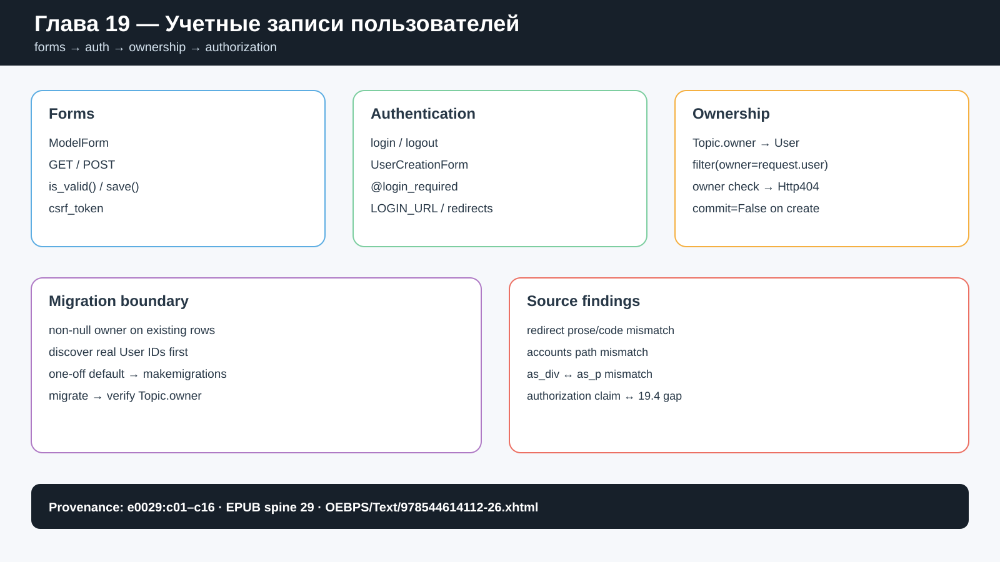
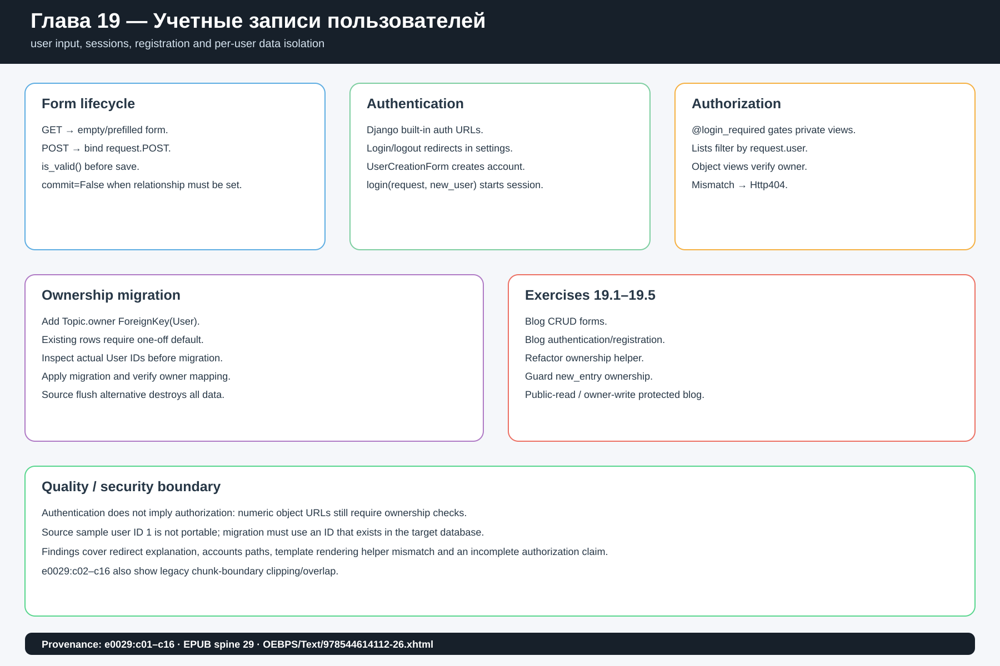

# Глава 19 — Учетные записи пользователей

RAG-grounded заметки по главе 19 книги «Изучаем Python: программирование игр, визуализация данных, веб-приложения. 3-е изд.».

## Идентификация

- Book ID: `python-crash-course-3e-ru-2024`
- Глава: 19
- Название: «Учетные записи пользователей»
- Slug: `user-accounts`
- Source policy: `rag_only`
- External sources: запрещены
- Model memory: запрещена
- Readiness contract: `BIBLIOTEKA-VSP-BOOK-READINESS v1.3`
- Chapter contract: `BIBLIOTEKA-VSP-CHAPTER-ARTIFACT-COLLECTION v1.7`
- Book readiness: `READY`
- Readiness evidence: workflow run `37485161334`; последующие изменения до стартового `main` не затрагивали source/RAG/contracts.

## Provenance

- RAG chunks: `e0029:c01`–`e0029:c16`
- EPUB spine item: `29`
- EPUB locator: `OEBPS/Text/978544614112-26.xhtml`
- `e0029:c01` начинается заголовком «19. Учетные записи пользователей».
- `e0029:c16` содержит упражнения 19.3–19.5 и раздел «Резюме».
- `e0030:c01` начинается главой 20 «Оформление и развертывание приложения».
- Chapter boundary verified: yes
- Source SHA-256: `a1e5ce950d3f9e2e38be23191250a46313b9b7d28663319970f4897902151f6c`

## Содержимое

- [cheatsheet.md](cheatsheet.md) — forms, authentication, ownership и authorization flow.
- [commands.md](commands.md) — source-confirmed Django operations с state/risk classification.
- [diagram.md](diagram.md) — Mermaid-потоки forms/auth/ownership.
- [summary.md](summary.md) — chapter-end summary.
- [review-questions.md](review-questions.md) — упражнения 19.1–19.5.
- [review-answers.md](review-answers.md) — RAG-grounded решения и security boundaries.
- [source-findings.md](source-findings.md) — source/code/path/security/extraction findings.
- [visual-cheatsheet.svg](visual-cheatsheet.svg) — компактный обзор.
- [visual-cheatsheet-detailed.svg](visual-cheatsheet-detailed.svg) — подробный обзор.

## Карта главы

1. `ModelForm` для Topic.
2. GET vs POST.
3. `is_valid()` и `save()`.
4. `csrf_token`.
5. `EntryForm` и custom widget.
6. `save(commit=False)` для связи Entry → Topic.
7. Редактирование Entry через `instance=entry`.
8. Приложение `accounts`.
9. Django auth URLs.
10. Login template и redirect settings.
11. POST logout.
12. `UserCreationForm` и automatic login после регистрации.
13. `@login_required`.
14. `LOGIN_URL`.
15. Topic → User через `ForeignKey`.
16. Migration обязательного owner для существующих rows.
17. `filter(owner=request.user)`.
18. Ownership checks через `Http404`.
19. Связывание новой Topic с `request.user`.
20. Exercises 19.1–19.5.

## Краткий анализ

Глава добавляет к CRUD-приложению две новые границы: формы для пользовательского ввода и identity/authorization.

`ModelForm` уменьшает ручную работу по созданию полей и validation. Для создания объектов с relationship, которого нет в самой форме, source использует `save(commit=False)`, затем задаёт related field и выполняет final `save()`.

Authentication отделено в приложение `accounts`. Built-in Django auth URLs дают login/logout routes, а registration реализуется через `UserCreationForm` и собственный view. После регистрации source сразу вызывает `login(request, new_user)`.

Authorization строится по принципу deny-by-default для private pages: почти все Learning Log views получают `@login_required`. Затем этого оказывается недостаточно: authenticated user всё ещё может подобрать numeric ID чужой Topic/Entry. Поэтому source добавляет ownership check и `Http404`.

Data ownership переносится на верхний уровень модели: `Topic.owner → User`. Entries автоматически наследуют ownership через Topic. Existing rows требуют one-off migration default; source отдельно показывает, что user ID сначала нужно определить через Django shell.

## Основной принцип

`authenticate user → restrict private views → filter list by owner → verify ownership on object access → attach owner on create`.

Для forms:

`GET → empty/prefilled form; POST → bind data → validate → mutate/save → redirect`.

## Source findings

1. **[Source prose/code mismatch]** — prose для `new_topic()` описывает imports `HttpResponseRedirect` и `reverse()`, shown code использует `redirect()` и не показывает эти imports.
2. **[Source path mismatch]** — listing создаёт `accounts/` рядом с `ll_project/`, но prose далее называет пути `ll_project/accounts/urls.py` и `ll_project/accounts/templates/registration/`.
3. **[Source template-rendering mismatch]** — registration template показывает `{{ form.as_div }}`, prose утверждает, что снова используется `as_p`.
4. **[Source markup-description mismatch]** — для `form.as_p` prose говорит о формате абзацев, но в скобках называет HTML `

`.
5. **[Source security/process contradiction]** — source заявляет, что после текущих ownership changes пользователь сможет работать только со своими данными «какие бы операции он ни пытался выполнять», однако упражнение 19.4 сразу указывает на ещё открытый cross-user path через `new_entry/<topic_id>/`.
6. **[Source extraction issue]** — `e0029:c02–c16` имеют boundary clipping/overlap.

## Ограничения

- Django project/runtime не запускался.
- User IDs из source (`1,2,3`) — sample data, не применимые автоматически к реальной БД.
- Реальные credentials не хранятся в artifacts.
- Current Django auth behavior/version compatibility: `[Needs confirmation]`.
- External Django documentation не открывалась.
