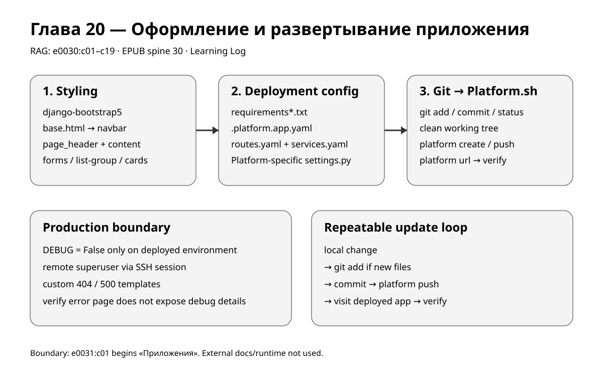
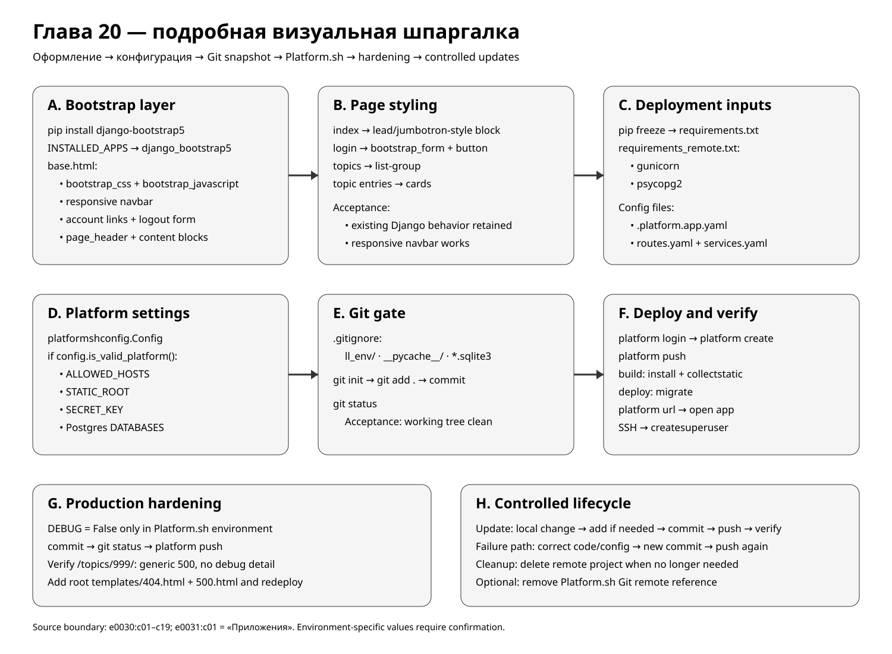

# Глава 20 — Оформление и развертывание приложения

RAG-grounded заметки по главе 20 книги «Изучаем Python: программирование игр, визуализация данных, веб-приложения. 3-е изд.».

## Идентификация

- Book ID: python-crash-course-3e-ru-2024
- Глава: 20
- Название: «Оформление и развертывание приложения»
- Slug: styling-and-deploying-an-app
- Source policy: rag_only
- External sources: запрещены
- Model memory: запрещена
- Readiness contract: BIBLIOTEKA-VSP-BOOK-READINESS v1.3
- Chapter contract: BIBLIOTEKA-VSP-CHAPTER-ARTIFACT-COLLECTION v1.7
- Book readiness: READY
- Readiness evidence: workflow run 37485161334; последующие изменения main до стартового commit cc86f93a0dd03e36c2a92e0b3b7b7fb9771d0dd7 не затрагивали source/RAG/contracts.

## Provenance

- RAG chunks: e0030:c01–e0030:c19
- EPUB spine item: 30
- EPUB locator: OEBPS/Text/978544614112-27.xhtml
- e0030:c01 начинается заголовком «20. Оформление и развертывание приложения».
- e0030:c19 содержит упражнения 20.3–20.4 и раздел «Резюме».
- e0031:c01 начинается разделом «Приложения».
- Chapter boundary verified: yes
- Source SHA-256: a1e5ce950d3f9e2e38be23191250a46313b9b7d28663319970f4897902151f6c

## Содержимое

- [cheatsheet.md](cheatsheet.md) — styling, deployment, Git и production-hardening flow.
- [commands.md](commands.md) — source-confirmed команды с классификацией state/risk.
- [diagram.md](diagram.md) — Mermaid-поток от локального приложения к развернутому проекту.
- [summary.md](summary.md) — chapter-end summary.
- [review-questions.md](review-questions.md) — упражнения 20.1–20.4.
- [review-answers.md](review-answers.md) — RAG-grounded решения и границы.
- [source-findings.md](source-findings.md) — source/code/extraction findings.
- [visual-cheatsheet.svg](visual-cheatsheet.svg) — компактный обзор.
- [visual-cheatsheet-detailed.svg](visual-cheatsheet-detailed.svg) — подробный обзор.

## Карта главы

1. Установка django-bootstrap5.
2. Подключение Bootstrap через INSTALLED_APPS и template tags.
3. Перестройка base.html: head, navbar, responsive collapse, page_header/content.
4. Оформление index, login, topics и topic.
5. Platform.sh CLI и пакет platformshconfig.
6. requirements.txt и requirements_remote.txt.
7. Конфигурация .platform.app.yaml.
8. Конфигурация .platform/routes.yaml и .platform/services.yaml.
9. Platform.sh-specific settings.py: ALLOWED_HOSTS, STATIC_ROOT, SECRET_KEY, Postgres.
10. Git: config, .gitignore, init/add/commit/status.
11. Создание Platform.sh project и platform push.
12. Проверка deployment через platform url.
13. Remote SSH и createsuperuser.
14. Production hardening: DEBUG = False.
15. Custom 404/500 templates.
16. Continuous update flow: local change → Git commit → platform push → verify.
17. Удаление Platform.sh project и remote reference.
18. Exercises 20.1–20.4.

## Краткий анализ

Глава завершает проект двумя слоями: presentation и deployment.

Для presentation source сохраняет существующую Django-функциональность и меняет шаблоны. django-bootstrap5 подключает Bootstrap, base.html становится общей точкой для navbar и блоков page_header/content, а отдельные страницы получают Bootstrap components и template tags. Ключевая идея — внешний вид меняется без изменения основной модели данных и URL/view logic.

Deployment строится как воспроизводимый процесс. Зависимости фиксируются в requirements-файлах, Platform.sh получает YAML-конфигурацию приложения, маршрутов и Postgres-сервиса, а settings.py переключает часть настроек только в Platform.sh environment. Git фиксирует проверенное состояние проекта перед отправкой.

Source отдельно проводит production security boundary: DEBUG должен оставаться полезным локально, но отключаться на удаленном сервере. После изменения необходимо зафиксировать код, выполнить platform push и повторно проверить поведение ошибки. Затем добавляются собственные 404/500 templates.

Текущая разработка оформлена как повторяемый цикл:

local change → git add when needed → git commit → platform push → deployed verification.

## Основной принцип

working local application → consistent UI → explicit dependencies/configuration → clean Git snapshot → deploy → verify → harden production → repeat controlled updates

## Source findings

1. **[Source wording/code mismatch]** — в base.html shown code использует Bootstrap class ms-auto, а prose называет ml-auto.
2. **[Source code mismatch]** — подраздел о services.yaml показывает listing label .platform/routes.yaml, хотя текст и содержимое описывают service db.
3. **[Source extraction issue]** — несколько chunk starts e0030:c02–c19 содержат continuation fragments/overlap; boundary и chapter-end content при этом восстанавливаются по соседним chunks.
4. **[Source extraction issue]** — в e0030:c05 prose говорит о втором div вокруг content, но извлеченный listing показывает дополнительный closing 
 без соответствующего opening tag; исходная intended markup structure требует проверки по source rendering.

## Ограничения

- Platform.sh deployment/runtime здесь не выполнялся.
- Текущая совместимость показанных Platform.sh, Python, Django, Postgres и package versions: [Needs confirmation].
- URL, region, project IDs, fingerprints и usernames из source — sample/environment-specific values.
- Credentials, passwords, SSH material и real SECRET_KEY не хранятся в artifacts.
- External Platform.sh/Bootstrap/Django documentation не открывалась.
- Прямой canonical EPUB не читался; использован только addressable RAG.
