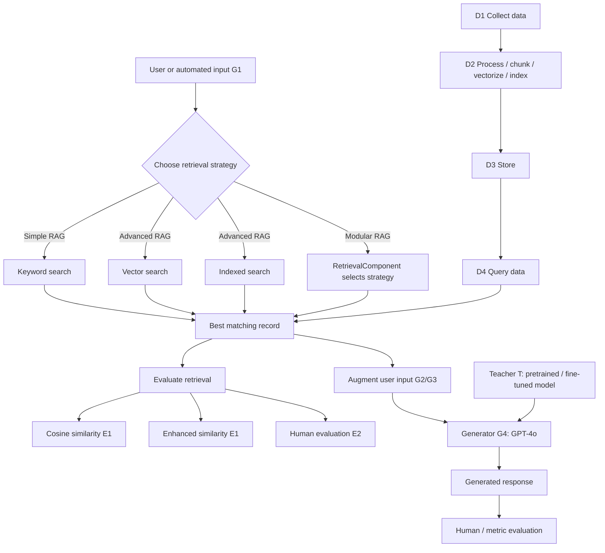

# Diagram — глава 1

Provenance: `p0020:c01–p0049:c01`.

## Interpretation

- `D1–D4` represent the retriever side of the chapter ecosystem.
- `G1–G4` represent the generator-side flow from input to generated result.
- `E1/E2` cover automated metrics and human evaluation.
- `T` represents pretrained/fine-tuned model handling.
- The practical implementation in this chapter starts with already prepared `db_records`; full collection/vector-store construction is deferred to later chapters.
