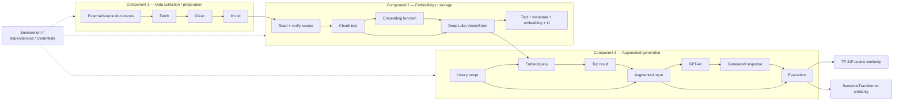

# Diagram — глава 2

Provenance: `p0052:c01–p0079:c01`.

## Interpretation

- Component 1 owns collection and cleaning.
- Component 2 owns chunking, embedding generation and vector storage.
- Component 3 owns retrieval, augmentation, generation and evaluation.
- The pipeline is intentionally decomposed so teams can develop/maintain components independently.
- Source example keeps metadata linking stored chunks back to `llm.txt`.
- Evaluation compares generated output to the original or augmented input; the chapter demonstrates that metric choice changes the numeric result.
