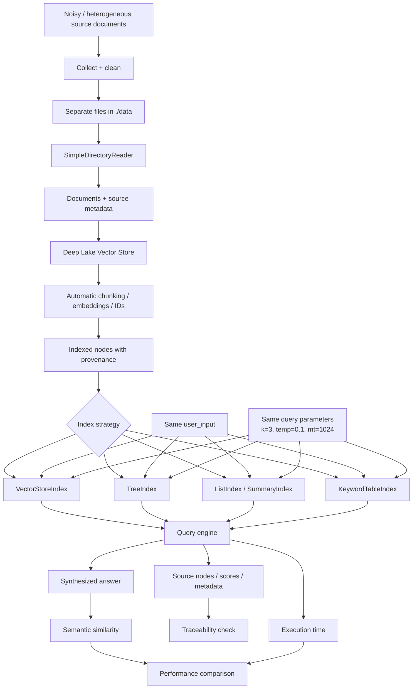

# Diagram — глава 3

Provenance: `p0080:c01–p0109:c01`.

## Interpretation

- Source data is preserved as separate documents so metadata can identify exact source files.
- Deep Lake/LlamaIndex handle chunks, embeddings and node/index structures.
- Four index strategies are tested with the same input and parameters.
- Query output is not only the answer: source nodes and metadata are part of the observability/provenance path.
- Performance combines answer/retrieval quality with query time, but source explicitly treats it as comparative, not absolute.
