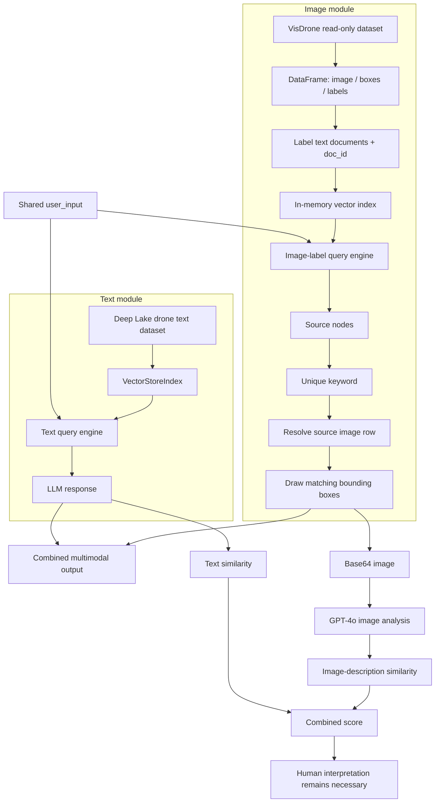

# Diagram — глава 4

Provenance: `p0110:c01–p0135:c01`.

## Interpretation

- The text and image branches share one user input.
- VisDrone retrieval operates over text labels/documents, then maps source nodes back to an image.
- Bounding boxes are applied after source-image resolution.
- GPT-4o is used as a multimodal evaluator that converts the image into a text description.
- Final evaluation is still not purely objective; the source emphasizes the difficulty of judging complex images.
