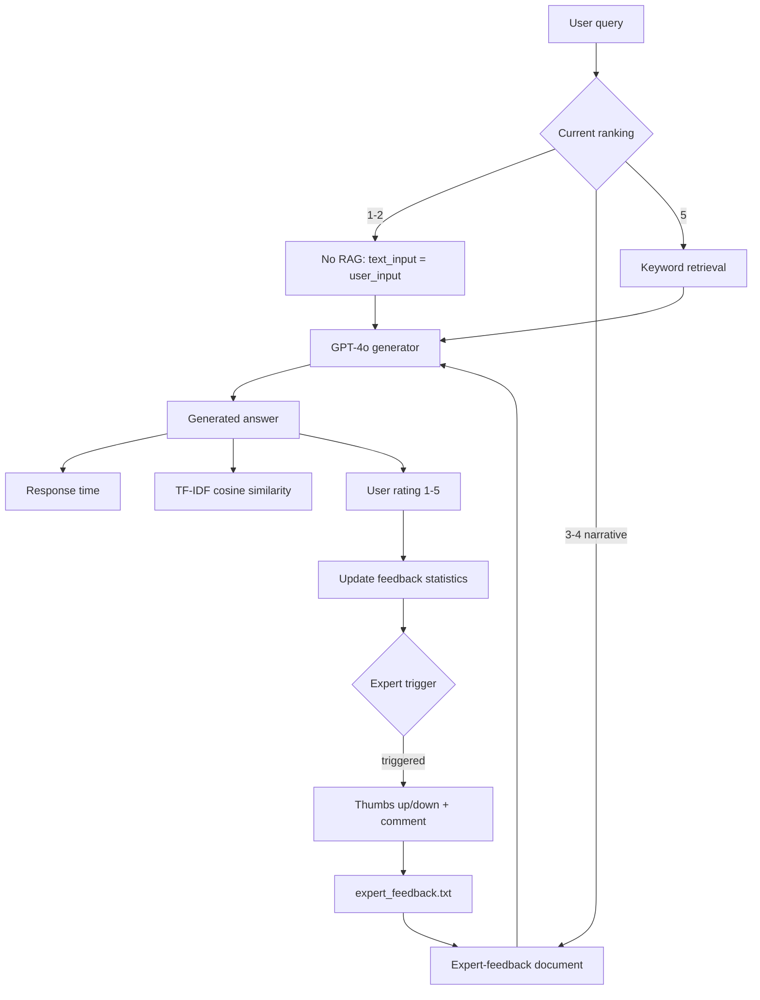

# Diagram — глава 5

Provenance: `p0136:c01–p0160:c01`.

## Interpretation

- Ranking changes the augmentation strategy.
- Automated metrics and user ratings are separate signals.
- Expert feedback is intended to become reusable retrieval/augmentation material.
- Source code has inconsistencies in the 3–4 branch and expert trigger; see README/commands.
