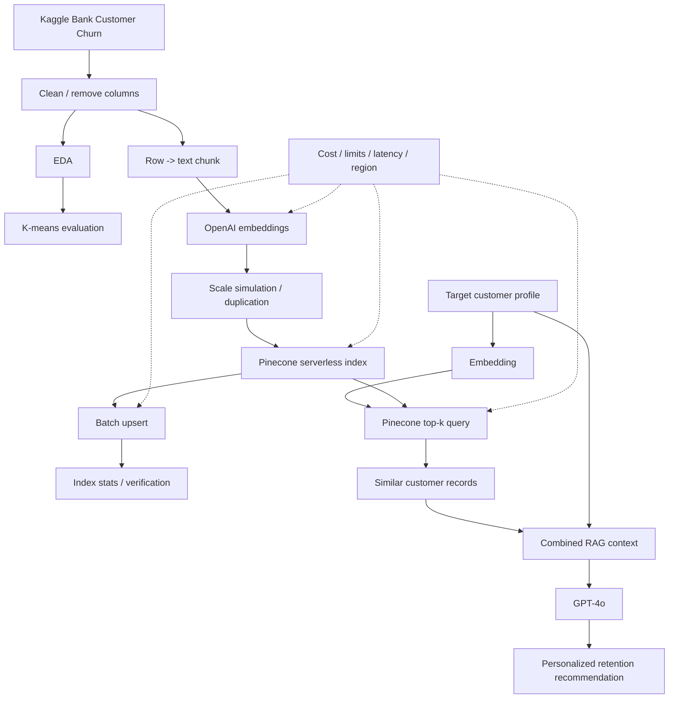

# Diagram — глава 6

Provenance: `p0161:c01–p0198:c01`.

## Interpretation

- Component 1 reduces and understands the dataset before vectorization.
- Component 2 turns records into embeddings and stores them in Pinecone.
- Component 3 uses a target profile as a vector query and augments GPT-4o with similar customer records.
- Cost, API limits and latency are cross-cutting concerns, not post-processing details.
