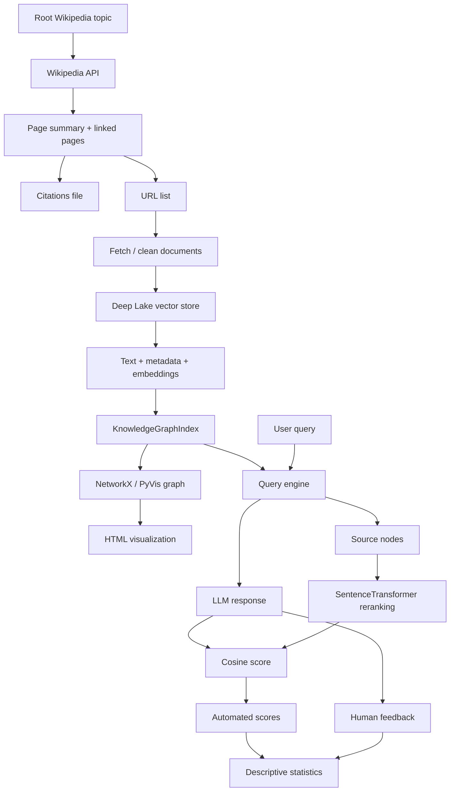

# Diagram — глава 7

Provenance: `p0199:c01–p0226:c01`.

## Interpretation

- Component 1 builds a reproducible source list and citations.
- Component 2 stores prepared documents and provenance in Deep Lake.
- Component 3 derives a knowledge-graph index and exposes query/source-node behavior.
- Automated similarity and human feedback remain distinct evaluation signals.
