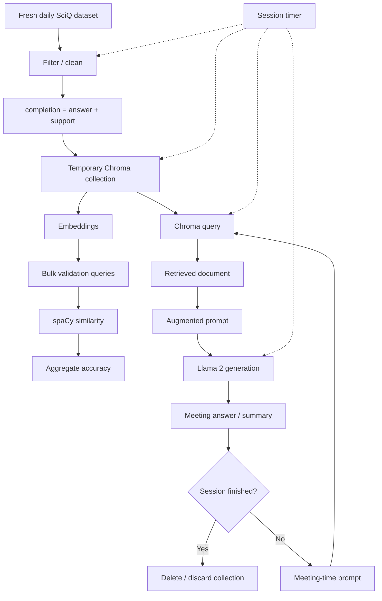

# Diagram — глава 8

Provenance: `p0227:c01–p0252:c01`.

## Interpretation

- The collection is intentionally temporary.
- Validation happens before live meeting use.
- Retrieval and generation are separate stages.
- Human supervision remains important when prompt wording drifts.
- Collection disposal is part of the lifecycle, not an error condition.
