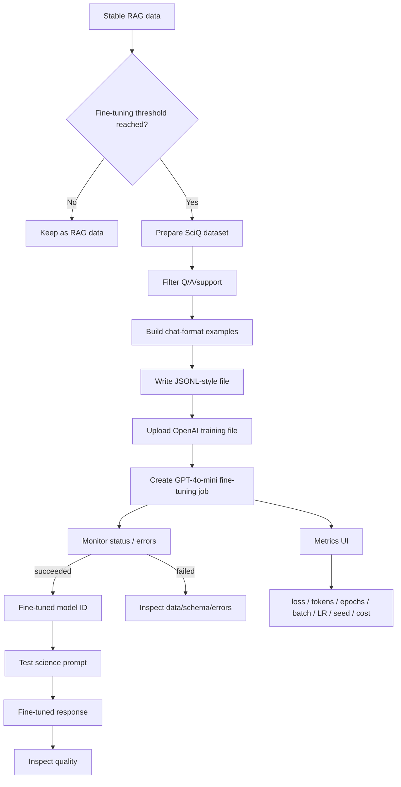

# Diagram — глава 9

Provenance: `p0253:c01–p0270:c01`.

## Interpretation

- Fine-tuning is an alternative for stable data, not a replacement for dynamic RAG.
- Data preparation quality is a prerequisite for training success.
- Remote OpenAI training state and cost must be monitored.
- The chapter validates the tuned model with known science questions and then inspects training metrics.
