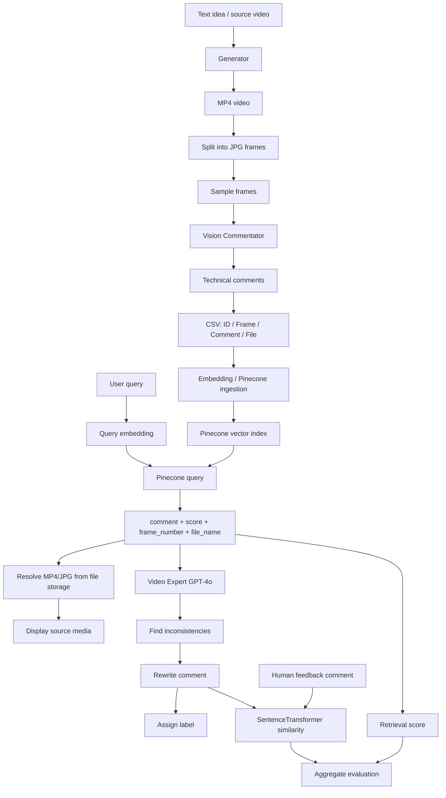

# Diagram — глава 10

Provenance: `p0271:c01–p0306:c01`.

## Interpretation

- Pinecone is used for semantic comment retrieval, not necessarily for storing raw video files.
- Metadata is the bridge from vector search back to exact media.
- Video Expert is a second-stage reasoning/rewrite agent after retrieval.
- Human feedback remains part of final quality evaluation.
