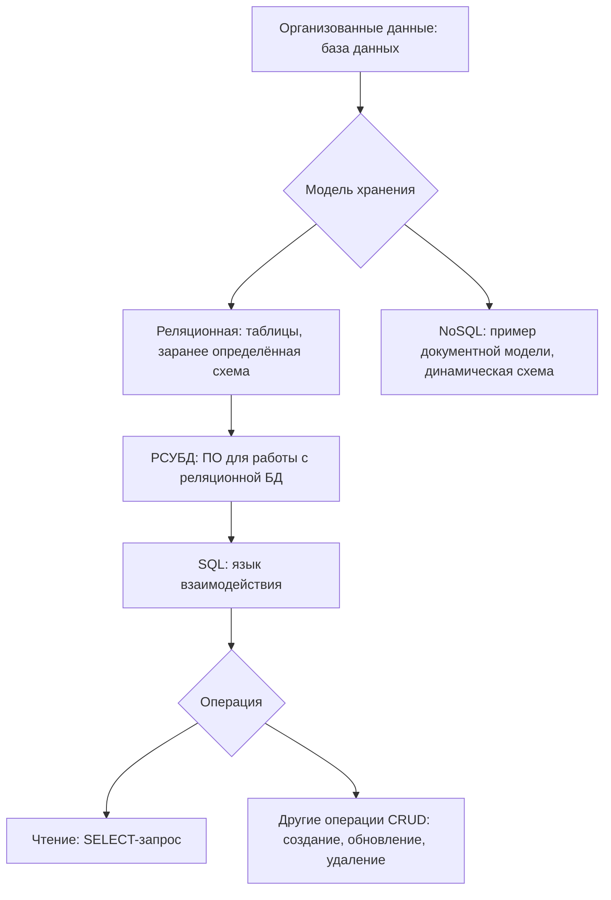
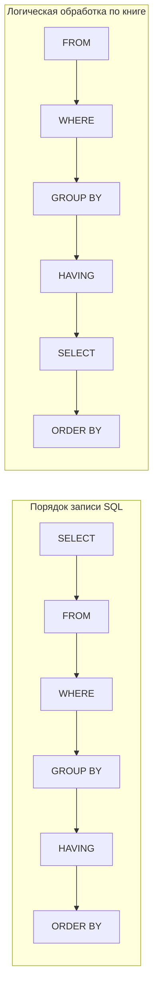
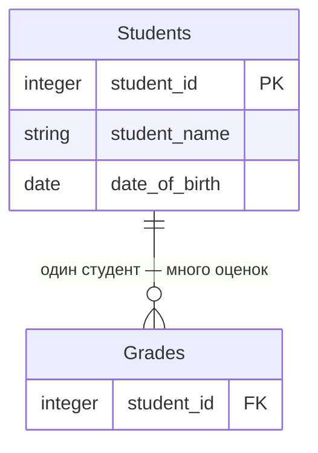

# Глава 1 — диаграммы по RAG

Источник: `sql-pocket-guide-alice-zhao-4e-ru`, PDF 21–32, chunks `p0021:c01`–`p0032:c01`. Диаграммы ниже **пересказывают текст**, а не копируют иллюстрации книги.

## 1. БД → РСУБД → SQL-запрос (PDF 21–27)

Provenance: `p0021:c01`–`p0027:c01`. Ветки CRUD — концепции; конкретные изменяющие SQL-операторы глава 1 не приводит.

## 2. Порядок написания и логической обработки (PDF 28–30)

Здесь нет утверждений о физическом плане оптимизатора. Provenance: `p0028:c01`, `p0029:c01`, `p0030:c01`.

## 3. Модель студентов и оценок (PDF 30–32)

**Граница реконструкции:** имена полей `student_id`, `student_name`, `date_of_birth` и семантика PK/FK подтверждены `p0031:c01`. Отношение 1:N подтверждено `p0032:c01`. Типы в Mermaid (`integer`, `string`, `date`) — **схематические метки диаграммы, не подтверждённые SQL-типы исходной модели**; реальное определение типов — [Needs confirmation]. Точное изображение рис. 1.3 недоступно текстовому RAG; см. `source-findings.md`.

## Правила проверки

- `SELECT` и `FROM` не смешиваются с порядком логической обработки.
- `Students.student_id` идентифицирует строку, `Grades.student_id` ссылается на него.
- Не добавлены другие таблицы, поля, ограничения или способы выполнения из внешних знаний.
