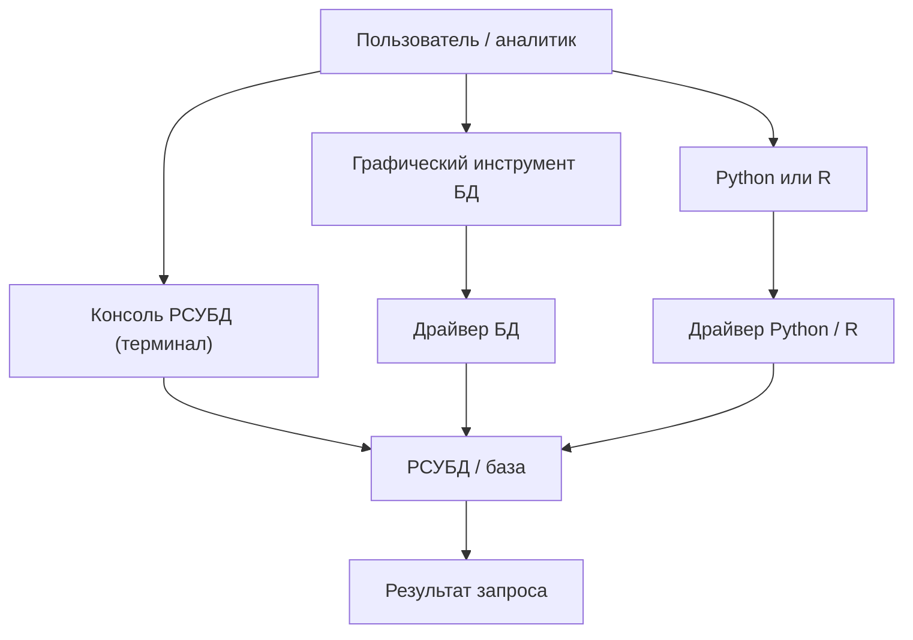
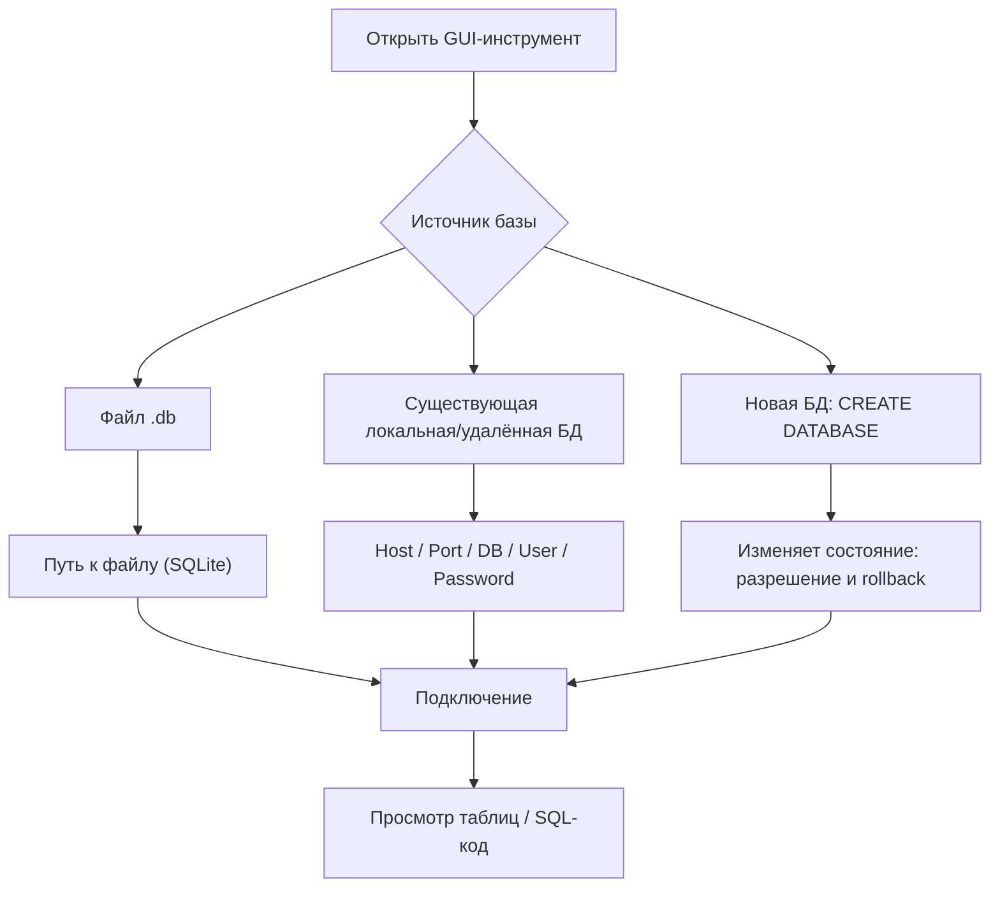
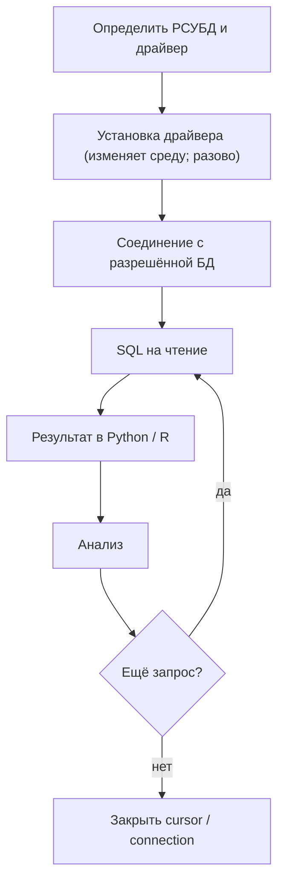
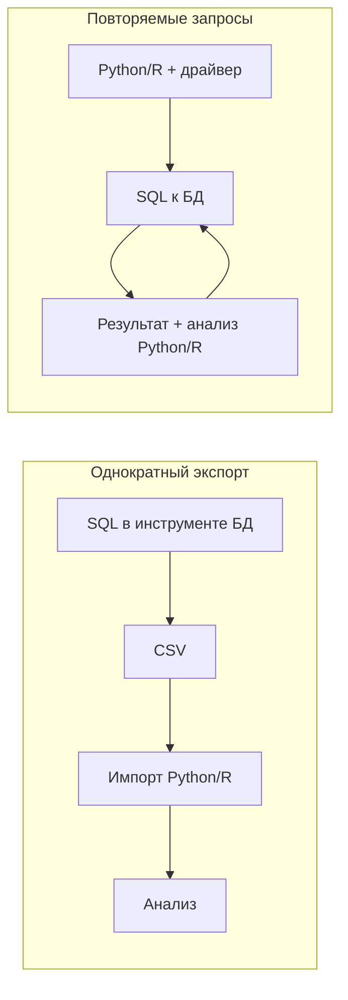

# Diagrams — глава 2 «Где можно писать SQL-код»

**Source:** PDF 33–54, `p0033:c01`–`p0054:c01`. Схемы построены по доступному тексту RAG, не являются копиями рис. 2.1.

## 1. Где работает SQL-код

**Подтверждение:** три варианта `p0033:c01`–`p0034:c01`; драйвер GUI `p0040:c01`; Python/R `p0044:c01`–`p0054:c01`. Вид иллюстрации в оригинале не установлен.

## 2. Три пути подключения через GUI

`CREATE DATABASE` — изменяющее действие; фактические реквизиты [Needs confirmation]. **Source:** `p0042:c01`–`p0043:c01`.

## 3. Python/R: аналитический цикл

- В книге Python: `cursor.execute()`, `fetchall()`, pandas `read_sql()`, закрытие `cursor.close()` / `conn.close()` (`p0048:c01`–`p0049:c01`).
- В книге R: `dbListTables()`, `dbReadTable()`, `dbGetQuery()`, `dbDisconnect()` (`p0053:c01`–`p0054:c01`).
- Пароль и параметры доступа — только placeholders при создании артефактов.

## 4. Сравнение двух аналитических workflow

Источник `p0044:c01`. Второй путь нужен при многократном изменении запроса.

## Acceptance

- Диаграммы описывают только подтверждённые элементы главы.
- Никакие порты, реальные адреса, схемы таблиц, данные или креденшелы не добавлены.
- Риски создающих/устанавливающих действий отражены и в `cheatsheet.md`, `commands.md`.
- Изображение рис. 2.1 недоступно как графический объект в text-only RAG; см. `source-findings.md`.
