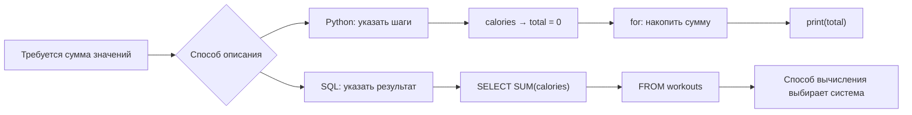
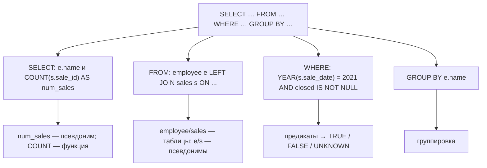
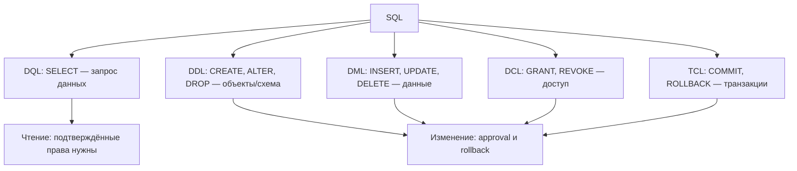
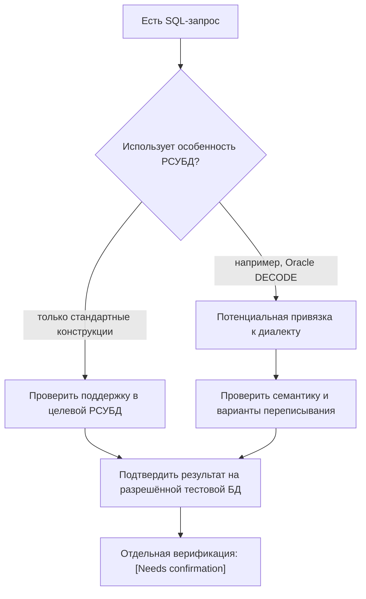

# Диаграммы — глава 3 «Язык SQL»

**Источник:** RAG PDF 55–69 (`p0055:c01`–`p0069:c01`). Mermaid-схемы воспроизводят **текстовые концепции главы**, не утверждают конкретный физический план SQL-движка и не являются результатом выполнения запросов.

## 1. Императивный алгоритм и декларативный SQL

**Provenance:** `p0055:c01`, `p0056:c01`. SQL в книге описан как декларативный язык специального назначения. Детали оптимизации конкретной СУБД не представлены.

## 2. Анатомия SELECT из главы

**Provenance:** `p0059:c01`–`p0065:c01`. Это **разбор составных частей**, а не граф физического выполнения.

## 3. Пять подъязыков и зона влияния

**Provenance:** `p0068:c01`, `p0069:c01`. Слова из таблицы автора **не являются готовой процедурой на запись**; цель, схема, владелец, привилегии и верификация — [Needs confirmation].

## 4. Выбор переносимого синтаксиса в рамках объяснения автора

**Provenance:** `p0057:c01`–`p0059:c01`. Ветка проверки/подтверждения — критерий неопределённости, а не дополнительная команда SQL. Случай `DECODE`/`CASE` зарегистрирован в `source-findings.md`.

## Acceptance / boundaries

- Использованы только элементы главы 3, SQL примеры и терминология источника.
- Декларативность не отождествлена с конкретным физическим планом.
- `SELECT` отделён от DDL/DML/DCL/TCL.
- Схематические блоки не дополняются неописанными особенностями БД.
- Source-level разночтения сохранены, см. `source-findings.md`.
