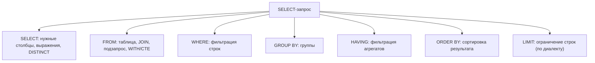
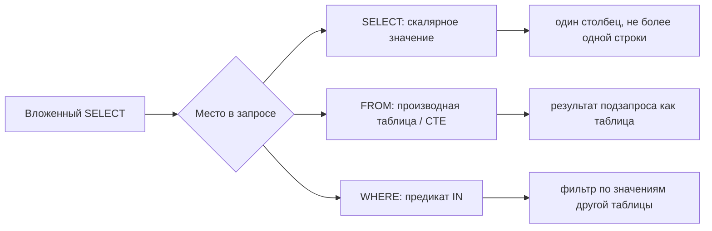
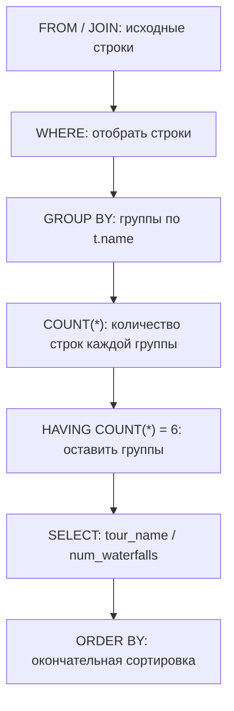
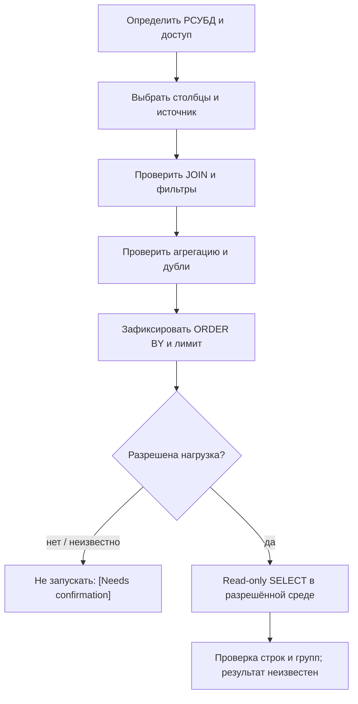

# Диаграммы — глава 4. Основы работы с запросами

**Источник:** PDF 70–104, RAG `p0070:c01`–`p0104:c01`. Mermaid — концептуальное представление текста главы; SQL не выполнялся.

## 1. Состав SELECT-запроса

**Источник:** `p0070:c01`, `p0071:c01`, `p0082:c01`, `p0090:c01`, `p0094:c01`, `p0098:c01`, `p0100:c01`, `p0103:c01`. Это карта **написанного** запроса, не физический план оптимизатора.

## 2. Варианты подзапроса

**Источник:** `p0078:c01`, `p0079:c01`, `p0085:c01`–`p0088:c01`, `p0091:c01`–`p0093:c01`. Авторская перепись correlated subquery через JOIN имеет mismatch `waterfall`/`waterfalls`, см. `source-findings.md`.

## 3. Группирование и фильтрация

**Источник:** `p0094:c01`–`p0100:c01`, сопоставление порядка обработки с `p0029:c01`–`p0030:c01` здесь **не используется**: диаграмма описывает взаимосвязь, прямо разъяснённую в текущей главе, а не физический план. `COUNT(*)` подсчитывает строки, не обязательно уникальные водопады.

## 4. Контроль read-only SELECT в работе

**Источник:** смысловые ограничения `p0072:c01`, `p0090:c01`, `p0096:c01`, `p0103:c01`. Этап проверки доступа — операционное условие для использования **непроверенного примера**, а не новая команда, представленная автором.

## Границы

- Диаграммы не добавляют таблиц/колонок вне `waterfall`, `owner`, `county`, `tour` и подтверждённых примеров.
- Корреляция и выигрыш производительности не подтверждены независимыми тестами.
- Несоответствия текста и кода источника документированы, но не исправлены.
