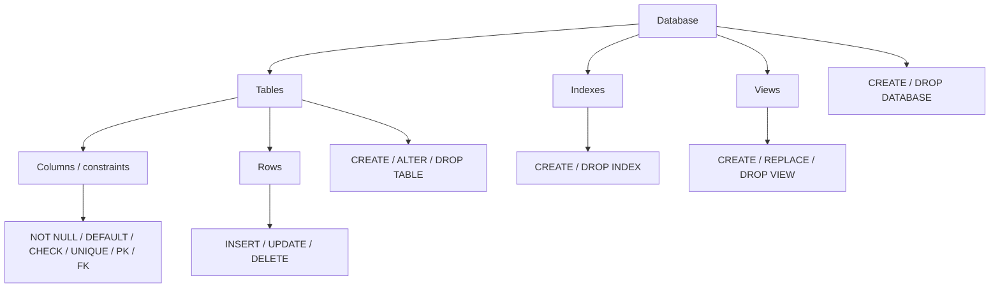
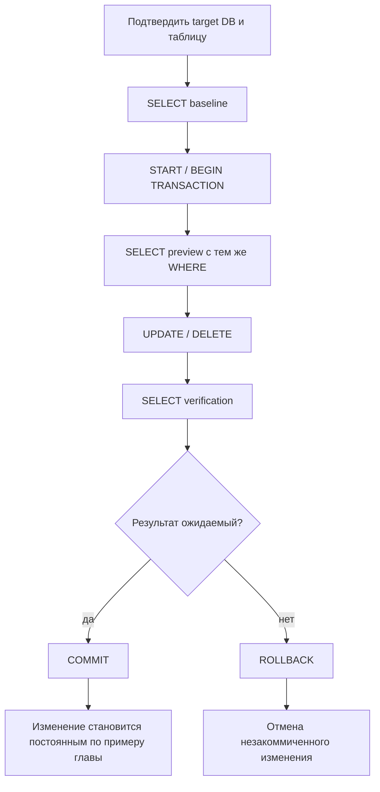
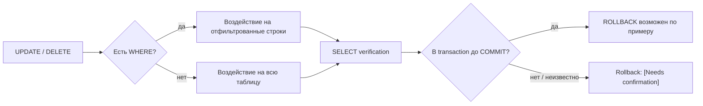
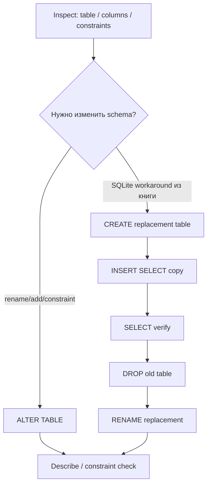
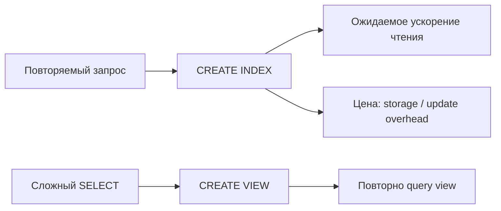

# Диаграммы — глава 5. Создание, обновление и удаление

**Источник:** PDF 105–154, RAG `p0105:c01`–`p0154:c01`.  
Схемы отражают логику главы и change-control boundary; ничего не исполнялось.

## 1. Объекты и типы изменений

**Provenance:** `p0105:c01`–`p0149:c01`. Все правые ветки — state-changing.

## 2. Rollback-first workflow для DML, показанный главой

**Provenance:** `p0137:c01`–`p0139:c01`, `p0149:c01`–`p0154:c01`.  
Точный transactional behavior DDL/конкретной РСУБД — [Needs confirmation].

## 3. WHERE как blast-radius control

**Provenance:** `p0133:c01`, `p0137:c01`–`p0139:c01`, `p0151:c01`–`p0154:c01`.

## 4. Изменение структуры таблицы

**Provenance:** `p0128:c01`–`p0136:c01`. SQLite workaround — многошаговый state-changing pattern, не гарантированно atomic.

## 5. Index и view

**Provenance:** `p0141:c01`–`p0149:c01`. Реальный performance effect [Needs confirmation].

## Acceptance boundary

- Read-only baseline должен предшествовать change.
- DROP/CASCADE и all-row UPDATE/DELETE считаются destructive.
- `COMMIT` отделён от verification.
- Source findings не скрыты: privilege wording, `' US'`, identifier `страна`, Oracle quotes, transaction wording.
- Не добавлены команды вне `p0105:c01`–`p0154:c01`.
