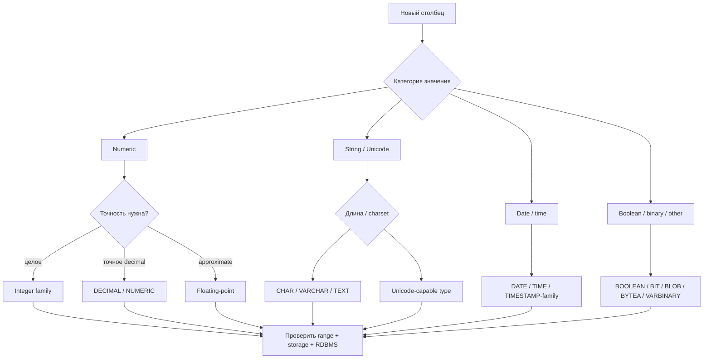
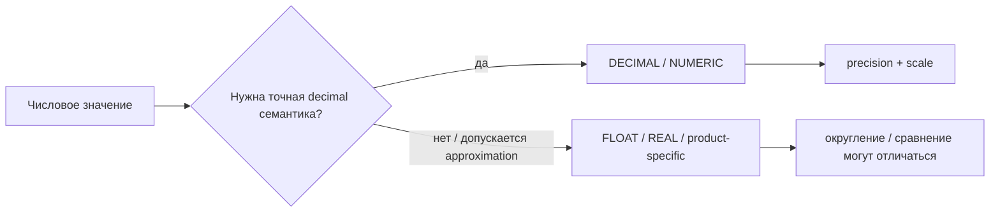
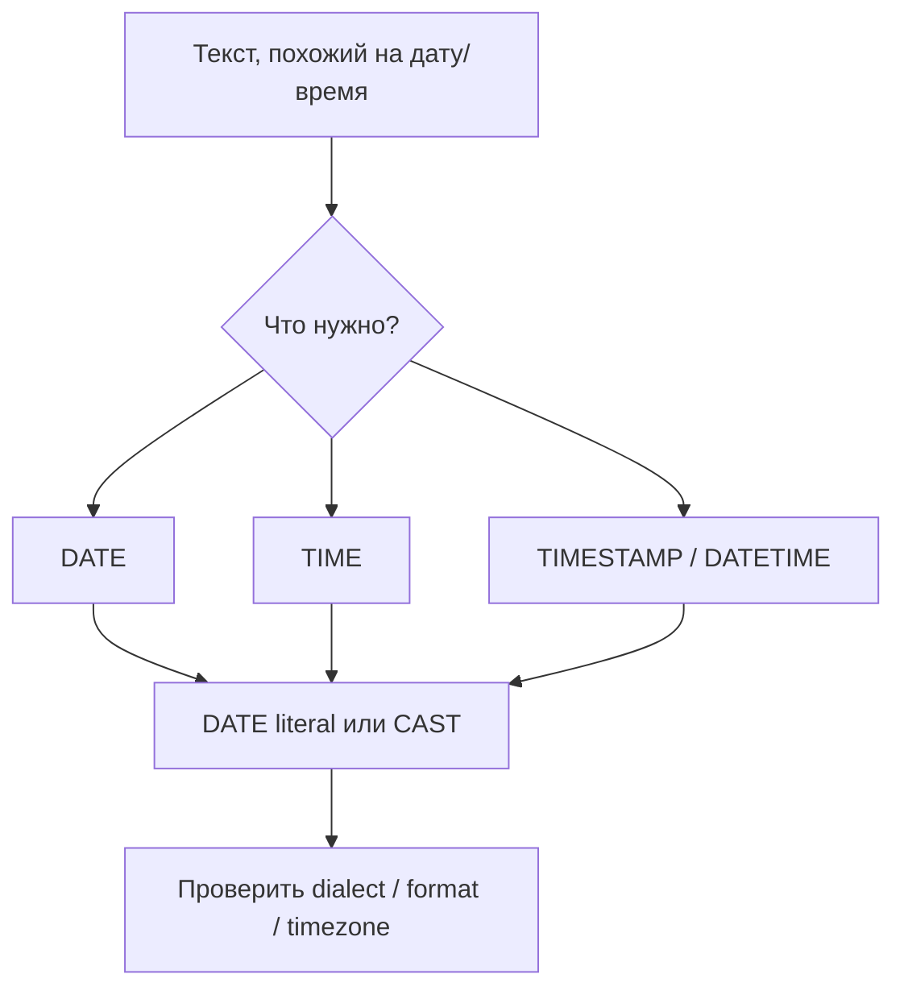
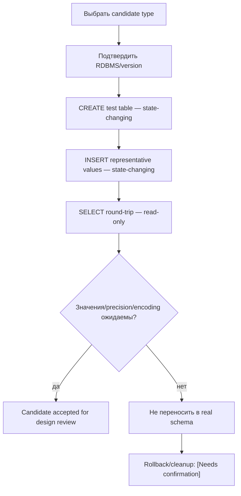
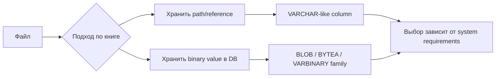

# Диаграммы — глава 6. Типы данных

**Source:** PDF 155–189, RAG `p0155:c01`–`p0189:c01`.  
Схемы отражают только текст главы; SQL не выполнялся.

## 1. Выбор типа данных

**Provenance:** `p0157:c01`–`p0189:c01`.

## 2. Exact versus approximate numeric

**Source:** `p0162:c01`–`p0165:c01`. Конкретные type names зависят от РСУБД.

## 3. Date/time: typed literal or conversion

**Source:** `p0173:c01`–`p0183:c01`. SQLite model в книге отдельно использует TEXT/REAL/INTEGER.

## 4. Schema-test boundary

Глава 6 показывает CREATE/INSERT/SELECT как учебный pattern, но не даёт универсального rollback.

## 5. External file strategy

**Source:** `p0185:c01`–`p0189:c01`. Threshold 1 MB — source heuristic, not benchmark.

## Boundaries

- Не подставлены современные product limits.
- Не исправлены damaged ASCII/Unicode exponents.
- MySQL datetime mismatch и SQLite datetime mismatch вынесены в `source-findings.md`.
- CREATE/INSERT/ALTER SESSION — state-changing.
