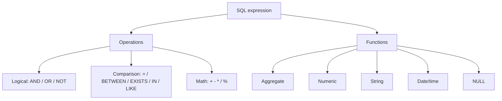
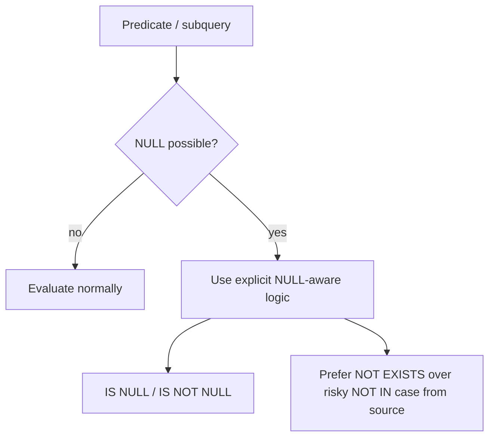
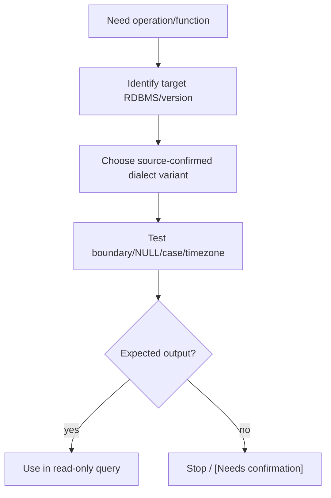
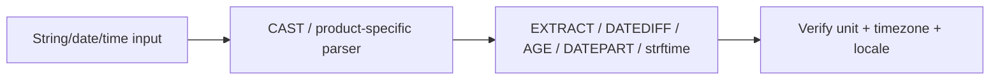
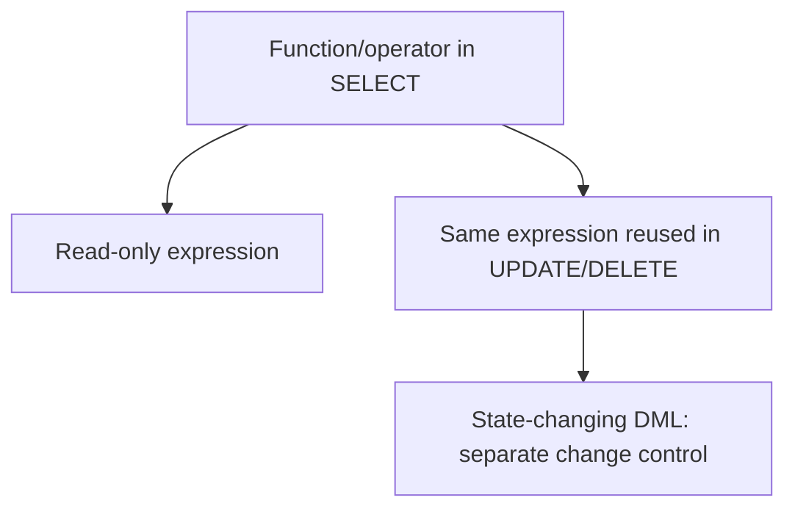

# Диаграммы — глава 7. Операции и функции

**Source:** PDF 190–243, RAG `p0190:c01`–`p0243:c01`.

## 1. Operations vs functions

## 2. NULL-sensitive predicate flow

## 3. Function portability

## 4. Date/time conversions

## 5. Change boundary

**Boundary:** diagrams express source concepts only; physical execution plans and current product behavior are not asserted.
