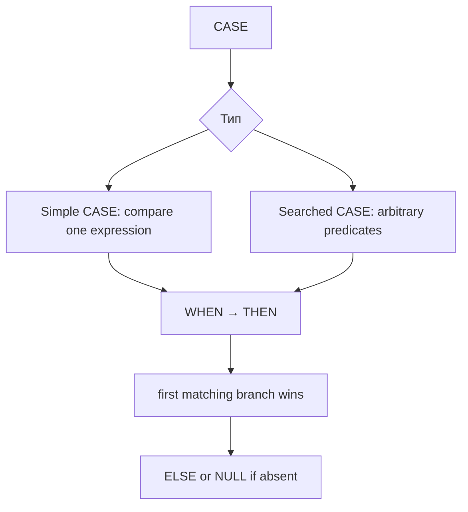
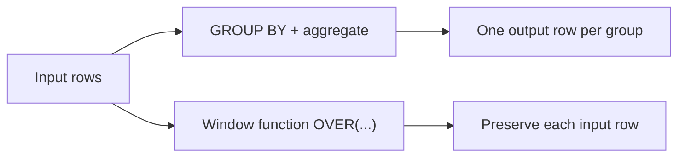
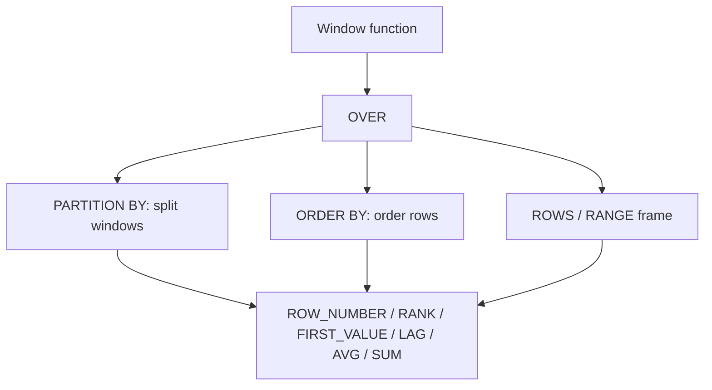
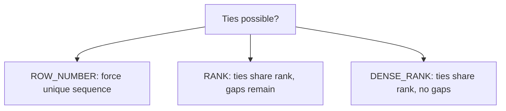
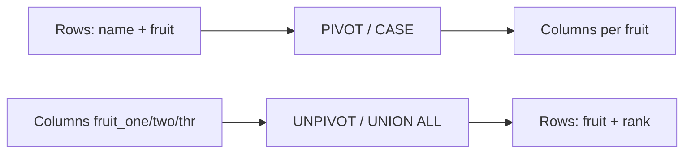

# Диаграммы — глава 8. Расширенные концепции запросов

**Source:** PDF 244–272, RAG `p0244:c01`–`p0272:c01`.

## 1. CASE

## 2. GROUP BY versus window function

## 3. Window anatomy

## 4. Ranking choice

## 5. Reshaping

## Boundary

Все схемы read-only и описывают source semantics. PIVOT/window/grouping support, default frames and performance require target-version verification.
