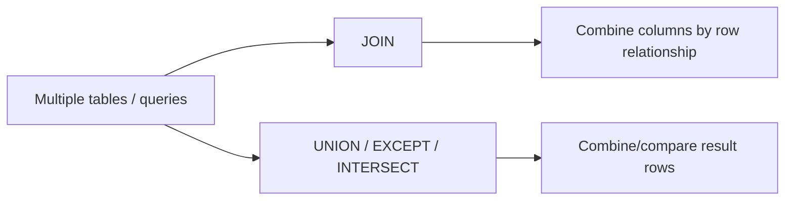
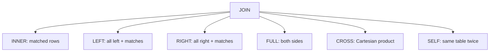
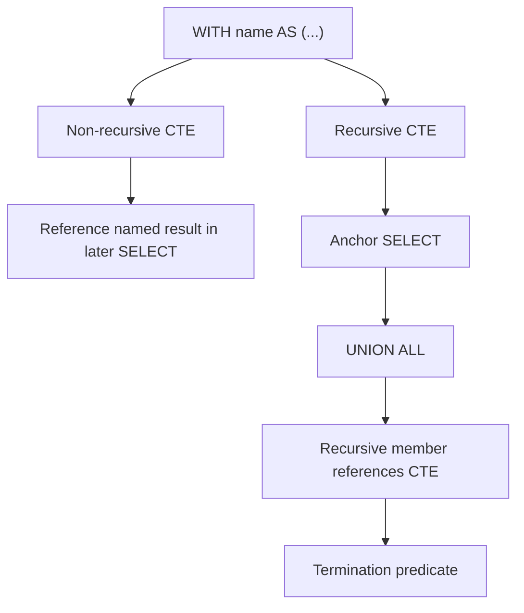
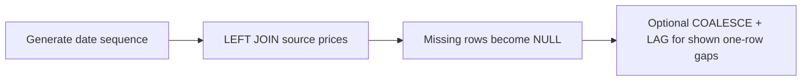
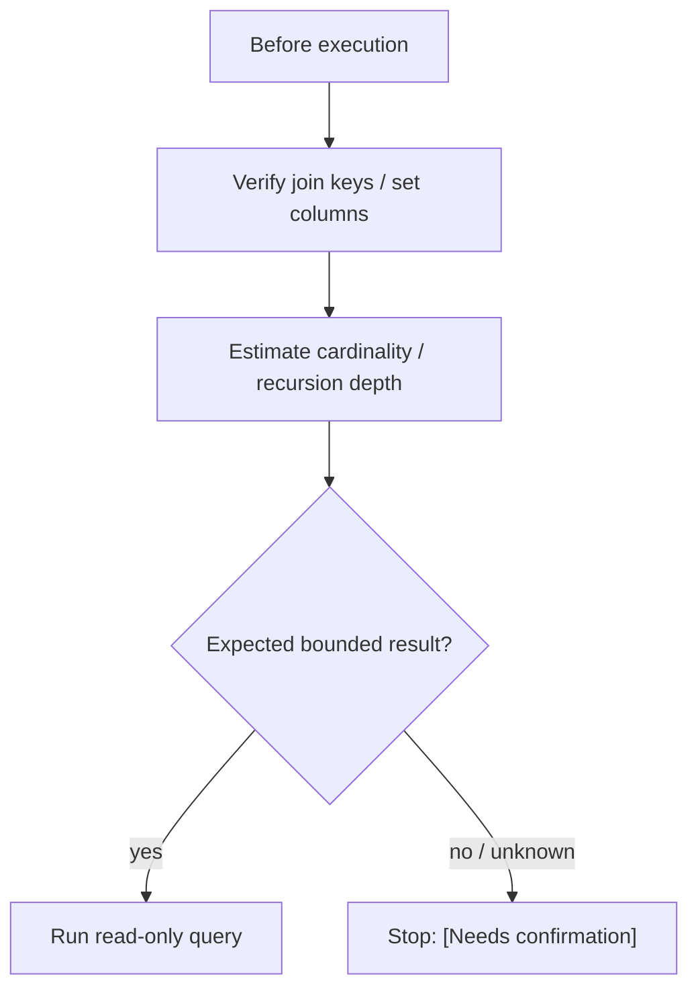

# Диаграммы — глава 9. Работа с несколькими таблицами и запросами

**Source:** PDF 273–303, RAG `p0273:c01`–`p0303:c01`.

## 1. JOIN versus set operations

## 2. JOIN family

## 3. CTE anatomy

## 4. Recursive date fill

## 5. Safety boundary

## Boundary

Все примеры read-only. CROSS JOIN/recursive CTE могут быть workload-generating; source не задаёт production timeout/cancellation procedure.
