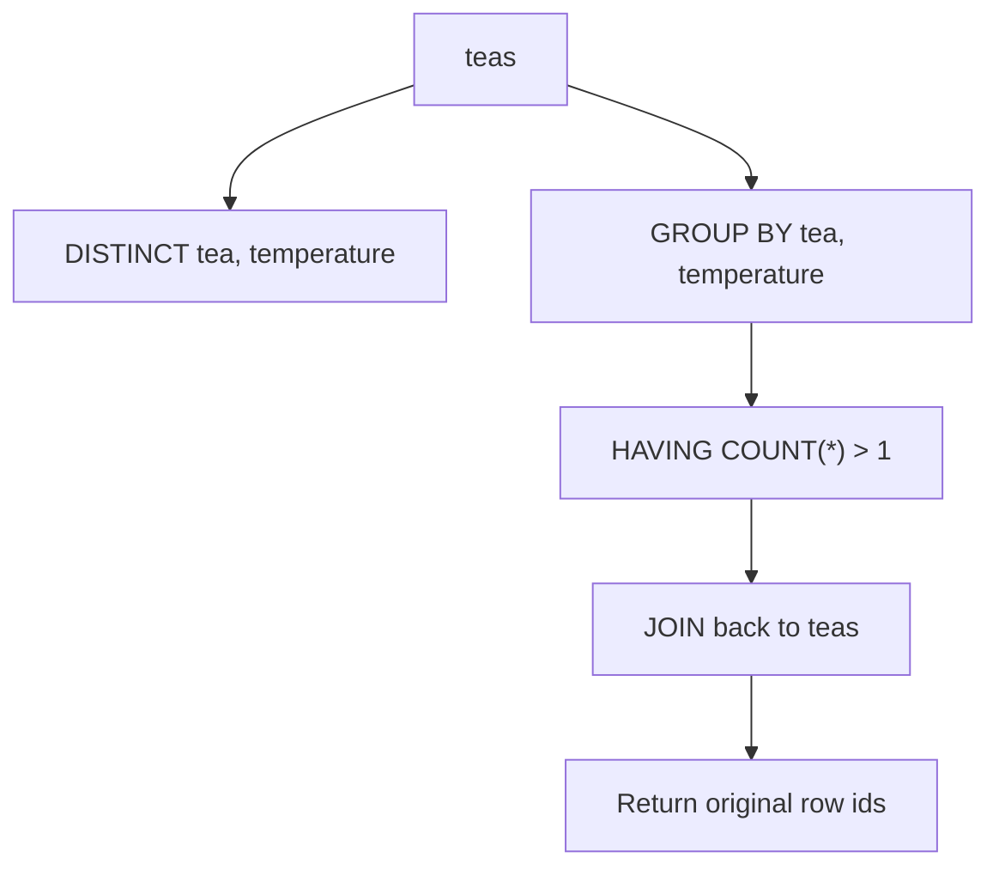
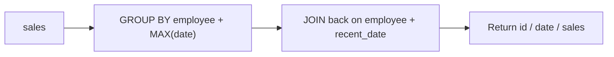
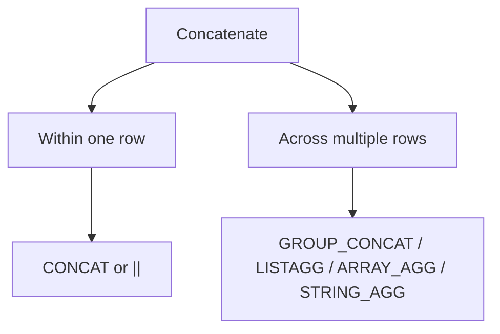
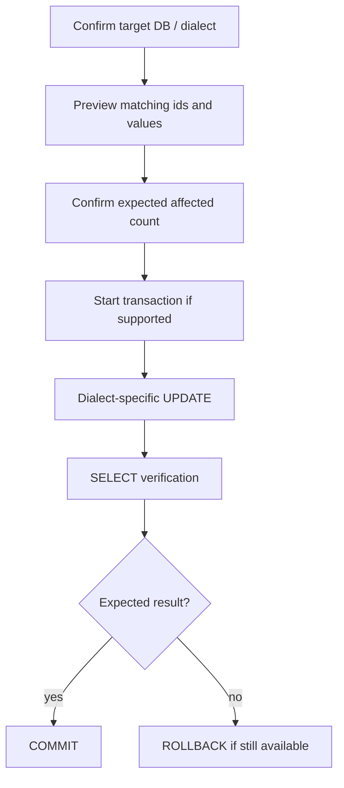

# Диаграммы — глава 10. Как мне?..

**Source:** PDF 304–315, RAG `p0304:c01`–`p0315:c01`.

## 1. Duplicate workflow

## 2. Max row per group

## 3. Concatenation patterns

## 4. Cross-table UPDATE safety flow

## Boundary

Read-only patterns are analytical. UPDATE is state-changing and requires separate transaction/rollback verification.
