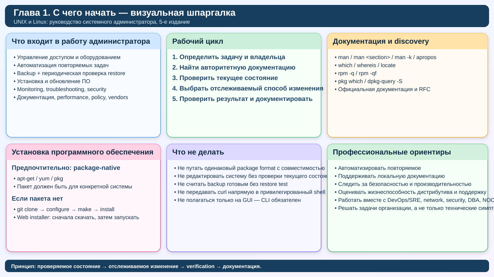

# Глава 1 — С чего начать

Практические заметки по главе 1 книги «Unix и Linux: руководство системного администратора», 5-е издание.

## Идентификация

- Book ID: `unix-linux-system-administration-handbook-5e-ru-2020`
- Глава: 1
- Название: «С чего начать»
- Slug: `getting-started`
- Source policy: `rag_only`
- External sources: запрещены
- Model memory: запрещена
- Прямой доступ к PDF: не использовался

## Provenance

- RAG chunks: `p0044:c01`–`p0069:c01`
- PDF pages: 44–69
- Printed pages: 43–68
- Следующий чанк `p0070:c01` начинает главу 2 «Загрузка и системные демоны».
- Provenance verified: yes

## Содержимое

- [commands.md](commands.md) — команды и инструменты, явно подтвержденные RAG главы.
- [cheatsheet.md](cheatsheet.md) — operational-шпаргалка: документация, поиск ПО, установка и безопасный install flow.
- [diagram.md](diagram.md) — Mermaid-схема базового рабочего цикла администратора по темам главы.
- [visual-cheatsheet.svg](visual-cheatsheet.svg) — визуальная шпаргалка главы.

## Краткий анализ главы

Глава задаёт профессиональный контекст системного администрирования и объясняет, что работа администратора значительно шире выполнения команд. В неё входят управление доступом, оборудование, автоматизация, резервное копирование и проверка восстановления, установка и обновление ПО, мониторинг, troubleshooting, локальная документация, безопасность, производительность, правила, работа с поставщиками и пользовательские инциденты.

Вторая важная линия главы — инструментарий и способ получения знаний. Администратор должен уверенно работать с командной строкой, редактором, сценариями и справочной системой. `man` рассматривается как авторитетный локальный источник по конкретным командам и форматам, а официальная документация и RFC — как дополнительные источники.

Практическая часть главы показывает последовательность работы с программным обеспечением: сначала определить, есть ли нужная команда или файл; затем установить пакет, предназначенный именно для данной системы; при необходимости собрать ПО из исходного кода. Веб-инсталляторы рассматриваются как допустимый, но менее отслеживаемый путь, причём глава отдельно предупреждает против передачи сетевого потока напрямую в привилегированную оболочку.

Глава также вводит организационный контекст: выбор дистрибутива следует оценивать не только по функциям, но и по жизнеспособности, обновлениям безопасности, сообществу, документации и поддержке. Системный администратор работает совместно с DevOps/SRE, security, network, DBA, NOC, datacenter и architecture ролями.

## Основной принцип

Профессиональное администрирование — это не набор разовых ручных команд, а управляемый процесс: понимать ответственность, искать подтвержденную документацию, автоматизировать повторяемое, проверять резервное восстановление, выбирать отслеживаемый способ установки ПО, документировать решения и сотрудничать с другими специалистами.

## OCR note

RAG построен из embedded OCR. В командах ниже исправлены только очевидные OCR-искажения, когда окружающий текст однозначно называет инструмент: например `apt-get`, `pkg`, `git`, `./configure`. Семантика команд не дополнялась внешними источниками.
