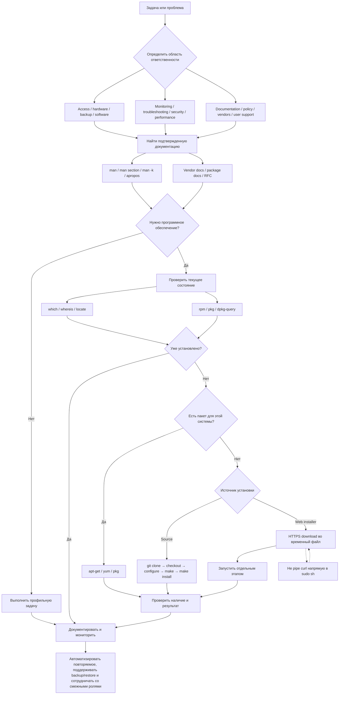

# Диаграмма: рабочий цикл по главе 1

Диаграмма — синтез только из тем главы 1. CPU/memory/storage branches из шаблона для главы 29 не используются, потому что эта глава не задаёт такую диагностическую методологию.

## Смысл диаграммы

Глава 1 связывает техническую работу администратора с процессной дисциплиной. Перед изменением полезно определить область задачи, использовать локальную/официальную документацию, проверить фактическое состояние и выбирать максимально отслеживаемый способ установки. После изменения результат должен быть проверяемым и документированным.
