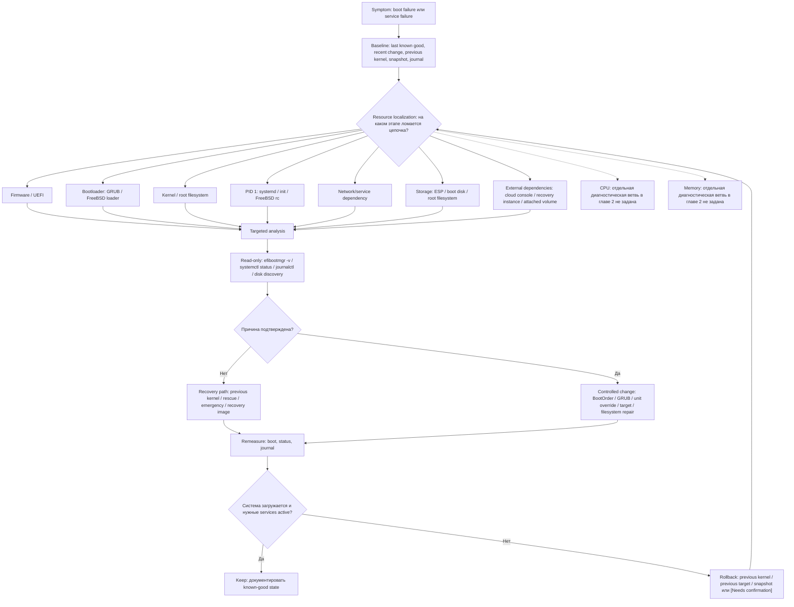

# Диаграмма: диагностика загрузки и системных демонов

## Смысл диаграммы

Глава предлагает мыслить по слоям загрузки. Неисправность firmware, bootloader, kernel, root filesystem и PID 1 требует разных проверок. Сначала собираются наблюдаемые данные, затем выполняется локальное изменение только в подтверждённом слое, после чего состояние проверяется повторной загрузкой, status/journal или recovery boot.

Узлы CPU и memory сохранены из общего artifact template, но явно помечены как неиспользуемые отдельные ветви: глава 2 не задаёт CPU/memory troubleshooting как часть boot workflow.
