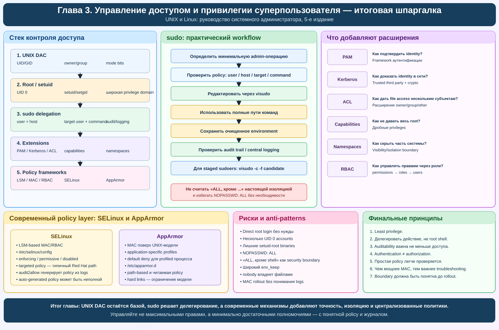
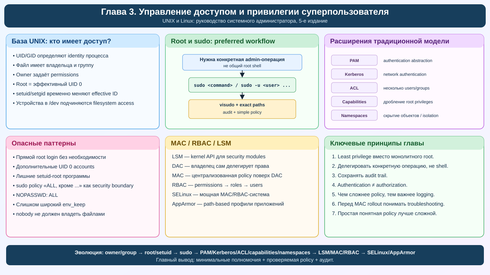

# Глава 3 — Управление доступом и привилегии суперпользователя

Практические заметки по главе 3 книги «UNIX и Linux: руководство системного администратора», 5-е издание.

## Идентификация

- Book ID: `unix-linux-system-administration-handbook-5e-ru-2020`
- Глава: 3
- Название: «Управление доступом и привилегии суперпользователя»
- Slug: `access-control-and-superuser-privileges`
- Source policy: `rag_only`
- External sources: запрещены
- Model memory: запрещена
- Прямой доступ к `source/book.pdf`: не использовался

## Provenance

- RAG chunks: `p0104:c01`–`p0127:c01`
- PDF pages: 104–127
- Printed pages: 103–126
- Boundary evidence:
  - `p0102:c01` — содержимое главы 2;
  - `p0103:c01` — текстовый чанк отсутствует;
  - `p0104:c01` — титульная страница главы 3;
  - `p0127:c01` — раздел 3.5 «Литература»;
  - `p0128:c01` — начало главы 4 «Управление процессами».
- Provenance verified: yes

## Содержимое

- [commands.md](commands.md) — команды и конфигурационные точки, подтверждённые главой.
- [cheatsheet.md](cheatsheet.md) — operational/conceptual quick reference по управлению привилегиями.
- [diagram.md](diagram.md) — Mermaid-карта уровней контроля доступа.
- [visual-cheatsheet.svg](visual-cheatsheet.svg) — компактный overview.
- [visual-cheatsheet-detailed.svg](visual-cheatsheet-detailed.svg) — итоговая визуальная summary всей главы.

## Карта главы

- 3.1 — стандартное управление доступом UNIX: пользователь, группа, владелец, root, setuid/setgid;
- 3.2 — управление учётной записью root: `su`, `sudo`, `sudoers`, аудит и централизованная конфигурация;
- 3.3 — расширения традиционной модели: PAM, Kerberos, ACL, Linux capabilities, namespaces;
- 3.4 — современный контроль доступа: LSM, DAC/MAC, RBAC, SELinux, AppArmor;
- 3.5 — литература.

## Краткий анализ

Глава начинает с традиционной модели UNIX, где решение о доступе строится вокруг UID/GID, владельца объекта и групп. Root исторически объединяет почти все административные полномочия в одной учётной записи, а setuid/setgid позволяют отдельным программам временно выполнять строго определённую привилегированную работу.

Главный operational-вывод главы — не работать через постоянные root-сессии без необходимости. Для делегирования административных действий авторы рекомендуют `sudo`: оно позволяет задавать, кто, на каком хосте, от имени какого пользователя и какие команды может выполнять, а также вести журнал. Конфигурацию `sudoers` следует держать простой, команды задавать полными путями и редактировать файл через `visudo`.

Глава отдельно подчёркивает ограничения `sudo`. Правила вида «разрешить всё, кроме нескольких команд» не являются надёжной границей безопасности; разрешённая программа может дать путь к оболочке или другой привилегированной операции. `NOPASSWD: ALL` описывается как опасная конфигурация. Окружение при запуске привилегированных команд тоже является частью security boundary, поэтому sudo по умолчанию передаёт ограниченный очищенный набор переменных.

Далее глава показывает, почему одной классической модели недостаточно. PAM отделяет приложение от конкретного механизма аутентификации; Kerberos реализует сетевую криптографическую аутентификацию; ACL позволяют назначать права нескольким пользователям и группам; Linux capabilities дробят монолитные полномочия root; namespaces ограничивают видимость объектов и лежат в основе контейнерной изоляции.

Современный слой строится через kernel security frameworks. В Linux LSM предоставляет API для подключаемых механизмов. MAC добавляет централизованные политики поверх discretionary permissions, а RBAC связывает разрешения с ролями, а не напрямую с пользователями. SELinux реализует широкий набор MAC/RBAC-возможностей, но требует понимания политики и журналов. AppArmor также реализует MAC, ориентируясь прежде всего на ограничение приложений посредством path-based профилей.

## Основной принцип

Не раздавать монолитный root-доступ там, где можно делегировать минимально необходимые полномочия и сохранить аудит.

Логическая эволюция главы:

`owner/group/UID/GID → root/setuid → sudo → PAM/Kerberos/ACL/capabilities/namespaces → LSM/MAC/RBAC → SELinux/AppArmor`

Чем мощнее механизм, тем важнее понимать его policy model, журналирование и failure mode до внедрения.

## OCR note

RAG построен из embedded OCR. Исправлены только очевидные и однозначные искажения токенов, например `ls -l`, `passwd -l`, `NOPASSWD`, `visudo -c -f`. Неоднозначные имена модулей SELinux не нормализовались без подтверждения.
