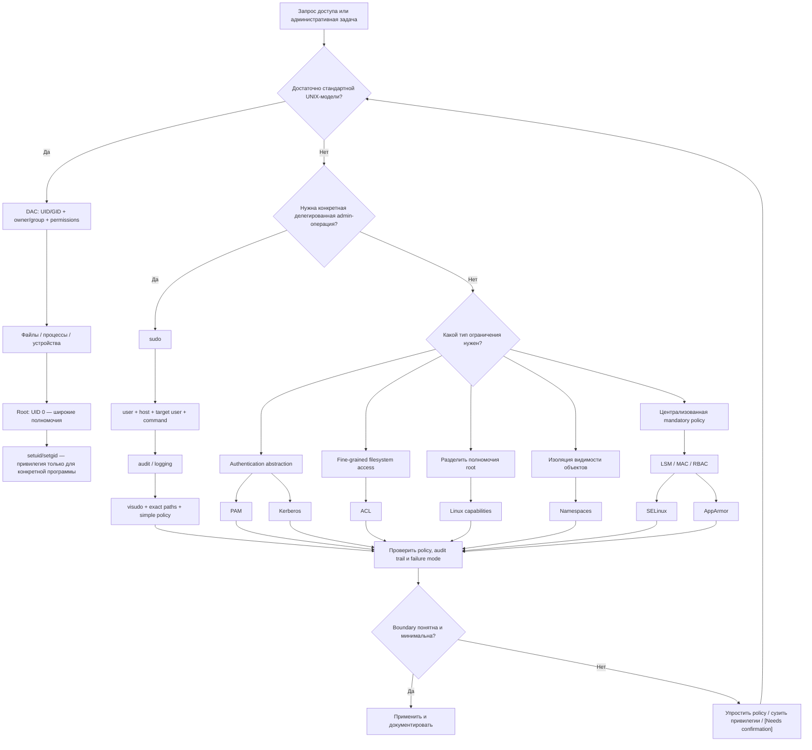

# Диаграмма: уровни управления доступом

## Смысл диаграммы

Глава показывает не одну систему доступа, а последовательность уровней. Традиционная UNIX-модель остаётся базой, `sudo` решает задачу делегирования административных действий, а PAM/Kerberos/ACL/capabilities/namespaces закрывают отдельные ограничения классической модели. Когда требуется централизованная mandatory policy, подключаются LSM/MAC/RBAC-механизмы вроде SELinux и AppArmor.
