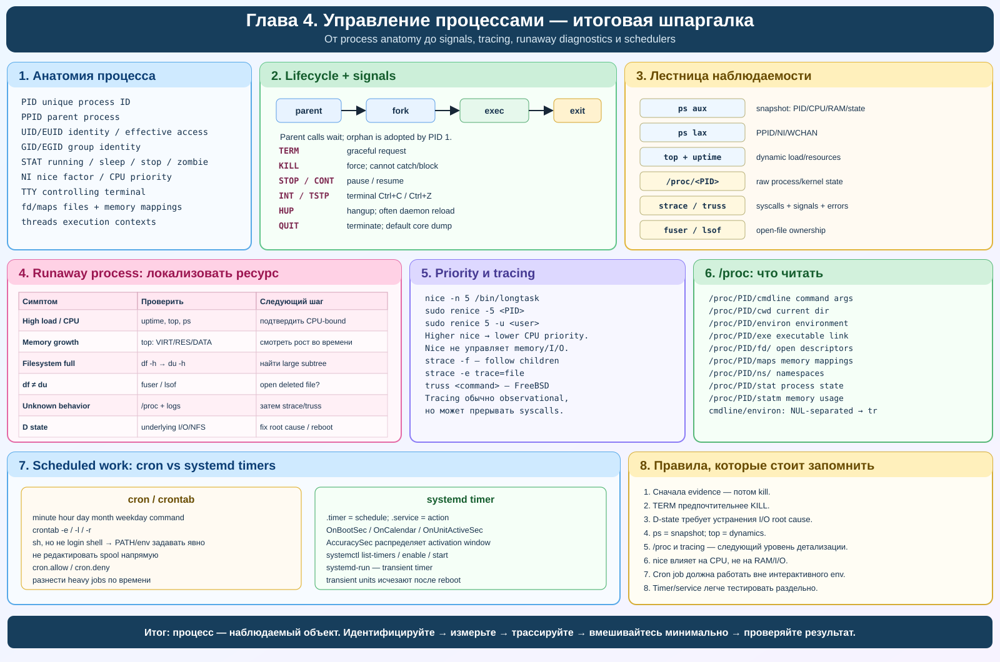
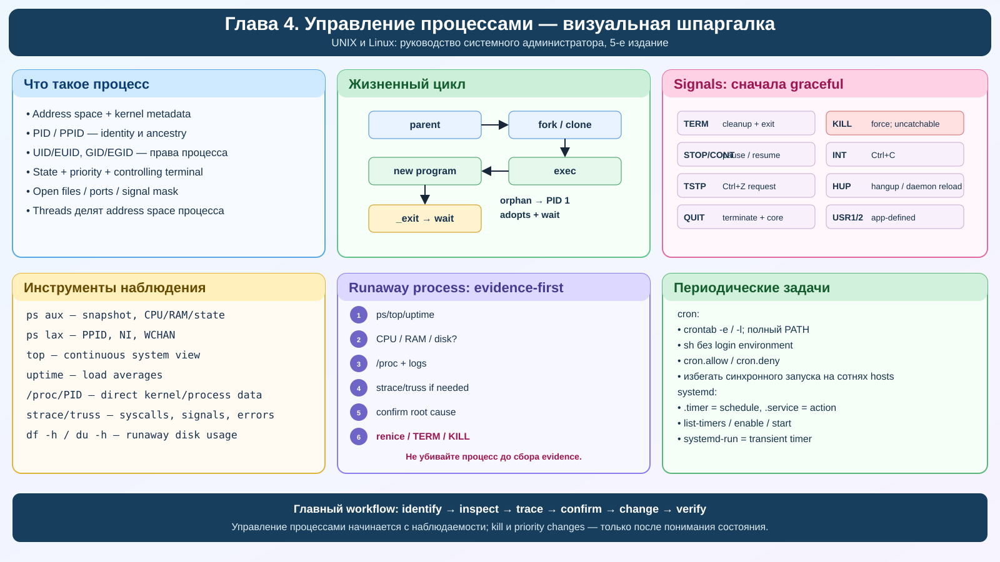

# Глава 4 — Управление процессами

Практические заметки по главе 4 книги «UNIX и Linux: руководство системного администратора», 5-е издание.

## Идентификация

- Book ID: `unix-linux-system-administration-handbook-5e-ru-2020`
- Глава: 4
- Название: «Управление процессами»
- Slug: `process-management`
- Source policy: `rag_only`
- External sources: запрещены
- Model memory: запрещена
- Прямой доступ к `source/book.pdf`: не использовался

## Provenance

- RAG chunks: `p0128:c01`–`p0155:c01`
- PDF pages: 128–155
- Printed pages: 127–154
- Boundary evidence:
  - `p0127:c01` — завершение главы 3;
  - `p0128:c01` — титульная страница главы 4;
  - `p0155:c01` — последний материал главы 4 о scheduled jobs;
  - `p0156:c01` — титульная страница главы 5 «Файловая система».
- Provenance verified: yes

## Содержимое

- [commands.md](commands.md) — process inspection, signals, priority, tracing и scheduling.
- [cheatsheet.md](cheatsheet.md) — operational workflow по диагностике и управлению процессами.
- [diagram.md](diagram.md) — Mermaid-карта жизненного цикла и troubleshooting flow.
- [visual-cheatsheet.svg](visual-cheatsheet.svg) — компактный overview.
- [visual-cheatsheet-detailed.svg](visual-cheatsheet-detailed.svg) — итоговая visual summary всей главы.

## Карта главы

- 4.1 — компоненты процесса: address space, kernel state, PID/PPID, UID/EUID, GID/EGID, priority, controlling terminal;
- 4.2 — жизненный цикл: fork/exec, exit/wait, orphan adoption, signals и process states;
- 4.3 — `ps` как основной snapshot-инструмент;
- 4.4 — интерактивный мониторинг через `top`;
- 4.5 — CPU scheduling priority через `nice` и `renice`;
- 4.6 — псевдофайловая система `/proc`;
- 4.7 — syscall/signal tracing через `strace` и `truss`;
- 4.8 — runaway processes: CPU, memory, disk growth и evidence-first investigation;
- 4.9 — periodic processes: cron, crontab access control, systemd timers и recurring maintenance.

## Краткий анализ

Глава рассматривает процесс как центральную административную абстракцию UNIX: выполняемая программа имеет address space и kernel metadata, а её поведение определяется identity, состоянием, priority, открытыми ресурсами и связью с родительским процессом.

Жизненный цикл строится вокруг `fork`/clone, семейства `exec`, завершения через `_exit` и подтверждения родителем через `wait`. Если родитель исчезает раньше дочернего процесса, PID 1 (`init`/systemd) принимает orphan и выполняет необходимый `wait`. Signals служат стандартным механизмом асинхронного управления процессами; особенно важны TERM, KILL, STOP, CONT, HUP, INT, QUIT и TSTP.

Для наблюдения глава разделяет snapshot и continuous monitoring. `ps` показывает PID, owner, CPU/memory, state и command; `ps lax` добавляет PPID, nice и wait channel. `top` показывает состояние системы в динамике и помогает увидеть load, CPU, memory и активные процессы.

Для диагностики недостаточно сразу завершить подозрительный процесс. Глава подчёркивает ценность «живого» проблемного процесса как источника доказательств: сначала `ps`/`top`, затем `/proc`, а если этого недостаточно — `strace` или `truss`. Эти инструменты показывают системные вызовы, аргументы, signals и коды возврата и особенно полезны для permission errors, missing files и socket conflicts.

При runaway process глава предлагает локализовать ресурс: CPU/load, memory или заполнение filesystem. Для disk-full сценария используется связка `df -h` → `du -h`; если показатели расходятся, возможен удалённый, но всё ещё открытый файл, который можно искать через `fuser`/`lsof`.

Вторая половина operational-материала посвящена scheduled work. Cron остаётся традиционной системой периодических задач; chapter отдельно разбирает crontab syntax, environment differences, access control и риск синхронного запуска одинаковых jobs на сотнях хостов. Systemd timers дают более выразительное scheduling и разделяют schedule (`.timer`) и action (`.service`), а временные timers можно создавать через `systemd-run`.

## Основной принцип

Сначала наблюдать и собирать доказательства, потом вмешиваться:

`identify → inspect → trace if needed → confirm resource/problem → change priority/signal/stop only when justified → verify`.

Для scheduled work тот же принцип:

`define schedule → use explicit environment/paths → test command independently → install/enable → verify logs/timer state`.

## OCR note

RAG построен из embedded OCR. Нормализованы только однозначные искажения: `kill -l`, `ps aux | grep`, `crontab -l`, `chmod +x`, `systemctl enable`, `/bin/sh -c`. Неоднозначные примеры команд не расширялись внешними источниками.
