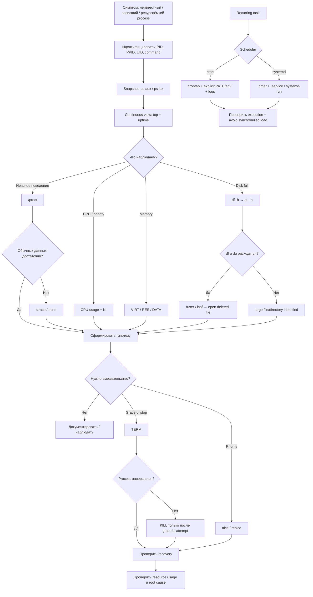

# Диаграмма: управление процессом от наблюдения до действия

## Смысл диаграммы

Глава строит управление процессами вокруг наблюдаемости. Process не следует останавливать только потому, что он выглядит подозрительно: сначала сохранить evidence, определить resource pattern и при необходимости трассировать syscalls. Signals и priority changes — controlled actions после diagnosis. Отдельная ветвь показывает recurring processes: scheduler должен быть таким же проверяемым объектом, как обычный process.
