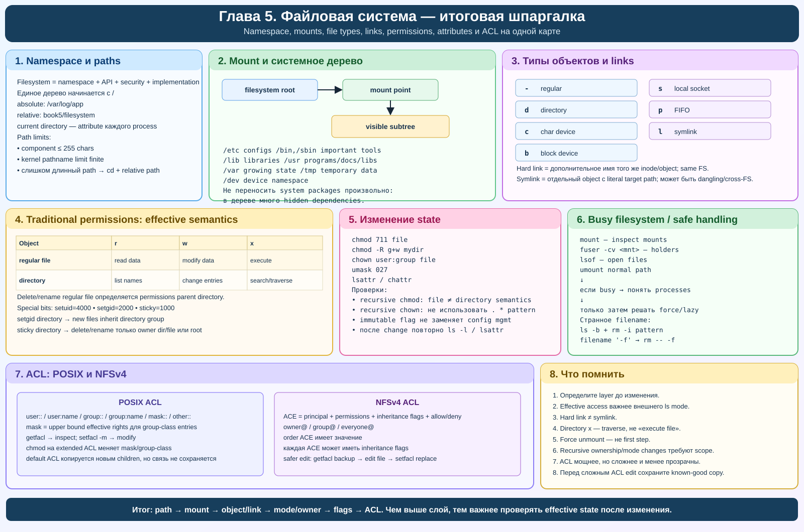
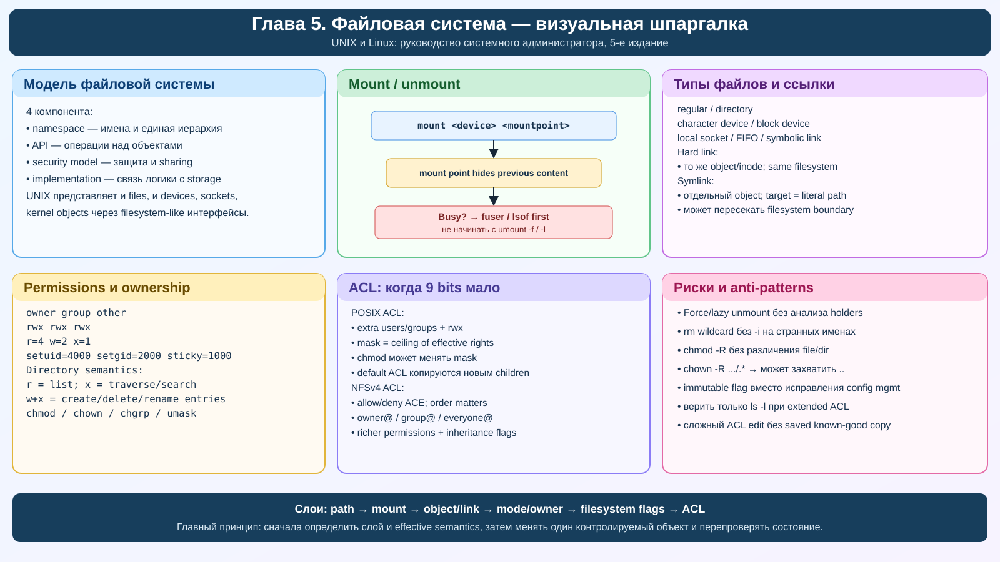

# Глава 5 — Файловая система

Практические заметки по главе 5 книги «UNIX и Linux: руководство системного администратора», 5-е издание.

## Идентификация

- Book ID: `unix-linux-system-administration-handbook-5e-ru-2020`
- Глава: 5
- Название: «Файловая система»
- Slug: `filesystem`
- Source policy: `rag_only`
- External sources: запрещены
- Model memory: запрещена
- Прямой доступ к `source/book.pdf`: не использовался

## Provenance

- RAG chunks: `p0156:c01`–`p0187:c01`
- PDF pages: 156–187
- Printed pages: 155–186
- Boundary evidence:
  - `p0155:c01` — завершение главы 4;
  - `p0156:c01` — титульная страница главы 5;
  - `p0187:c01` — последний материал главы 5, изменение NFSv4 ACL;
  - `p0188:c01` — начало главы 6 «Инсталляция и управление программным обеспечением».
- Provenance verified: yes

## Содержимое

- [commands.md](commands.md) — mount, inspection, links, permissions, ownership, attributes и ACL.
- [cheatsheet.md](cheatsheet.md) — operational/conceptual quick reference по файловой системе.
- [diagram.md](diagram.md) — Mermaid-карта от namespace до ACL.
- [visual-cheatsheet.svg](visual-cheatsheet.svg) — компактный overview.
- [visual-cheatsheet-detailed.svg](visual-cheatsheet-detailed.svg) — итоговая visual summary всей главы.

## Карта главы

- 5.1 — абсолютные и относительные пути, текущий каталог процесса;
- 5.2 — монтирование/демонтирование файловых систем, mount point, `/etc/fstab`, busy filesystem;
- 5.3 — структура файлового дерева и назначение ключевых каталогов;
- 5.4 — типы файлов, hard links, device files, local sockets, FIFO, symbolic links;
- 5.5 — mode bits, setuid/setgid/sticky, `ls`, `chmod`, `chown`, `chgrp`, `umask`, Linux file flags;
- 5.6 — ACL: POSIX ACL и NFSv4 ACL, masks, inheritance, interaction с traditional mode bits.

## Краткий анализ

Глава начинает с базовой идеи UNIX: файловая система — не только хранение обычных файлов, а единый namespace для разных системных объектов. Авторы выделяют четыре составляющих: namespace, API, security model и implementation. В одно файловое дерево могут быть встроены дисковые, сетевые и виртуальные файловые системы.

Mount связывает корень отдельной файловой системы с существующим каталогом дерева. Пока filesystem смонтирована, прежнее содержимое mount point скрыто. Перед `umount` нужно убедиться, что filesystem не занята. Вместо force-unmount глава предлагает сначала определить процессы через `fuser` или `lsof`.

Авторы не рекомендуют «улучшать» системную иерархию каталогов вручную: в ней много скрытых зависимостей. Для системных пакетов следует предпочитать расположение, принятое дистрибутивом. Отдельно рассматриваются ключевые каталоги `/etc`, `/bin`, `/sbin`, `/lib`, `/usr`, `/var`, `/tmp`, `/dev`.

Глава подробно разбирает семь традиционных типов файлов и различие между hard link и symbolic link. Hard links — несколько имён одного и того же объекта и не могут пересекать filesystem boundary; symbolic link — отдельный объект, содержащий имя target, и может ссылаться на объект в другой filesystem или даже на несуществующий path.

Traditional UNIX permissions состоят из owner/group/other и битов read/write/execute. Для directory semantics особенно важно, что execute означает возможность прохода/поиска, а create/delete/rename определяются permissions каталога, а не самого файла. Дополнительные setuid, setgid и sticky bits изменяют semantics; setgid на directory помогает group collaboration, sticky ограничивает удаление файлов в shared directories.

Команды `chmod`, `chown`, `chgrp` и `umask` изменяют модель доступа. Глава отдельно предупреждает о recursive operations: `chmod -R` опасен из-за различной semantics execute bit для файлов и каталогов, а шаблон `.*` в recursive `chown` может захватить `..` и изменить parent tree.

Linux file attributes через `lsattr`/`chattr` добавляют filesystem-specific flags, но авторы предостерегают от использования immutable flag как обхода configuration management: это создаёт скрытое состояние и затрудняет troubleshooting.

Последняя крупная тема — ACL. POSIX ACL расширяют owner/group/other дополнительными users/groups, но вводят mask, которая ограничивает effective rights. `chmod` на файле с ACL может менять mask, поэтому вывод `ls` способен выглядеть вводяще в заблуждение. NFSv4 ACL богаче: поддерживают allow/deny ACE, отдельные права и сложную inheritance model; порядок ACE имеет значение. Глава подчёркивает, что ACL мощнее, но сложнее, и не предлагает считать их универсальной заменой традиционных permissions.

## Основной принцип

Файловая система — это одновременно namespace, ownership/security boundary и интерфейс к системным ресурсам. Перед изменением нужно понимать уровень, на котором действует операция:

`path → mount → object type/link → traditional mode/owner → filesystem flags → ACL`.

Чем сложнее уровень прав, тем важнее проверять effective access, а не только внешний вид mode bits.

## OCR note

RAG построен из embedded OCR. Исправлены только очевидные OCR-искажения, однозначные из контекста: `ls -l`, `umount -l`, `ln -s`, `getfacl`, `setfacl`, `chgrp`, `umask`. Неоднозначные device/path examples не нормализовались сверх необходимого.
