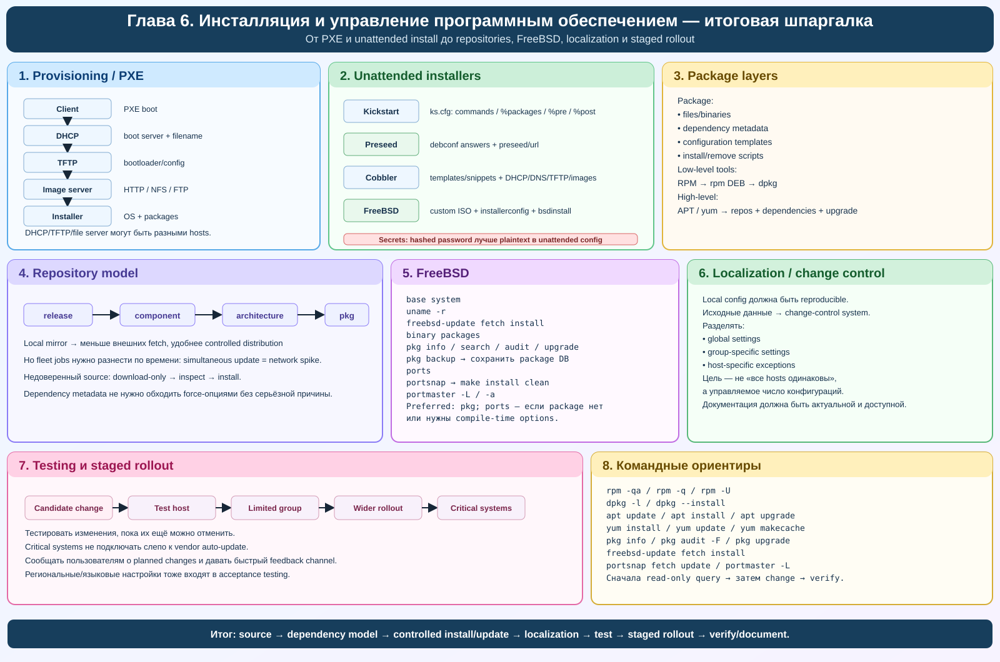
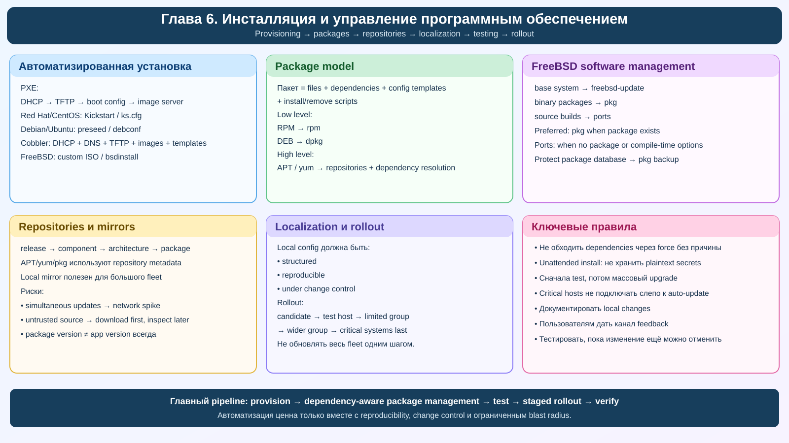

# Глава 6 — Инсталляция и управление программным обеспечением

Практические заметки по главе 6 книги «UNIX и Linux: руководство системного администратора», 5-е издание.

## Идентификация

- Book ID: `unix-linux-system-administration-handbook-5e-ru-2020`
- Глава: 6
- Название: «Инсталляция и управление программным обеспечением»
- Slug: `installation-and-software-management`
- Source policy: `rag_only`
- External sources: запрещены
- Model memory: запрещена
- Прямой доступ к `source/book.pdf`: не использовался

## Provenance

- RAG chunks: `p0188:c01`–`p0215:c01`
- PDF pages: 188–215
- Printed pages: 187–214
- Boundary evidence:
  - `p0187:c01` — завершение главы 5;
  - `p0188:c01` — титульная страница главы 6;
  - `p0215:c01` — раздел 6.7 «Литература»;
  - `p0216:c01` — начало главы 7 «Сценарии и командная оболочка».
- Provenance verified: yes

## Содержимое

- [commands.md](commands.md) — команды automated install, package managers, repositories и FreeBSD software management.
- [cheatsheet.md](cheatsheet.md) — operational/conceptual quick reference по installation/update lifecycle.
- [diagram.md](diagram.md) — Mermaid-карта от provisioning до controlled rollout.
- [visual-cheatsheet.svg](visual-cheatsheet.svg) — компактный overview.
- [visual-cheatsheet-detailed.svg](visual-cheatsheet-detailed.svg) — итоговая visual summary всей главы.

## Карта главы

- 6.1 — инсталляция ОС: PXE, PXELINUX, Kickstart, Debian/Ubuntu preseed, Cobbler, FreeBSD bsdinstall;
- 6.2 — зачем нужны package systems: atomic installation, dependencies, config preservation, package scripts;
- 6.3 — Linux low-level package tools: RPM и dpkg;
- 6.4 — high-level Linux package management: repositories, APT, yum, mirrors и updates;
- 6.5 — FreeBSD: base system, `freebsd-update`, `pkg`, ports и `portmaster`;
- 6.6 — localization/configuration: reproducibility, source/change control, staged rollout, release discipline и testing;
- 6.7 — литература.

## Краткий анализ

Глава рассматривает управление программным обеспечением как полный жизненный цикл, а не как отдельную команду установки пакета. Начальная установка ОС, автоматизация развертывания, dependency management, repositories, обновления, локальная конфигурация и тестирование должны образовывать воспроизводимый процесс.

Для массовой установки глава начинает с PXE: клиент получает boot parameters через DHCP, загрузочный файл через TFTP, а installation image — через HTTP/NFS/другой сервер. PXELINUX использует PXE API и может загружать разные ОС. Для Red Hat/CentOS описан Kickstart с `ks.cfg`, разделами commands / packages / pre/post; для Debian/Ubuntu — preseed через debconf; Cobbler объединяет DHCP/DNS/TFTP/images/templates; FreeBSD automation строится вокруг кастомизированного installer image и `bsdinstall`.

Package system нужен не только для копирования файлов. Пакет содержит binaries, dependency metadata и configuration templates; installer стремится сделать установку атомарной, сохранить локальные configuration changes и выполнить install scripts. Dependency graph позволяет безопаснее управлять библиотеками, но ошибки и version conflicts остаются возможными.

В Linux глава разделяет low-level и high-level tooling. RPM/dpkg непосредственно устанавливают, удаляют и запрашивают пакеты. APT/yum работают поверх repositories, разрешают dependencies и обновляют систему. Authors отдельно предупреждают не обходить dependency checks через force без серьёзной причины: dependency metadata существует именно для предотвращения повреждения системы.

Repositories задают software universe через releases, components, architectures и packages. Для большого числа машин полезны локальные mirrors, но массовые scheduled updates следует разносить по времени, чтобы не создавать network spike. Если источник обновлений не полностью доверен, глава предлагает разделить download и install и сначала проверить полученные packages.

FreeBSD разбивает software management на base system, binary packages и ports. Base RELEASE обновляется через `freebsd-update`; additional software предпочтительно вести через `pkg`, а ports использовать, когда package отсутствует или нужны compile-time options. Package database должна сохраняться и резервироваться.

Финальный operational-блок — localization и change management. Configuration должна быть структурированной и воспроизводимой, исходные данные — храниться в change-control system. Новые releases не следует развёртывать сразу на все hosts: изменения сначала тестируются, затем распространяются по группам. Critical systems не должны слепо подключаться к vendor auto-update service; глава рекомендует промежуточный test system и staged promotion.

## Основной принцип

Software management — это управляемый pipeline:

`provision → package/dependency model → repository/source → test → staged rollout → verify → document`.

Автоматизация полезна только тогда, когда source, change, dependency и rollback boundaries понятны и проверяемы.

## OCR note

RAG построен из embedded OCR. Нормализованы только однозначные токены: `PXE`, `Kickstart`, `dpkg`, `apt`, `yum`, `pkg`, `freebsd-update`, `portsnap`, `portmaster`. Версии и примеры, искажённые OCR и не требуемые для смысла, не нормализовались.
