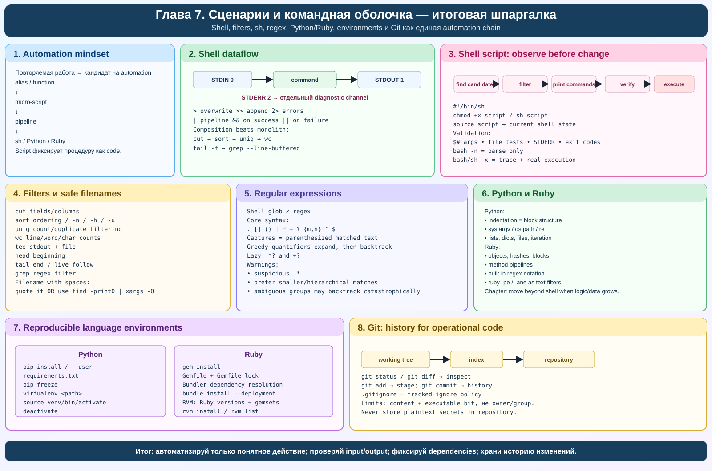
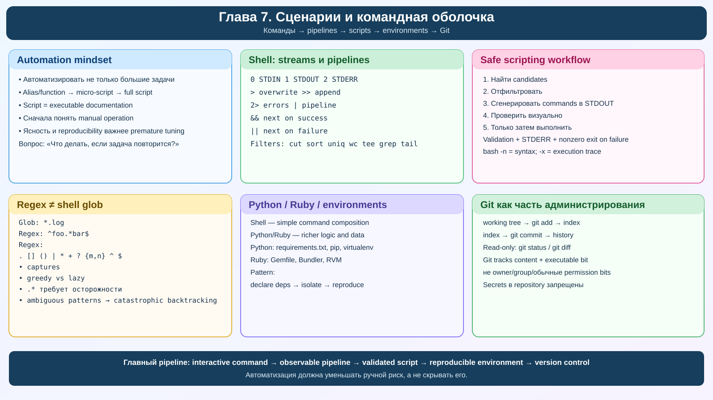

# Глава 7 — Сценарии и командная оболочка

Практические заметки по главе 7 книги «UNIX и Linux: руководство системного администратора», 5-е издание.

## Идентификация

- Book ID: `unix-linux-system-administration-handbook-5e-ru-2020`
- Глава: 7
- Название: «Сценарии и командная оболочка»
- Slug: `scripts-and-shell`
- Source policy: `rag_only`
- External sources: запрещены
- Model memory: запрещена
- Прямой доступ к `source/book.pdf`: не использовался

## Provenance

- RAG chunks: `p0216:c01`–`p0273:c01`
- PDF pages: 216–273
- Printed pages: 215–272
- Boundary evidence:
  - `p0215:c01` — завершение главы 6;
  - `p0216:c01` — титульная страница главы 7;
  - `p0272:c01`–`p0273:c01` — раздел 7.9 «Литература»;
  - `p0274:c01` — начало главы 8 «Управление учетными записями пользователей».
- Provenance verified: yes

## Содержимое

- [commands.md](commands.md) — shell, filters, scripting/debug, Python/Ruby environments и Git.
- [cheatsheet.md](cheatsheet.md) — operational/conceptual quick reference по automation workflow.
- [diagram.md](diagram.md) — Mermaid-карта от интерактивной команды до контролируемого сценария и version control.
- [visual-cheatsheet.svg](visual-cheatsheet.svg) — компактный overview.
- [visual-cheatsheet-detailed.svg](visual-cheatsheet-detailed.svg) — итоговая visual summary всей главы.

## Карта главы

- 7.1 — основы scripting: automation mindset, micro-scripts, aliases/functions, выбор языка, правила качества;
- 7.2 — основы shell: command editing, STDIN/STDOUT/STDERR, redirection, pipelines, variables, environment, filters;
- 7.3 — sh scripting: shebang, execution/source, development from command line, input/output, arguments, conditions, loops, arithmetic;
- 7.4 — regular expressions: matching, special characters, captures, greediness/laziness и catastrophic backtracking;
- 7.5 — Python: language basics, input validation, data types, iteration и regex module;
- 7.6 — Ruby: objects, hashes, blocks, regex и filter-style one-liners;
- 7.7 — Python/Ruby library and environment management: pip/gem, requirements/Gemfile, virtualenv, Bundler, RVM;
- 7.8 — Git: repository/index/commit workflow, status/diff/.gitignore, caveats, collaborative development;
- 7.9 — литература.

## Краткий анализ

Глава начинает не с синтаксиса, а с модели работы администратора: автоматизацию следует использовать не только для больших проектов, но и для повторяющихся мелких операций. Сценарий стандартизирует процедуру и одновременно фиксирует её как исполняемую документацию. Авторы предлагают задавать себе вопрос: «Что я сделаю, если эта задача повторится?».

Shell рассматривается как композиционная среда. Унифицированные STDIN/STDOUT/STDERR и file descriptors 0/1/2 позволяют связывать команды через redirection и pipelines. В результате небольшие специализированные utilities можно собирать в более сложные операции без написания большой программы.

Для sh-сценариев глава рекомендует сначала отладить pipeline интерактивно, направлять потенциально опасный результат в STDOUT и только после визуальной проверки превращать его в реальное modifying action. Пример с массовым rename строится именно так: `find` → filtering → генерация команд → проверка → выполнение через shell. Это один из самых сильных operational-паттернов главы.

Отдельно разбираются input validation, usage messages, exit status и STDERR. Сценарий должен проверять arguments до destructive operations, возвращать 0 при успехе и ненулевой code при ошибке. Для shell debugging глава указывает `-x` для отображения команд перед выполнением и `-n` для syntax-only check. Setuid scripts не рекомендуются; privilege delegation предлагается делать через `sudo`.

Большой блок посвящён text processing: `cut`, `sort`, `uniq`, `wc`, `tee`, `head`, `tail`, `grep`. Их сила раскрывается в pipelines. Для filenames с spaces chapter отдельно показывает NUL-safe pair `find -print0 | xargs -0`.

Regular expressions отделяются от shell globbing. Глава разбирает anchors, classes, grouping, alternation, quantifiers и captures, а затем предупреждает о greediness/backtracking. Сложные выражения с несколькими широкими шаблонами могут получить catastrophic backtracking; authors советуют уменьшать scope matching и настороженно относиться к `.*`.

Python и Ruby представлены как general-purpose scripting languages для задач, которые перерастают shell. В историческом контексте издания authors рекомендуют Python как основной general-purpose scripting language для системных администраторов; Ruby описывается как близкий по возможностям, с сильной object/block model и удобством для DSL.

Раздел 7.7 переносит тему scripting в reliability of environments. `pip`/`gem` управляют packages, `requirements.txt`/`Gemfile` описывают dependencies, `pip freeze` и Bundler lock state помогают воспроизводить окружения, а virtualenv/RVM изолируют версии языка и libraries между приложениями.

Финальная тема — Git. Version control нужен не только разработчикам: scripts, configuration-management code, templates и другие text artifacts должны иметь историю. Chapter различает working tree, index и repository; показывает `git init/add/commit/status/diff/.gitignore`; отдельно предупреждает, что Git не восстанавливает ownership и обычные permission bits и что secrets не должны попадать в repository.

## Основной принцип

Административная автоматизация должна развиваться так:

`interactive command → observable pipeline → validated script → reproducible environment → version-controlled artifact`.

Сначала сделать действие понятным и проверяемым, затем автоматизировать, затем сохранять историю и воспроизводимость.

## OCR note

RAG построен из embedded OCR. Нормализованы только однозначные токены и команды: `grep`, `chmod +x`, `bash -x/-n`, `find -print0`, `xargs -0`, `python3`, `pip`, `gem`, `virtualenv`, `git`. Неоднозначные OCR-искажения примеров не расширялись внешними источниками.
