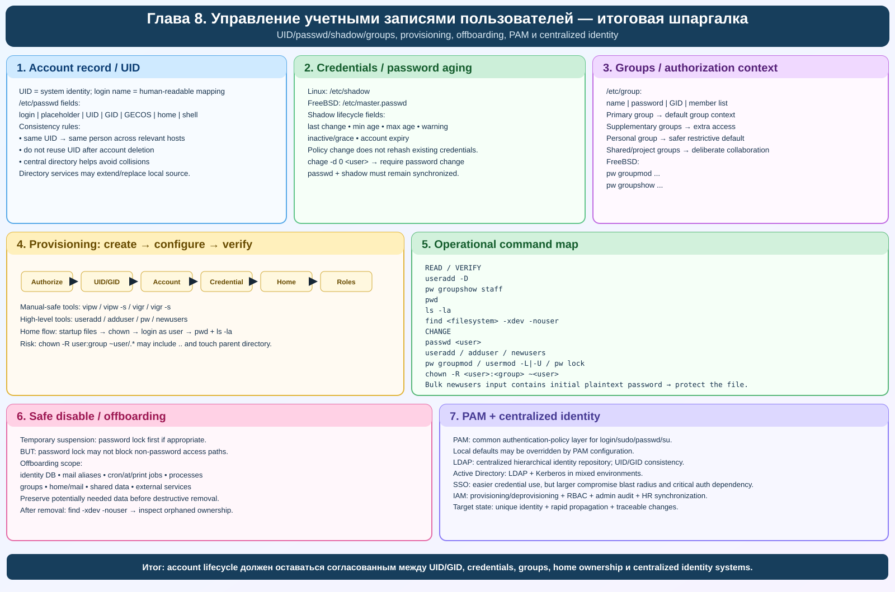
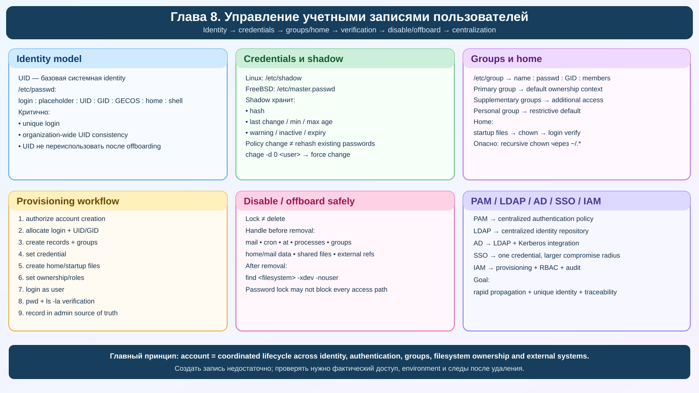

# Глава 8 — Управление учетными записями пользователей

Практические заметки по главе 8 книги «UNIX и Linux: руководство системного администратора», 5-е издание.

## Идентификация

- Book ID: `unix-linux-system-administration-handbook-5e-ru-2020`
- Глава: 8
- Название: «Управление учетными записями пользователей»
- Slug: `user-account-management`
- Source policy: `rag_only`
- External sources: запрещены
- Model memory: запрещена
- Прямой доступ к `source/book.pdf`: не использовался

## Provenance

- RAG chunks: `p0274:c01`–`p0299:c01`
- PDF pages: 274–299
- Printed pages: 273–298
- Boundary evidence:
  - `p0273:c01` — завершение главы 7;
  - `p0274:c01` — титульная страница главы 8;
  - `p0299:c01` — завершение раздела об identity management;
  - `p0300:c01` — начало главы 9 «Облачные вычисления».
- Provenance verified: yes

## Содержимое

- [commands.md](commands.md) — команды и проверки для passwd/shadow/group, user lifecycle, locking и verification.
- [cheatsheet.md](cheatsheet.md) — operational/conceptual quick reference по жизненному циклу учетной записи.
- [diagram.md](diagram.md) — Mermaid-карта account lifecycle от identity record до disable/delete/centralization.
- [visual-cheatsheet.svg](visual-cheatsheet.svg) — компактный overview.
- [visual-cheatsheet-detailed.svg](visual-cheatsheet-detailed.svg) — итоговая visual summary всей главы.

## Карта главы

- 8.1 — основы account management: UID как базовая identity, системные библиотеки и источники учетных данных;
- 8.2 — `/etc/passwd`: login name, UID, GID, GECOS, home, shell и password placeholder;
- 8.3 — `/etc/shadow`: password hash, aging, warning/expiry fields;
- 8.4 — FreeBSD: `/etc/master.passwd` и `/etc/login.conf`;
- 8.5 — `/etc/group`, GID, primary/supplementary groups, personal groups;
- 8.6 — ручное подключение пользователя: passwd/group, password, home, startup files, ownership, RBAC, verification;
- 8.7 — `useradd`, `adduser`, `newusers` и platform-specific automation;
- 8.8 — безопасное удаление учетных записей и поиск orphaned files;
- 8.9 — временная блокировка учетных записей;
- 8.10 — PAM как policy/authentication boundary;
- 8.11 — централизованное управление: LDAP, Active Directory, SSO и identity management.

## Краткий анализ

Глава строит account management вокруг UID, а не вокруг имени пользователя. Login name — удобный human-readable key, но именно UID связывает процессы, ownership и восстановленные из backup файлы с пользователем. Поэтому авторы отдельно предупреждают не переиспользовать UID после удаления учетной записи и стремиться к уникальности UID в масштабе организации.

Традиционная локальная модель разделена между несколькими файлами. `/etc/passwd` хранит общедоступные account attributes: login name, UID, primary GID, GECOS, home directory и login shell. Password hash вынесен в закрытый `/etc/shadow` в Linux и `/etc/master.passwd` в FreeBSD. Глава подчеркивает, что passwd и shadow — независимые состояния, которые должны оставаться согласованными; для ручного редактирования предлагается использовать locking-aware tools вроде `vipw` и `vigr`.

Password management рассматривается не только как выбор хеша. В shadow хранятся password-aging fields: дата последнего изменения, минимальный и максимальный срок, warning period и account expiry. Изменение hashing algorithm не обновляет уже существующие hashes автоматически; пользователь должен сменить пароль, а глава приводит `chage -d 0 <user>` как способ принудить к обновлению при следующем использовании account.

Группы — отдельная identity/authorization плоскость. `/etc/group` содержит group name, GID и supplementary members. Authors рекомендуют согласовывать group names/GIDs между системами, особенно при совместном доступе к файлам, и описывают персональные группы как способ уменьшить риск непреднамеренного sharing по умолчанию. Для реального sharing создаются отдельные project/role groups.

Ручное создание учетной записи разбито на проверяемые шаги: создать records, назначить password, создать home, развернуть startup files, выставить ownership/mode, настроить roles/privileges и затем войти под новой учетной записью для verification. Глава считает ручное редактирование error-prone и предпочитает high-level tools `useradd`, `adduser`, `pw` и связанные platform-specific wrappers.

Operationally важен порядок с home directory. После копирования skeleton/startup files ownership следует выставлять на весь home tree. Глава отдельно предупреждает не использовать recursive pattern вида `~/.*`, потому что он может захватить `..` и изменить ownership родительского каталога.

Bulk provisioning поддерживается `newusers`, но его input содержит initial password в plaintext. Поэтому source прямо предупреждает о защите такого файла. Для large-scale onboarding authors предлагают оборачивать platform tools своим automation layer, если локальная policy сложнее возможностей штатной команды.

Offboarding трактуется как гораздо более широкая операция, чем удаление строки из passwd. Нужно обработать mail aliases, cron/at/print jobs, running processes, group membership, home/mail directories, shared data и другие references. До удаления данных рекомендуется сохранить то, что может понадобиться другим пользователям. После удаления account chapter предлагает `find ... -xdev -nouser` для поиска файлов с orphaned UID.

Locking account и удаление account — разные операции. Linux `usermod -L/-U` и FreeBSD `pw lock` изменяют password field так, чтобы password authentication больше не проходила. При этом глава предупреждает: блокировка password не гарантирует блокировку всех возможных access paths, поэтому реальный effect зависит от конкретного authentication stack.

PAM описывается как слой, централизующий authentication policy для таких программ, как `login`, `sudo`, `passwd` и `su`. Account-management tools должны учитывать PAM policy; если поведение `useradd` или `usermod` не совпадает с локальными defaults, глава предлагает проверить, не переопределяет ли их PAM configuration.

Финальная часть расширяет локальную модель до organization-wide identity. LDAP используется как centralized repository, в том числе для обеспечения UID/GID consistency. Active Directory сочетает LDAP и Kerberos. SSO уменьшает количество credentials для пользователя, но увеличивает blast radius compromise и делает authentication infrastructure критической зависимостью. Identity-management systems добавляют provisioning, role-based access, audit trail, global password operations и synchronization с HR/business data.

## Основной принцип

Учетная запись — это жизненный цикл, а не запись в одном файле:

`identity → UID/GID → authentication data → groups/roles → home/environment → verification → disable/offboard → audit/centralization`.

Безопасное управление account требует согласованности между identity, authentication, filesystem ownership, group membership и внешними системами.

## OCR note

RAG построен из embedded OCR. Нормализованы только однозначные токены и команды: `/etc/passwd`, `/etc/shadow`, `/etc/master.passwd`, `/etc/group`, `vipw`, `vigr`, `useradd`, `adduser`, `newusers`, `usermod`, `pw`, `passwd`, `chage`, `find -nouser`, LDAP, PAM, SSO. Исторические значения и platform defaults сохраняются как содержание издания и не заменяются внешними актуальными данными.
