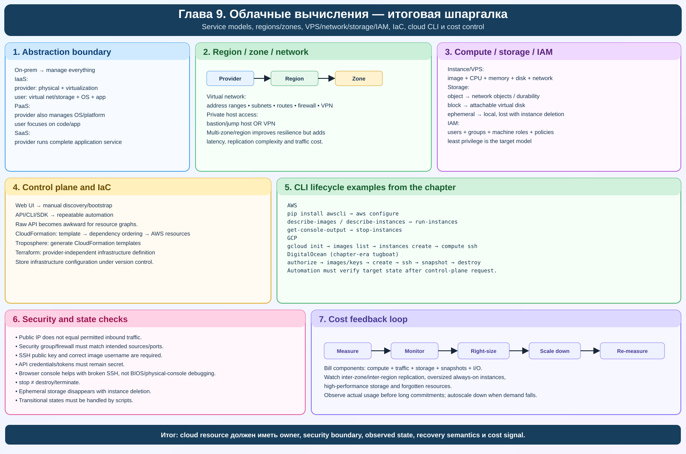
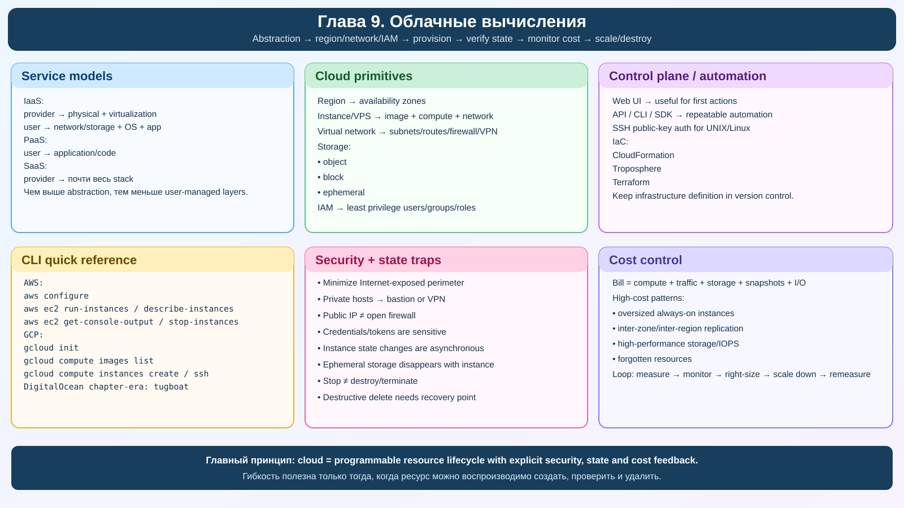

# Глава 9 — Облачные вычисления

Практические заметки по главе 9 книги «UNIX и Linux: руководство системного администратора», 5-е издание.

## Идентификация

- Book ID: `unix-linux-system-administration-handbook-5e-ru-2020`
- Глава: 9
- Название: «Облачные вычисления»
- Slug: `cloud-computing`
- Source policy: `rag_only`
- External sources: запрещены
- Model memory: запрещена
- Прямой доступ к `source/book.pdf`: не использовался

## Provenance

- RAG chunks: `p0300:c01`–`p0321:c01`
- PDF pages: 300–321
- Printed pages: 299–320
- Boundary evidence:
  - `p0299:c01` — завершение главы 8;
  - `p0300:c01` — титульная страница главы 9;
  - `p0321:c01` — раздел 9.6 «Литература»;
  - `p0322:c01` — начало главы 10 «Журналирование».
- Provenance verified: yes

## Содержимое

- [commands.md](commands.md) — AWS/GCP/DigitalOcean CLI, SSH и lifecycle-команды, подтвержденные RAG.
- [cheatsheet.md](cheatsheet.md) — operational/conceptual quick reference по cloud architecture, provisioning и cost control.
- [diagram.md](diagram.md) — Mermaid-карта от выбора abstraction/provider до provisioning, automation и cost feedback.
- [visual-cheatsheet.svg](visual-cheatsheet.svg) — компактный overview.
- [visual-cheatsheet-detailed.svg](visual-cheatsheet-detailed.svg) — итоговая visual summary всей главы.

## Карта главы

- 9.1 — облако в контексте: экономика масштаба, automation и infrastructure as code;
- 9.2 — выбор cloud platform: AWS, Google Cloud Platform, DigitalOcean и компромиссы между функциональностью, сложностью и моделью использования;
- 9.3 — основы cloud services: IaaS/PaaS/SaaS, web/API/CLI access, regions/zones, VPS, networking, storage, IAM и automation;
- 9.4 — быстрый запуск VPS: AWS CLI, GCP `gcloud`, DigitalOcean `tugboat`;
- 9.5 — контроль затрат: compute, network transfer, storage/IOPS, pricing models, autoscaling, measurement and monitoring;
- 9.6 — литература.

## Краткий анализ

Глава определяет облачные вычисления как аренду ресурсов из общего пула по требованию. Ключевой технический сдвиг по сравнению с традиционным дата-центром — программируемость инфраструктуры. Cloud providers предоставляют API, CLI и web interfaces, благодаря чему полный lifecycle систем можно автоматизировать; chapter связывает это с концепцией infrastructure as code.

Авторы разделяют service models на IaaS, PaaS и SaaS по границе ответственности. Для системного администратора IaaS наиболее близок к привычной работе: provider управляет физической инфраструктурой и virtualization layer, а пользователь — guest OS, virtual network, storage layout и собственным software. По мере движения к PaaS/SaaS всё больше слоев передается provider.

Доступ к cloud control plane возможен через web console, API, CLI и SDK. Web UI удобен для первых действий, но repeatability и automation требуют command-line/API-driven workflows. Для доступа к UNIX/Linux instances chapter использует SSH public-key authentication.

Regions и availability zones задают fault and latency topology. Размещение по нескольким zones/regions увеличивает availability, но добавляет complexity и может увеличить network cost. Region следует выбирать с учетом users, developers, latency и required resilience.

VPS/instances создаются из images и получают configurable compute, memory, disk и network characteristics. Виртуальные сети позволяют задавать address ranges, subnets, routes, firewall rules и VPN connectivity. Chapter рекомендует минимизировать Internet-exposed perimeter: hosts without public IP can be reached through a bastion/jump host or VPN.

Storage разделен по semantics. Object storage — flat namespace, high durability и network access; block storage — virtual disks attached to instances; ephemeral storage — fast local instance storage, данные которого теряются вместе с instance. Managed database services рассматриваются как отдельная cloud capability.

Для authorization chapter подчеркивает least privilege. AWS IAM приведен как пример service, где users, groups и machine roles могут получать policies для cloud resources. Идентификация и authorization должны быть частью архитектуры, а не post-factum настройкой.

Automation layer поверх raw API представлен CloudFormation и Terraform. Template описывает desired resources и dependencies, а tool выполняет provider API calls. Авторы считают hand-written large CloudFormation templates difficult to maintain и упоминают generation через Troposphere; Terraform описывается как provider-independent infrastructure tool. Infrastructure configuration следует хранить под version control.

Раздел 9.4 показывает практический CLI lifecycle на трех clouds. AWS CLI: install/configure, create EC2 instance, inspect metadata/console output, stop instance. GCP: `gcloud init`, list images, create instance, SSH. DigitalOcean в историческом контексте chapter управляется через third-party `tugboat`: key setup, authorize, list images/keys, create droplet, SSH, snapshot/destroy.

Отдельно важен lifecycle state. AWS instance не меняет state мгновенно; automation должна учитывать transitional states вроде starting/stopping. GCP `gcloud compute` в приведенном workflow работает synchronously и ждет completion operation.

Последняя тема — стоимость. Cloud bill складывается не только из compute. Chapter выделяет compute time, Internet/inter-zone/inter-region traffic, storage capacity, snapshots и иногда I/O operations. Reserved/spot/preemptible models могут снижать цену, но меняют constraints. Авторы прямо предупреждают, что cloud не гарантирует меньшую стоимость, чем private datacenter.

Главная защита от неожиданного bill — measurement, monitoring и трезвый capacity planning. Chapter рекомендует autoscaling down when capacity is not needed, smaller instances for finer control и наблюдение за actual usage перед долгими commitments или high-throughput storage.

## Основной принцип

Cloud administration — это программируемый lifecycle ресурсов:

`choose abstraction/provider → define region/network/identity → provision from image → automate/configure → observe state → control exposure → measure usage/cost → scale or destroy`.

Cloud flexibility полезна только при явном контроле state, security boundary и cost feedback.

## OCR note

RAG построен из embedded OCR. Нормализованы только однозначные tokens/commands: `aws configure`, `aws ec2`, `gcloud init`, `gcloud compute`, `tugboat`, `ssh-keygen`, `pip install awscli`. Исторические product names, prices и provider behavior сохраняются как содержание издания и не обновляются внешними источниками.
