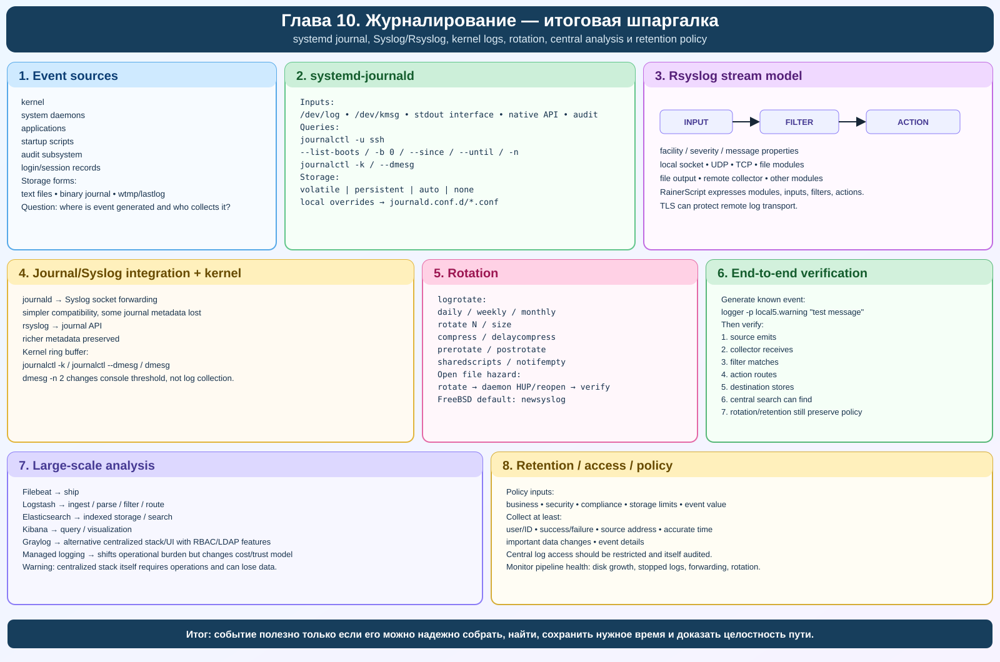
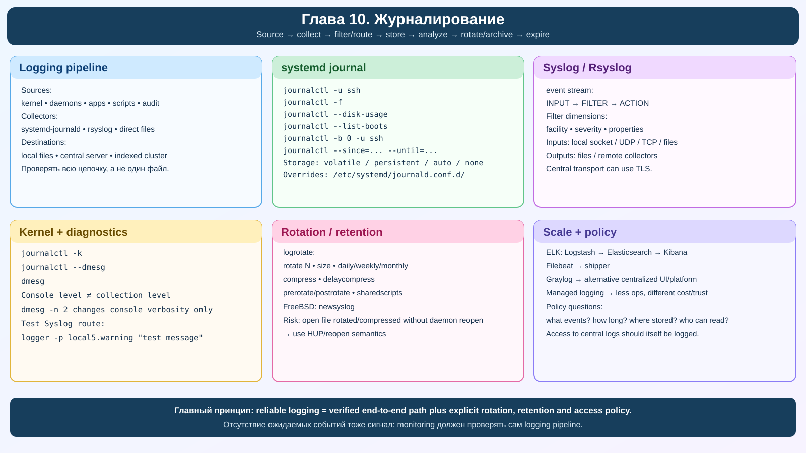

# Глава 10 — Журналирование

Практические заметки по главе 10 книги «UNIX и Linux: руководство системного администратора», 5-е издание.

## Идентификация

- Book ID: `unix-linux-system-administration-handbook-5e-ru-2020`
- Глава: 10
- Название: «Журналирование»
- Slug: `logging`
- Source policy: `rag_only`
- External sources: запрещены
- Model memory: запрещена
- Прямой доступ к `source/book.pdf`: не использовался

## Provenance

- RAG chunks: `p0322:c01`–`p0351:c01`
- PDF pages: 322–351
- Printed pages: 321–350
- Boundary evidence:
  - `p0321:c01` — завершение главы 9;
  - `p0322:c01` — титульная страница главы 10;
  - `p0351:c01` — завершение раздела 10.7 о стратегии хранения/доступа;
  - `p0352:c01` — начало главы 11 «Драйверы и ядро».
- Provenance verified: yes

## Содержимое

- [commands.md](commands.md) — `journalctl`, `dmesg`, `logger`, rsyslog lifecycle, persistent journald и log inspection.
- [cheatsheet.md](cheatsheet.md) — operational/conceptual quick reference от локального события до retention policy.
- [diagram.md](diagram.md) — Mermaid-карта log pipeline: sources → journal/syslog → rotation/centralization → search/retention.
- [visual-cheatsheet.svg](visual-cheatsheet.svg) — компактный overview.
- [visual-cheatsheet-detailed.svg](visual-cheatsheet-detailed.svg) — итоговая visual summary всей главы.

## Карта главы

- 10.1 — где находятся журналы: текстовые и бинарные файлы, `wtmp`, `lastlog`, systemd journal;
- 10.2 — systemd journal: источники, persistent storage, filtering, boot/session queries и coexistence с Syslog;
- 10.3 — Syslog/Rsyslog: event-stream model, facility/severity, inputs/filters/actions, RainerScript, central forwarding и TLS;
- 10.4 — kernel logging: kernel ring buffer, `journalctl -k`, `dmesg`, console severity;
- 10.5 — rotation: `logrotate`, FreeBSD `newsyslog`, retention/compression/postrotate semantics;
- 10.6 — large-scale log management: ELK, Filebeat, Graylog, hosted logging services;
- 10.7 — logging policy: what to collect, how long to retain, who may access, monitoring and compliance input.

## Краткий анализ

Глава рассматривает logging как отдельную системную функцию со своим lifecycle: события нужно собрать, структурировать, отфильтровать, передать, сохранить, проиндексировать, ротировать, архивировать и удалить в соответствии с operational/security/compliance requirements. Авторы отдельно подчеркивают, что журналы — первое место для поиска причин daemon failures, boot errors, configuration problems и security incidents.

UNIX logging исторически фрагментирован. Часть software пишет через Syslog, часть — в собственные text files, Linux дополнительно использует binary systemd journal. Поэтому администратор должен понимать не один конкретный файл, а всю topology источников и collectors.

Systemd journal собирает сообщения из `/dev/log`, kernel channel, stdout/stderr-oriented interfaces, native journal API и audit sources. `journalctl` позволяет фильтровать их по unit, boot, time range, executable и другим metadata. Journal может coexist with Syslog; forwarding через socket теряет часть journal-specific metadata, тогда как direct API integration сохраняет больше контекста.

Глава обращает особое внимание на persistence. `journald.conf` поддерживает режимы `volatile`, `persistent`, `auto`, `none`. Локальные overrides предлагается размещать в `/etc/systemd/journald.conf.d/`, а не редактировать основной файл напрямую. После изменения configuration требуется restart `systemd-journald`. Forward Secure Sealing упоминается как механизм повышения integrity журнала.

Rsyslog представлен как stream-processing architecture:

`input → metadata/facility/severity filters → action/output`.

Inputs могут быть local socket, files, UDP/TCP и другие modules. Outputs — files, remote log hosts и иные destinations. Traditional Syslog selectors и RainerScript позволяют маршрутизировать events по facility/severity и message properties. Центральный collection server может принимать сообщения от многих hosts; в chapter также показана TLS-oriented configuration для защищенной передачи.

Kernel messages живут в отдельном ring buffer. В Linux их можно читать через `journalctl -k` / `journalctl --dmesg` или традиционный `dmesg`; в FreeBSD и старых Linux `dmesg` остается базовым interface. Console verbosity регулируется отдельно от самого collection: снижение console level не прекращает попадание kernel events в log buffer.

Logging без rotation опасен: активный log может заполнить filesystem. `logrotate` управляет frequency, number of retained generations, compression, size thresholds, pre/post hooks и application-specific reopen semantics. Глава предупреждает, что нельзя просто сжимать/переименовывать файл, который daemon продолжает держать открытым; для rsyslog HUP используется для закрытия/reopen descriptors. FreeBSD по умолчанию использует `newsyslog`.

На масштабе сотен/тысяч hosts local text files перестают быть достаточным operational interface. ELK разделяет ingest/transform/search/visualization между Logstash, Elasticsearch и Kibana; Filebeat используется как shipper. Graylog строится поверх Elasticsearch и предлагает иной UI/RBAC model. Chapter также рассматривает hosted logging services как альтернативу эксплуатации собственного large-scale stack.

Последний раздел превращает logging в governance discipline. Retention period, storage tier, event categories и access model должны определяться не привычкой администратора, а business/security/compliance requirements. Central log servers должны иметь ограниченный access, а обращение к ним — само логироваться. Logs нужно мониторить не только на ошибки, но и на отсутствие ожидаемого роста: переставший обновляться журнал может означать failure collection path.

## Основной принцип

Logging — это pipeline:

`event source → collection → filtering/routing → local/central storage → query/analysis → rotation/archive → retention/expiry`.

Надежность журнала определяется не наличием файла, а проверяемостью всей цепочки от source до retention и доступа.

## OCR note

RAG построен из embedded OCR. Нормализованы только однозначные tokens/commands: `journalctl`, `systemd-journald`, `rsyslogd`, `RainerScript`, `dmesg`, `logger`, `logrotate`, `newsyslog`, ELK, Filebeat, Graylog. Неоднозначные OCR-фрагменты конфигурации не восстанавливались сверх очевидной формы.
