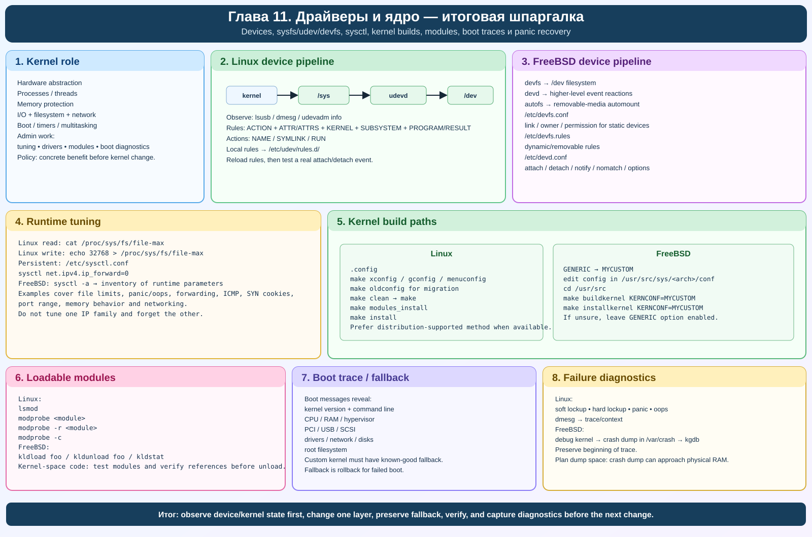
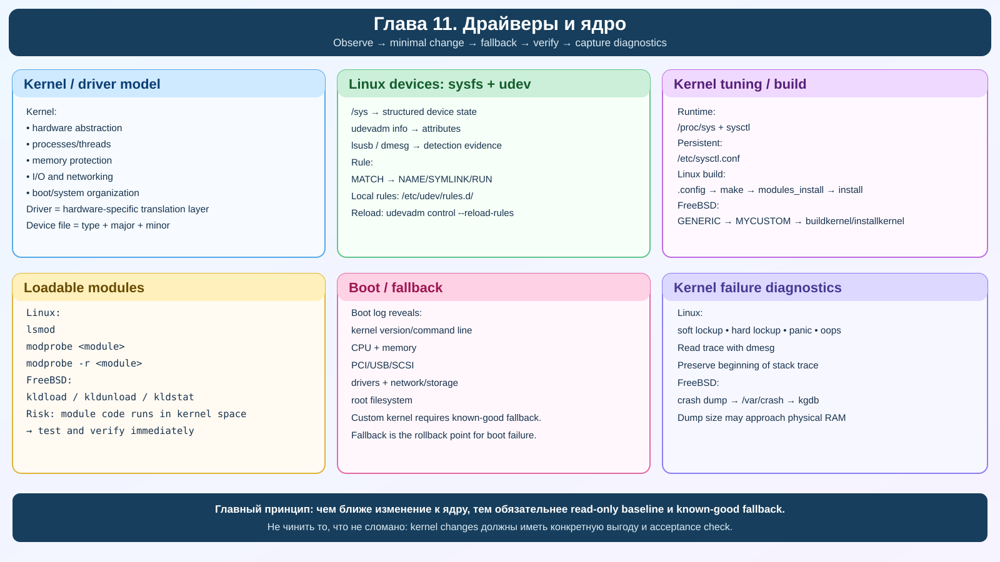

# Глава 11 — Драйверы и ядро

Практические заметки по главе 11 книги «UNIX и Linux: руководство системного администратора», 5-е издание.

## Идентификация

- Book ID: `unix-linux-system-administration-handbook-5e-ru-2020`
- Глава: 11
- Название: «Драйверы и ядро»
- Slug: `drivers-and-kernel`
- Source policy: `rag_only`
- External sources: запрещены
- Model memory: запрещена
- Прямой доступ к `source/book.pdf`: не использовался

## Provenance

- RAG chunks: `p0352:c01`–`p0383:c01`
- PDF pages: 352–383
- Printed pages: 351–382
- Boundary evidence:
  - `p0351:c01` — завершение главы 10;
  - `p0352:c01` — титульная страница главы 11;
  - `p0383:c01` — раздел 11.10 «Литература»;
  - `p0384:c01` — начало главы 12 «Печать».
- Provenance verified: yes

## Содержимое

- [commands.md](commands.md) — `uname`, `udevadm`, `lsusb`, `sysctl`, kernel build, module management и crash diagnostics.
- [cheatsheet.md](cheatsheet.md) — operational/conceptual quick reference по kernel/device lifecycle.
- [diagram.md](diagram.md) — Mermaid-карта от hardware/device discovery до modules, boot и panic analysis.
- [visual-cheatsheet.svg](visual-cheatsheet.svg) — компактный overview.
- [visual-cheatsheet-detailed.svg](visual-cheatsheet-detailed.svg) — итоговая visual summary всей главы.

## Карта главы

- 11.1 — роль ядра в системном администрировании: tuning, drivers, occasional custom builds;
- 11.2 — версии Linux/FreeBSD kernels и связь с distributions/releases;
- 11.3 — devices/drivers: device files, major/minor numbers, Linux `sysfs`/udev и FreeBSD `devfs`/devd;
- 11.4 — Linux kernel configuration: `/proc/sys`, `sysctl`, build configuration и kernel compilation;
- 11.5 — FreeBSD kernel configuration: runtime `sysctl`, GENERIC-based build, `buildkernel/installkernel`;
- 11.6 — loadable kernel modules: Linux `lsmod/modprobe`, FreeBSD `kldload/kldunload/kldstat`;
- 11.7 — boot: interpreting Linux and FreeBSD kernel initialization messages;
- 11.8 — alternate kernels in cloud environments and fallback boot configuration;
- 11.9 — kernel failures: lockups, panic, Linux oops, diagnostic capture and FreeBSD crash dumps;
- 11.10 — литература.

## Краткий анализ

Глава начинается с ядра как abstraction boundary. Kernel скрывает hardware details и одновременно управляет CPU scheduling, memory protection, I/O, device interfaces и system lifecycle. Для администратора это означает, что большая часть работы с ядром происходит не через исходный код, а через runtime parameters, device-driver management, boot diagnostics и controlled module/kernel changes.

Authors рекомендуют относиться к kernel changes консервативно. Даже небольшие изменения могут дестабилизировать систему, поэтому custom kernel или new driver должен иметь конкретную operational benefit. Для Linux отдельно говорится, что distribution kernel часто выбран с учетом compatibility/stability goals; без необходимости заменять его новым upstream kernel не рекомендуется.

Device driver представлен как translation layer между hardware-specific protocol и standardized kernel interface. Device files дают user space путь к driver, используя major/minor identity. Static device-file management исторически плохо масштабировался, поэтому современные systems переходят к event-driven management.

В Linux device model построена вокруг `sysfs`, `udevd` и rules. `sysfs` предоставляет structured view hardware/device state, а `udevadm` позволяет исследовать attributes, monitor events и reload rules. Udev rule состоит из match conditions и assignments/actions. Chapter показывает USB flash example, где kernel attributes используются для persistent naming и автоматического mount/unmount.

FreeBSD решает ту же проблему иначе: `devfs` отвечает за `/dev`, `devd` реагирует на device events, а `autofs` участвует в automount removable media. `/etc/devfs.conf` применяется к static devices, `/etc/devfs.rules` — к dynamic/removable rules, `/etc/devd.conf` — к higher-level event actions.

Runtime kernel tuning в Linux идет через pseudo-files under `/proc/sys` или через `sysctl`. Direct write действует только до reboot; persistent values размещаются в `/etc/sysctl.conf`. Chapter рассматривает parameters для file limits, panic behavior, forwarding, source validation, ICMP, SYN cookies и memory behavior и отдельно предупреждает: defaults различаются, а IPv4/IPv6 settings нужно рассматривать согласованно.

Если runtime tuning недостаточно, Linux kernel можно собрать из source tree. Configuration строится вокруг `.config`; chapter предпочитает `make xconfig`, `make gconfig` или `make menuconfig`, а для migration — `make oldconfig`. Build pipeline: config → clean → build → modules install → kernel install. Authors советуют сначала оценить выгоду и использовать distribution-specific build method, если он есть.

FreeBSD kernel build starts from GENERIC. Custom config создается как копия GENERIC, затем редактируется и передается в `make buildkernel KERNCONF=...` и `make installkernel KERNCONF=...`. Chapter советует сохранять GENERIC options, если нет уверенности, что они не нужны.

Loadable modules уменьшают необходимость rebuild kernel, но сами являются high-risk modifying action. Linux `modprobe` разрешает dependencies и выбирает module под running kernel; `lsmod` показывает active modules; `modprobe -r` удаляет module только если reference count это позволяет. FreeBSD использует `kldload`, `kldunload`, `kldstat`; persistent boot loading задается через `/boot/loader.conf`.

Boot messages — один из основных diagnostics surfaces. Kernel reports command line, CPU/memory discovery, buses, drivers, network/storage devices and root filesystem. Chapter показывает, как читать такие messages не как шум, а как ordered initialization trace.

Для cloud/custom kernels ключевой operational safeguard — fallback. Chapter показывает GRUB configuration, где custom kernel имеет fallback на known-good kernel. Это прямой rollback point для boot-level experiments.

Kernel failure разделен на soft lockup, hard lockup, panic и Linux oops. `dmesg` используется для получения context/trace. Chapter подчеркивает, что для разработчика модуля полезнее полный diagnostic context, особенно начало stack trace. FreeBSD panic debugging опирается на crash dump в `/var/crash` и `kgdb`; volume dump может быть сопоставим с physical RAM, поэтому capacity нужно планировать заранее.

## Основной принцип

Изменения на уровне kernel должны идти от observation к минимальному контролируемому вмешательству:

`identify hardware/state → inspect driver/device data → change runtime parameter or module only when justified → preserve fallback → verify boot/runtime behavior → capture diagnostics on failure`.

Чем ближе действие к kernel, тем важнее rollback path и known-good boot option.

## OCR note

RAG построен из embedded OCR. Нормализованы только очевидные tokens/commands: `uname -r`, `mknod`, `udevadm`, `lsusb`, `sysctl`, `make menuconfig`, `modprobe`, `lsmod`, `kldload`, `kldunload`, `kldstat`, `dmesg`, `kgdb`. Неоднозначные OCR-фрагменты option names/commands не восстанавливались внешними источниками.
