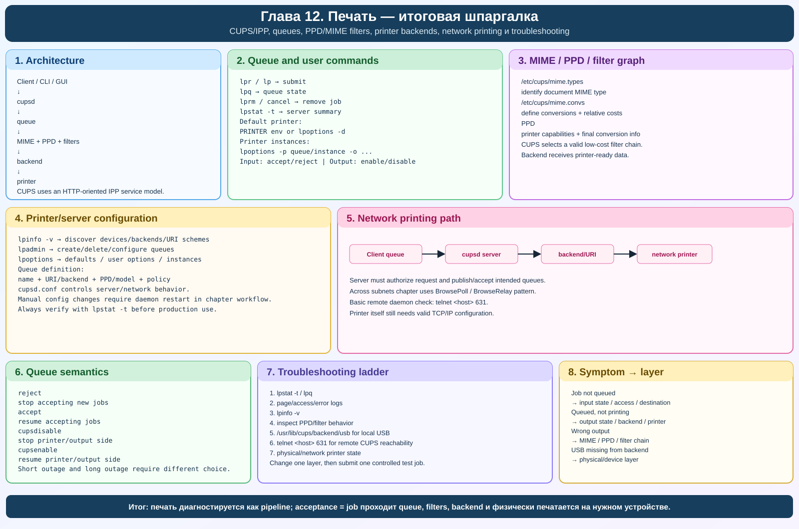
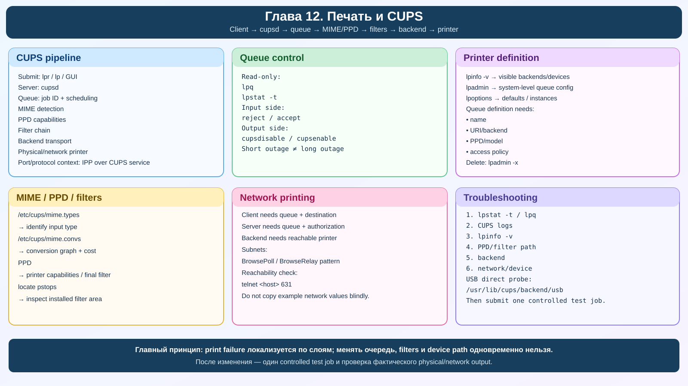

# Глава 12 — Печать

Практические заметки по главе 12 книги «UNIX и Linux: руководство системного администратора», 5-е издание.

## Идентификация

- Book ID: `unix-linux-system-administration-handbook-5e-ru-2020`
- Глава: 12
- Название: «Печать»
- Slug: `printing`
- Source policy: `rag_only`
- External sources: запрещены
- Model memory: запрещена
- Прямой доступ к `source/book.pdf`: не использовался

## Provenance

- RAG chunks: `p0384:c01`–`p0395:c01`
- PDF pages: 384–395
- Printed pages: 383–394
- Boundary evidence:
  - `p0383:c01` — завершение главы 11;
  - `p0384:c01` — титульная страница главы 12;
  - `p0395:c01` — раздел 12.4 «Литература»;
  - `p0396:c01` — переход к части II «Работа в сетях»;
  - `p0398:c01` — начало главы 13 «Сети TCP/IP»;
  - chunk `p0397:c01` в текущем RAG отсутствует.
- Provenance verified: yes

## Содержимое

- [commands.md](commands.md) — CUPS CLI, queue management, printer configuration и troubleshooting commands.
- [cheatsheet.md](cheatsheet.md) — operational/conceptual quick reference по CUPS pipeline.
- [diagram.md](diagram.md) — Mermaid-карта от submit до queue/filter/backend/printer и troubleshooting.
- [visual-cheatsheet.svg](visual-cheatsheet.svg) — компактный overview.
- [visual-cheatsheet-detailed.svg](visual-cheatsheet-detailed.svg) — итоговая visual summary всей главы.

## Карта главы

- 12.1 — CUPS: client/server model, IPP, queues, PPD, filters, backends, printer instances и network printing;
- 12.2 — управление CUPS server: `cupsd.conf`, network access, printer creation/removal, queue enable/disable/reject/accept и CLI utilities;
- 12.3 — troubleshooting: daemon restart, CUPS logs, direct backend test и network path analysis;
- 12.4 — литература.

## Краткий анализ

Глава рассматривает печать как pipeline, а не как одну команду. Пользовательское приложение или CLI отправляет job в `cupsd`; server помещает его в queue, определяет document type, сопоставляет PPD capabilities, выбирает filter chain, после чего backend передает результат конкретному printer через локальный device или network protocol.

CUPS описан как client/server system, где взаимодействие строится поверх HTTP/IPP. Shell utilities вроде `lpr`, `lpq`, `lprm`, `lpstat`, `lpadmin` и `lpoptions` являются frontends к одному CUPS service model. Это важно для troubleshooting: queue state, server configuration и physical/backend path нужно проверять отдельно.

PPD и MIME/filter subsystem определяют преобразование job. CUPS сначала определяет MIME type, затем по `mime.types`, `mime.convs` и printer PPD выбирает подходящую цепочку filters. Если преобразование может быть выполнено несколькими путями, chapter описывает выбор пути с меньшей суммарной cost. Последний этап — backend, который отправляет готовые данные printer и возвращает status server.

Queue management разделено на input и output sides. `reject/accept` управляют приемом новых jobs, а `cupsdisable/cupsenable` — самой печатью уже поставленных jobs. Chapter рекомендует различать short maintenance и long outage: для короткой паузы можно остановить output side, а для долгой недоступности разумнее прекратить прием новых jobs.

Printer configuration возможна через web UI и CLI. `lpadmin` применяется для system-level changes: создание/удаление printers/classes, URI/backend, PPD и access restrictions. `lpoptions` ориентирован на per-user/default options и printer instances. Chapter показывает отдельные instances одного physical printer с разными defaults, например 2-up printing.

Network printing добавляет еще один dependency chain: client must know queue and destination, server must authorize submission and route output to device. CUPS servers can advertise printers within a subnet; chapter также показывает relay/poll pattern между подсетями. Для сетевого printer важны IP configuration, queue URI и server access policy.

Главный troubleshooting principle — локализовать failure по этапам. Сначала проверить `lpstat -t`/queue state и daemon configuration, затем CUPS logs, далее backend/device visibility и network reachability. Для direct USB chapter показывает запуск CUPS USB backend; если physical printer disappears from backend output, problem находится ниже queue/filter layer.

CUPS ведет page, access и error logs. Chapter прямо рекомендует перезапускать daemon после manual `cupsd.conf` changes и использовать logs для анализа failed jobs, filter startup и backend execution.

## Основной принцип

Печатный job проходит последовательность:

`client → cupsd → queue → MIME/PPD decision → filter chain → backend → printer`.

Troubleshooting эффективен, когда каждый слой проверяется отдельно и state-changing action выполняется только после локализации failure.

## OCR note

RAG построен из embedded OCR. Нормализованы только очевидные CUPS tokens/commands: `lpr`, `lpq`, `lprm`, `lpstat`, `lpoptions`, `lpinfo`, `lpadmin`, `cupsdisable`, `cupsenable`, `accept`, `reject`, `cupsd`, `systemctl`. Исторические syntax/config examples сохраняются только там, где OCR позволяет восстановить форму однозначно. В source text встречаются отдельные подозрительные port/syntax fragments; они не исправлялись из внешних знаний.
