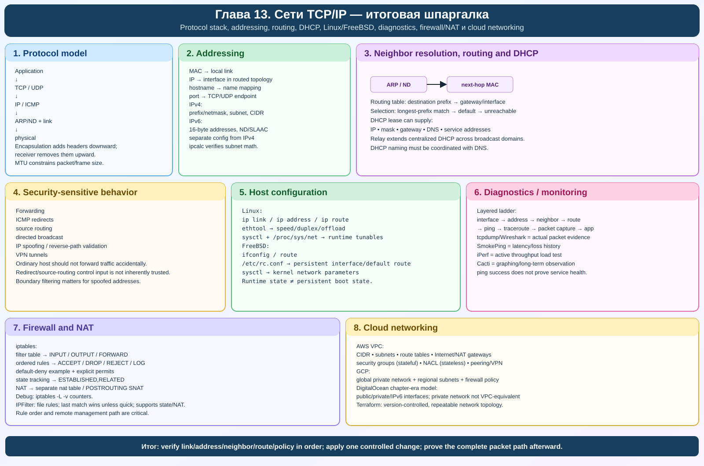
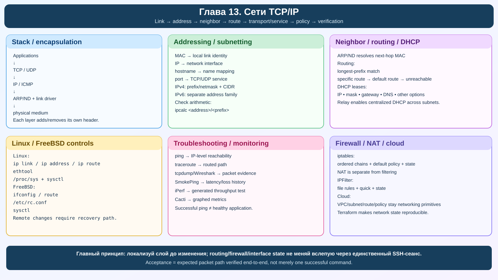

# Глава 13 — Сети TCP/IP

Практические заметки по главе 13 книги «UNIX и Linux: руководство системного администратора», 5-е издание.

## Идентификация

- Book ID: `unix-linux-system-administration-handbook-5e-ru-2020`
- Глава: 13
- Название: «Сети TCP/IP»
- Slug: `tcp-ip-networks`
- Source policy: `rag_only`
- External sources: запрещены
- Model memory: запрещена
- Прямой доступ к `source/book.pdf`: не использовался

## Provenance

- RAG chunks: `p0398:c01`–`p0476:c01`
- PDF pages: 398–476
- Printed pages: 397–475
- Boundary evidence:
  - `p0396:c01` — переход к части II «Работа в сетях»;
  - `p0397:c01` — отсутствует в текущем RAG;
  - `p0398:c01` — начало главы 13;
  - `p0475:c01`–`p0476:c01` — раздел 13.16 «Литература»;
  - `p0477:c01` — отсутствует в текущем RAG;
  - `p0478:c01` — начало главы 14 «Сетевые аппаратные средства».
- Provenance verified: yes

## Содержимое

- [commands.md](commands.md) — read-only и modifying network commands, подтвержденные RAG.
- [cheatsheet.md](cheatsheet.md) — operational/conceptual quick reference по TCP/IP, addressing, routing, Linux/FreeBSD networking, diagnostics, firewall/NAT и cloud networking.
- [diagram.md](diagram.md) — Mermaid workflow от packet/address model до configuration, troubleshooting и policy.
- [visual-cheatsheet.svg](visual-cheatsheet.svg) — компактный chapter overview.
- [visual-cheatsheet-detailed.svg](visual-cheatsheet-detailed.svg) — итоговая visual summary всей главы.

## Карта главы

- 13.1 — TCP/IP и Интернет: governance, IETF/RFC и network standards;
- 13.2 — основы TCP/IP: protocol family, layered model, IPv4/IPv6, encapsulation, Ethernet framing, MTU;
- 13.3 — packet addressing: MAC, IP, host names, ports, unicast/multicast/broadcast/anycast;
- 13.4 — IP addresses: IPv4 classes, subnetting, CIDR, private addressing/NAT, IPv6 addressing/autoconfiguration;
- 13.5 — routing: routing table, longest-prefix matching, default route, static/dynamic routing, ICMP redirects;
- 13.6 — ARP/Neighbor Discovery: IP↔link-layer resolution and cache behavior;
- 13.7 — DHCP: leases, relay, ISC implementation and address/configuration distribution;
- 13.8 — security concerns: forwarding, redirects, source routing, directed broadcast, spoofing, firewall/VPN context;
- 13.9 — network configuration fundamentals: naming, interfaces, IP, routes, DNS and boot persistence;
- 13.10 — Linux networking: NetworkManager, `ip`, distro configuration, `ethtool`, `/proc/sys`/sysctl and security tunables;
- 13.11 — FreeBSD networking: `ifconfig`, `rc.conf`, DHCP, media options and `sysctl`;
- 13.12 — troubleshooting: `ping`, `traceroute`, packet analyzers, `tcpdump`/Wireshark;
- 13.13 — monitoring: SmokePing, iPerf and Cacti;
- 13.14 — firewalls/NAT: Netfilter/`iptables`, stateful filtering, NAT and IPFilter;
- 13.15 — cloud networking: AWS VPC, GCP and DigitalOcean examples, including Terraform;
- 13.16 — литература.

## Краткий анализ

Глава строит TCP/IP как layered system, а не как набор несвязанных команд. Application traffic спускается через transport к IP, затем к link layer и physical medium; на каждом уровне добавляется собственный header. На принимающей стороне инкапсуляция разворачивается в обратном порядке. Для администратора это дает диагностическую модель: failure нужно локализовать на конкретном уровне — name/port, route/IP, neighbor/MAC, interface/link или physical path.

Базовый protocol set главы включает IP, ICMP, ARP/Neighbor Discovery, UDP и TCP. IP отвечает за delivery between interfaces, ICMP — за control/error signaling, ARP/ND — за сопоставление IP и link-layer address, UDP — за datagram delivery без надежного session semantics, TCP — за reliable duplex stream с flow/error control.

Глава отдельно подчеркивает различие между MAC, IP, hostname и port. MAC действует на link layer; IP идентифицирует network interface в IP context; hostname является human-friendly mapping; TCP/UDP port идентифицирует service/channel на host interface. Эти пространства не взаимозаменяемы.

IPv4 subnetting и CIDR занимают центральное место: prefix length определяет network/host boundary, а longest-prefix matching определяет выбор route. `ipcalc` показан как практический инструмент проверки network/broadcast/host ranges. IPv6 рассматривается как separate address family with larger address space, multicast-oriented mechanisms and autoconfiguration, but operationally chapter требует понимать coexistence IPv4/IPv6.

Routing model: local kernel table содержит destination/prefix → next hop/interface. Для каждого packet выбирается наиболее конкретный matching route; если его нет, используется default route; если нет и его — packet не доставляется. Static routing удобно для простой стабильной topology, dynamic routing — для более сложной.

ARP в IPv4 и Neighbor Discovery в IPv6 разрешают next-hop IP в link-layer address только для directly reachable network. Linux использует `ip neigh`, FreeBSD — `arp`/ `ndp`. Неверные cache entries chapter связывает как с configuration conflicts, так и с возможным spoofing.

DHCP представлен как lease-based distribution of IP configuration. Он может выдавать address, mask, default gateway, DNS и другие parameters; relay позволяет централизовать DHCP server за границами broadcast domain. Chapter также отмечает необходимость продумать interaction DHCP с DNS.

Network security section связывает forwarding, ICMP redirects, source routing, directed broadcasts и IP spoofing с attack surface. Для обычного host forwarding лучше отключать, redirects/source-routing не считать trusted control path, а spoofed traffic фильтровать на boundary. VPN рассматривается как encrypted tunneling over untrusted network, но chapter предупреждает не смешивать VPN marketing/interface behavior с полноценным routed IP tunnel.

Linux configuration разделяет `ip link`, `ip address` и `ip route`. Persistence зависит от distribution config; `ethtool` управляет link characteristics. Kernel networking tunables доступны через `/proc/sys/net` и `sysctl`, но changes, сделанные runtime-only, не переживают reboot. Глава отдельно предупреждает о риске удаленно изменить interface/routing и потерять доступ.

FreeBSD использует `ifconfig`, `route`, `/etc/rc.conf` и `sysctl`; device-specific media settings также идут через `ifconfig`. После persistent changes chapter показывает restart network/routing services.

Troubleshooting section строит ladder: сначала `ping` для basic reachability, затем `traceroute` для path, затем packet capture. Успешный ping доказывает только IP-level reachability и не гарантирует health application service. `tcpdump` и Wireshark позволяют видеть actual packets and headers.

Monitoring section разводит point-in-time troubleshooting и continuous observation. SmokePing tracks latency/loss over time, iPerf measures throughput using generated traffic, Cacti graphs metrics. iPerf therefore workload-generating and должен применяться осознанно.

Firewall/NAT section показывает ordered-rule processing. Для `iptables` chapter использует default-deny policy, explicit allow rules, logging, state tracking and NAT. Rule order changes semantics. `iptables -L -v` используется для counters/debugging. IPFilter использует file-based rule set, last-match semantics unless `quick` stops evaluation, and supports state tracking/NAT.

Cloud networking переносит те же concepts в programmable environment: VPC/subnet/route/security boundary remain networking constructs, only provisioned by provider APIs/IaC. Terraform example reinforces that network state should be reproducible code rather than one-off console changes.

## Основной принцип

Главная operational модель главы:

`link/interface → address/prefix → neighbor resolution → route → transport/service → policy/filter → end-to-end verification`.

Troubleshooting и changes должны идти в этом порядке: сначала read-only state, затем минимальное изменение одного слоя, затем acceptance check.

## OCR note

RAG построен из embedded OCR. Нормализованы только однозначные tokens/commands: `ip`, `ifconfig`, `route`, `netstat`, `ipcalc`, `ip neigh`, `ethtool`, `sysctl`, `ping`, `traceroute`, `tcpdump`, `iperf`, `iptables`, `ipf`, `terraform`. Там, где OCR искажает package/command spelling или example addresses, canonical artifacts используют только однозначно восстанавливаемые forms.
