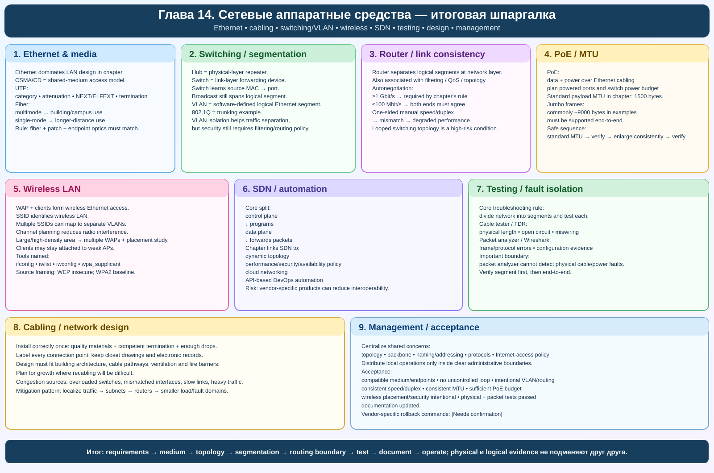
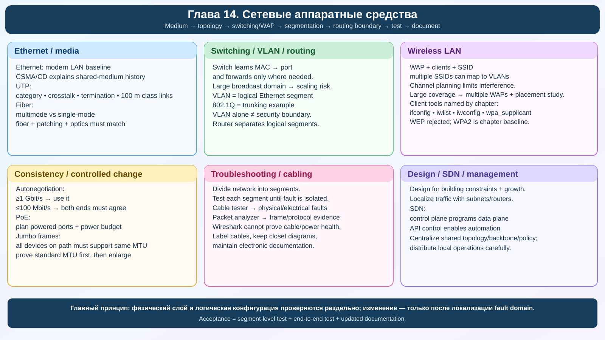

# Глава 14 — Сетевые аппаратные средства

Практические заметки по главе 14 книги «UNIX и Linux: руководство системного администратора», 5-е издание.

## Идентификация

- Book ID: `unix-linux-system-administration-handbook-5e-ru-2020`
- Глава: 14
- Название: «Сетевые аппаратные средства»
- Slug: `network-hardware`
- Source policy: `rag_only`
- External sources: запрещены
- Model memory: запрещена
- Прямой доступ к `source/book.pdf`: не использовался
- Unknown data policy: не восстанавливать отсутствующее содержимое; использовать `[Needs confirmation]`

## Provenance

- Available RAG scope: `p0478:c01`–`p0498:c01`
- Available PDF pages: 478–498
- Available printed pages: 477–497
- Boundary evidence:
  - `p0478:c01` — начало главы 14 «Сетевые аппаратные средства»;
  - `p0498:c01` — раздел 14.9 «Литература»;
  - `p0499:c01` — отсутствует в текущем RAG;
  - `p0500:c01` — начало главы 15 «IP-маршрутизация».
- Provenance verified: yes, для доступного диапазона RAG.
- Completeness caveat: terminal printed page 498 / PDF page 499 отсутствует в RAG. Ее содержимое не реконструируется. Поэтому финальная часть раздела 14.9 может быть неполной.

## Содержимое

- [commands.md](commands.md) — команды беспроводной клиентской конфигурации, прямо перечисленные в RAG главы.
- [cheatsheet.md](cheatsheet.md) — Ethernet, UTP/fiber, switches/VLANs/routers, autonegotiation, PoE, jumbo frames, wireless, SDN, testing, cabling, design и management.
- [diagram.md](diagram.md) — Mermaid-поток проектирования, развертывания, проверки и сопровождения физической/логической сети.
- [visual-cheatsheet.svg](visual-cheatsheet.svg) — компактный chapter overview.
- [visual-cheatsheet-detailed.svg](visual-cheatsheet-detailed.svg) — итоговая visual summary всей доступной главы.

## Карта главы

- 14.1 — Ethernet: принцип работы, топология, UTP, fiber, hubs, switches, VLAN, routers, autonegotiation, PoE, jumbo frames;
- 14.2 — wireless LAN: 802.11 family, client access, WAP topology, SSID, channels, roaming, security;
- 14.3 — SDN: separation of control plane and data plane, API-driven network control;
- 14.4 — testing/debugging: segmentation of fault domain, cable testers, packet analyzers, Wireshark;
- 14.5 — cabling: Cat 6a, office drops, TIA/EIA cabling/documentation practices;
- 14.6 — network design: media, topology, building constraints, growth, congestion, documentation;
- 14.7 — network management: centralized vs distributed responsibility and control;
- 14.8 — recommended vendors from the chapter's publication context;
- 14.9 — literature; terminal page may be incomplete because `p0499:c01` is absent.

## Краткий анализ

Глава переводит сетевое администрирование от уровня протоколов главы 13 к физической и канальной инфраструктуре. Главная мысль: виртуализированные и SDN-сети по-прежнему используют терминологию и архитектурные принципы физических сетей, поэтому системный администратор должен понимать medium, topology, switching, routing boundaries и physical installation.

Ethernet представлен как доминирующая LAN technology. Исторический CSMA/CD объясняет shared-medium behavior, но современная switched Ethernet уменьшает collision domain до отдельных link segments. При этом broadcast domain остается логической сущностью: широковещательный traffic должен распространяться по портам одного logical segment, а слишком крупный сегмент может страдать от broadcast load.

UTP — основной copper medium в главе. Категории кабеля связываются с поддерживаемой скоростью, частотой, crosstalk и installation constraints. Для четырехпарного UTP chapter требует придерживаться consistent termination standard. Fiber рассматривается как medium для ситуаций, где нужны distance, bandwidth или resistance to electrical interference; multimode и single-mode не следует смешивать без проверки совместимости fiber, patching и endpoint optics.

Hubs работают на physical layer и только повторяют frames; chapter считает switches стандартным способом соединения Ethernet devices. Switch learns source MAC locations and forwards traffic only where needed. Loop topology без соответствующего control mechanism опасна. Для крупных switched domains broadcast traffic становится причиной масштабируемости и должен локализоваться routing/segmentation boundaries.

VLAN — software-defined grouping of switch ports into logical Ethernet segments. VLAN повышает traffic isolation and manageability, но chapter отдельно предупреждает: сама VLAN не является достаточной security boundary; inter-VLAN traffic должен фильтроваться. 802.1Q trunking позволяет одной logical VLAN проходить через несколько switches.

Routers operate at network layer and select paths using network-layer information. Помимо forwarding, chapter associates them with packet filtering, traffic prioritization and topology functions. Specialized routers are presented as more predictable network infrastructure than general-purpose hosts when high reliability/performance are required.

Autonegotiation is treated as an operational consistency problem. For 1 Gbit/s and faster links chapter requires autonegotiation. For 100 Mbit/s and below, both ends must use consistent negotiation/manual settings. One-sided manual speed/duplex configuration can create mismatch and severe performance degradation.

PoE combines data and power over Ethernet cabling. Operational consequence: port planning and power budgeting must include PoE devices and switch capacity.

Jumbo frames increase Ethernet MTU above the standard 1500-byte payload. The chapter emphasizes homogeneity: every device in the subnet/path must support the selected size. It recommends validating the network with standard MTU first and enabling jumbo frames later. Therefore MTU change is treated here as a controlled change, not a default optimization.

Wireless LAN extends Ethernet semantics through WAPs and clients. SSID identifies a wireless LAN, multiple SSIDs can map to separate VLANs, channel planning mitigates interference, and large/high-density deployments require deliberate placement and management. The chapter treats WEP as unsuitable and WPA2 as the required security baseline in its publication context.

For Linux/FreeBSD wireless clients chapter explicitly lists `ifconfig`, `iwlist`, `iwconfig`, and `wpa_supplicant`. The chapter does not provide exact command lines for these tools, so canonical artifacts do not invent options or invocation syntax.

SDN separates control plane from data plane and exposes topology/network behavior through programmable control. The chapter links this model to cloud infrastructure and DevOps-style automation, while warning that vendor-specific SDN products may diverge from the original interoperability goal.

The troubleshooting principle is physical segmentation: divide the path into segments and test them until the fault domain is isolated. Cable testers detect electrical/termination problems; packet analyzers work at link/protocol level and cannot diagnose physical cable damage or power faults. Wireshark is explicitly named as the packet-analysis tool.

Cabling is treated as long-lived infrastructure. The chapter stresses quality materials, competent installation, sufficient office drops, labeling, documentation and building/fire-safety constraints. Physical rework costs dominate material cost, so overprovisioning hard-to-reach cabling is cheaper than repeated retrofits.

Network design should account for physical building constraints, future expansion, traffic localization and congestion. Subnets and routers can localize traffic and isolate experimental or high-load areas. Documentation quality directly affects maintainability.

Network management should centralize architecture-wide policy and shared infrastructure while leaving appropriate local operations distributed. The chapter identifies topology, backbone, naming/addressing, supported protocols and Internet-access rules as examples of centrally coordinated domains.

## Основной принцип

Главная operational model главы:

`requirements → medium → physical topology → logical segmentation → switching/routing boundary → installation → testing → documentation → centralized policy + local operation`.

Для troubleshooting:

`physical link/cable → switch/WAP segment → logical VLAN/broadcast domain → router boundary → packet analysis`.

Для change:

`baseline → one controlled change → segment-level verification → end-to-end verification → documentation`.

## Риски

- looped switching topology;
- broadcast-domain growth;
- VLAN treated as a security control without filtering;
- speed/duplex mismatch from inconsistent autonegotiation;
- enabling jumbo frames only on part of the path;
- insufficient PoE power/port planning;
- weak wireless security;
- poor WAP placement/channel planning;
- mixing incompatible fiber types/components;
- unlabelled or undocumented cabling;
- remote logical changes made without understanding physical topology;
- treating packet analysis as proof that the physical layer is healthy.

## OCR note

RAG построен из embedded OCR. Нормализованы только однозначные terms/tokens: Ethernet, CSMA/CD, UTP, VLAN, 802.1Q, PoE, MTU, WAP, SSID, MIMO, WPA/WPA2, SDN, `ifconfig`, `iwlist`, `iwconfig`, `wpa_supplicant`, Wireshark. Отсутствующий `p0499:c01` не восстанавливается.
