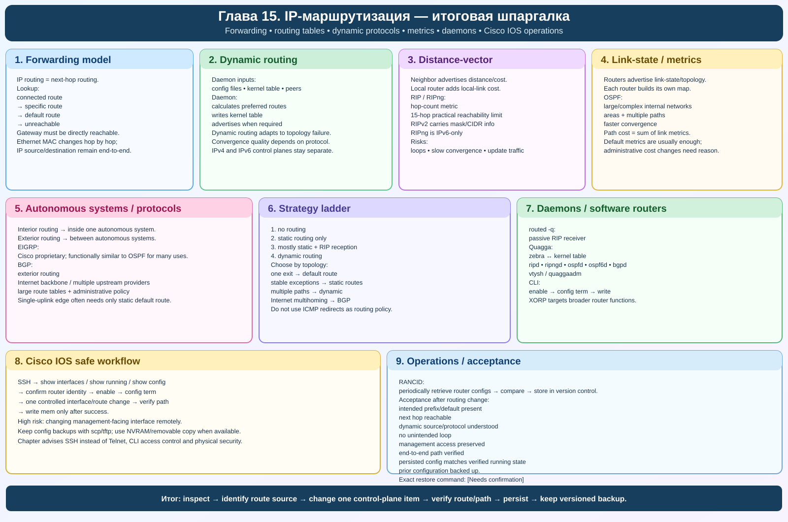
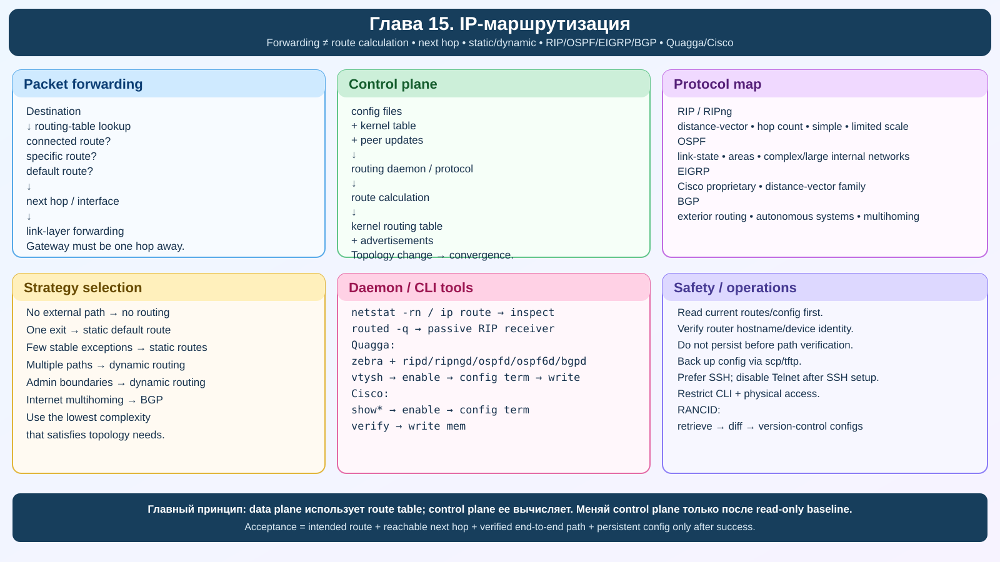

# Глава 15 — IP-маршрутизация

Практические заметки по главе 15 книги «UNIX и Linux: руководство системного администратора», 5-е издание.

## Идентификация

- Book ID: `unix-linux-system-administration-handbook-5e-ru-2020`
- Глава: 15
- Название: «IP-маршрутизация»
- Slug: `ip-routing`
- Source policy: `rag_only`
- External sources: запрещены
- Model memory: запрещена
- Прямой доступ к `source/book.pdf`: не использовался

## Provenance

- Available RAG scope: `p0500:c01`–`p0516:c01`
- Available PDF pages: 500–516
- Available printed pages: 499–515
- Boundary evidence:
  - `p0498:c01` — конец доступной части главы 14;
  - `p0499:c01` — отсутствует в RAG;
  - `p0500:c01` — начало главы 15;
  - `p0516:c01` — раздел 15.8 «Литература»;
  - `p0517:c01` — отсутствует в RAG;
  - `p0518:c01` — начало главы 16.
- Provenance verified: yes, для доступного диапазона.
- Completeness caveat: missing PDF 517 / printed 516 may contain only the tail of 15.8. Sections 15.1–15.7 are present in available RAG; absent content is not reconstructed.

## Артефакты

- [commands.md](commands.md)
- [cheatsheet.md](cheatsheet.md)
- [diagram.md](diagram.md)
- [visual-cheatsheet.svg](visual-cheatsheet.svg)
- [visual-cheatsheet-detailed.svg](visual-cheatsheet-detailed.svg)

## Карта главы

- 15.1 — packet forwarding, route tables, next hop, default route, IPv4/IPv6 examples;
- 15.2 — routing daemons; distance-vector vs link-state; cost metrics; internal/external routing;
- 15.3 — RIP/RIPng, OSPF, EIGRP, BGP;
- 15.4 — multicast coordination;
- 15.5 — routing-strategy selection;
- 15.6 — `routed`, Quagga/Zebra, XORP;
- 15.7 — Cisco IOS operation/configuration;
- 15.8 — literature/RFC list; tail may be incomplete because `p0517:c01` is missing.

## Краткий анализ

Главное различие главы: packet forwarding и route computation — разные процессы. Forwarding использует уже существующую routing table для выбора следующего hop. Routing protocols/daemons вычисляют и поддерживают эту table.

IP routing описан как next-hop routing: узлу достаточно определить следующий router/host, а не весь путь до конечного destination. Directly connected network обслуживается напрямую; затем рассматривается более конкретный route; если его нет — default route; без подходящего route destination недостижим. Gateway должен находиться на directly connected network.

При forwarding Ethernet destination меняется от hop к hop, а IP source/destination продолжают представлять end-to-end endpoints. Поэтому router принимает frame на свой MAC, но IP destination остается адресом конечного host.

Статическая маршрутизация подходит для простых и стабильных topology. Когда manual route maintenance перестает масштабироваться, routing daemon объединяет configuration files, kernel routing table и peer updates, вычисляет preferred routes, записывает их в kernel и при необходимости рекламирует соседям.

Distance-vector protocols распространяют distance/cost estimates. Их слабые места — loops, slow convergence и update traffic. RIP использует hop count, RIPv2 добавляет mask/CIDR information, RIPng работает для IPv6.

Link-state protocols распространяют topology information, после чего каждый router строит собственную map и вычисляет routes. Это повышает convergence quality, но требует больше CPU/memory и более сложной configuration. Главный representative — OSPF.

Routing metric — numeric cost пути; total path cost складывается из link metrics. Chapter считает standard metrics достаточными в большинстве случаев и допускает искусственное повышение стоимости link только по понятной administrative причине.

Autonomous system отделяет internal routing от inter-domain routing. RIP/OSPF/EIGRP относятся к internal-routing context; BGP — к routing between autonomous systems и Internet multihoming.

Раздел 15.5 предлагает поднимать complexity только при необходимости: no routing → static only → mostly static with RIP reception → dynamic routing. Single-exit clients usually need one static default route; multiple alternative paths or administrative boundaries justify dynamic routing; multiple Internet upstreams lead to BGP.

Для UNIX/Linux chapter считает software routing useful for test/auxiliary networks but prefers dedicated routers for production. `routed -q` is passive RIP reception. Quagga uses `zebra` as coordination point between kernel route table and protocol daemons `ripd`, `ripngd`, `ospfd`, `ospf6d`, `bgpd`.

Cisco IOS workflow: inspect first with `show` commands, confirm device identity, then `enable`, `config term`, make one controlled change, verify live routing/connectivity, and only then persist with `write mem`. Chapter explicitly recommends configuration backup via `scp` or `tftp`, SSH instead of Telnet, CLI access controls, physical security and versioned config tracking via RANCID.

## Основной принцип

Data plane:

`destination → route lookup → connected/specific/default route → next hop → link-layer forwarding`

Control plane:

`config + kernel table + peer updates → routing daemon/protocol → route calculation → kernel table → advertisement`

Safe change:

`inspect → identify route source → one controlled change → verify route table → verify end-to-end path → persist only after success → keep backup`

## Риски

- confusing forwarding with route calculation;
- depending on ICMP redirects as routing policy;
- route loops / slow convergence;
- RIP used beyond practical scale;
- wrong metric producing undesirable path;
- IPv4/IPv6 assumptions mixed together;
- dynamic routing deployed where a static default is enough;
- wrong-router configuration;
- remote management-interface change without recovery path;
- unverified running config persisted;
- missing configuration backup/version history.

## OCR note

OCR distortions were normalized only where context made the intended token unambiguous, including IP/IPv4/IPv6, Cisco, enable, write mem and protocol names. Missing `p0517:c01` is not reconstructed.
