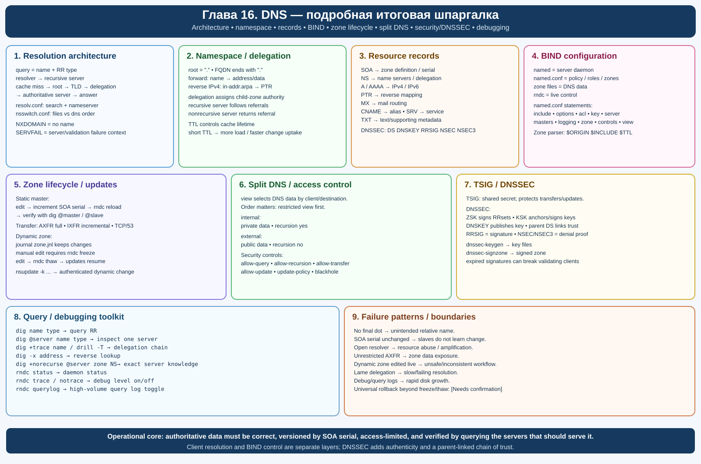
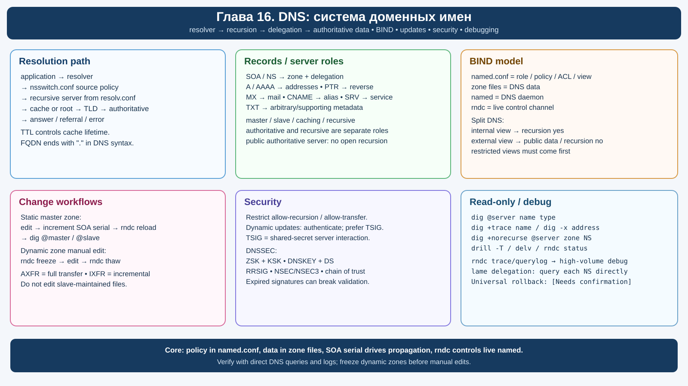

# Глава 16 — DNS: система доменных имен

Практические заметки по главе 16 книги «UNIX и Linux: руководство системного администратора», 5-е издание.

## Идентификация

- Book ID: unix-linux-system-administration-handbook-5e-ru-2020
- Глава: 16
- Название: «DNS: система доменных имен»
- Slug: dns
- Source policy: rag_only
- External sources: запрещены
- Model memory: запрещена
- Прямой доступ к source/book.pdf: не использовался
- Unknown data policy: отсутствующие данные помечаются [Needs confirmation]; пропущенные RAG-чанки не реконструируются

## Provenance

- Available RAG scope: p0518:c01–p0594:c01
- Available PDF pages: 518–594
- Available printed pages: 517–593
- Boundary evidence:
  - p0517:c01 — отсутствует в RAG; по оглавлению это хвост главы 15;
  - p0518:c01 — начало главы 16;
  - p0594:c01 — раздел 16.12 «Литература»;
  - p0595:c01 — отсутствует в RAG; по оглавлению соответствует printed page 594 и может содержать хвост 16.12;
  - p0596:c01 — начало главы 17.
- Provenance verified: yes, для доступного диапазона.
- Completeness caveat: missing p0595:c01 не реконструируется; основные разделы 16.1–16.12 присутствуют в доступном RAG.

## Артефакты

- [commands.md](commands.md)
- [cheatsheet.md](cheatsheet.md)
- [diagram.md](diagram.md)
- [visual-cheatsheet.svg](visual-cheatsheet.svg)
- [visual-cheatsheet-detailed.svg](visual-cheatsheet-detailed.svg)

## Карта главы

- 16.1 — архитектура DNS, запросы и ответы;
- 16.2 — DNS-клиент: /etc/resolv.conf и /etc/nsswitch.conf;
- 16.3 — пространство имен DNS, FQDN, прямое/обратное преобразование;
- 16.4 — серверные роли, delegation, recursion, caching, TTL, query tools;
- 16.5 — файлы зон и resource records: SOA, NS, A, AAAA, PTR, MX, CNAME, SRV, TXT и DNSSEC records;
- 16.6 — BIND 9: named, named.conf, rndc, zones, ACL, logging и controls;
- 16.7 — split DNS через view;
- 16.8 — примеры BIND-конфигурации;
- 16.9 — обновление зон, AXFR/IXFR, dynamic updates, nsupdate;
- 16.10 — безопасность DNS: ACL, open resolvers, chroot/unprivileged mode, TSIG и DNSSEC;
- 16.11 — debugging BIND: logging, debug levels, rndc, lame delegation;
- 16.12 — литература; хвост может быть неполным из-за отсутствующего p0595:c01.

## Краткий анализ

DNS в главе представлен как распределенная иерархическая база данных. Клиентский resolver формирует запрос имени и типа записи, а сервер возвращает resource records, ошибку или referral, ведущий дальше по иерархии.

Клиентская часть начинается с /etc/resolv.conf: там задаются recursive name servers и search domains. /etc/nsswitch.conf определяет, когда использовать DNS относительно других источников, например /etc/hosts.

DNS namespace — дерево с корнем «.». Прямое преобразование связывает имена с адресами и другими данными, обратное преобразование связывает адрес с именем; для IPv4 используется обратная ветвь in-addr.arpa. Внутри DNS конечная точка отличает FQDN от относительного имени, и пропущенная точка в zone file может изменить смысл имени.

Серверные роли разделяются по источнику и способу обработки данных: master/slave/stub, authoritative/caching, recursive/nonrecursive, forwarder. Делегирование передает ответственность дочерним зонам; caching уменьшает количество повторных запросов, а TTL ограничивает срок использования кешированной записи.

Основной диагностический инструмент главы — dig; также рассматриваются nslookup, host, drill и delv. dig +trace и drill -T показывают путь от корня вниз; параметр @server позволяет спросить конкретный сервер; -x выполняет reverse lookup. Статусы NXDOMAIN и SERVFAIL используются при интерпретации ошибок.

Файл зоны содержит parser directives ($ORIGIN, $INCLUDE, $TTL, а в BIND также $GENERATE) и resource records. Ключевые записи главы: SOA и NS для зоны; A/AAAA для адресов; PTR для reverse mapping; MX для mail routing; CNAME для aliases; SRV для service location; TXT для произвольных данных и ряда mail-related механизмов; DS/DNSKEY/RRSIG/NSEC/NSEC3 для DNSSEC.

BIND 9 разделяет данные и управление: named.conf задает роли, zones, global options, ACL, keys, logging, controls и views; zone files содержат DNS data. rndc управляет работающим named.

Изменение master zone требует изменить данные и увеличить SOA serial, после чего BIND принимает изменения через rndc reload. Master/slave synchronization использует AXFR или IXFR. Для dynamically updated zone ручное редактирование нельзя выполнять напрямую: сначала rndc freeze, затем редактирование, затем rndc thaw.

Split DNS реализуется через view: internal и external clients могут получать разные zone data. Порядок views важен: более ограниченные представления должны проверяться раньше общих.

Security layer главы строится вокруг ограничения recursion, query/transfer/update access, защиты dynamic updates и zone transfers. Internet-facing authoritative servers не должны быть open recursive resolvers. Для межсерверной аутентификации и dynamic updates рассматривается TSIG. DNSSEC добавляет подписи и chain of trust с ZSK/KSK, DNSKEY/DS/RRSIG/NSEC/NSEC3; dnssec-keygen создает ключи, dnssec-signzone подписывает zone.

Debugging BIND опирается на logging categories/channels, dig/DNSSEC query tools и rndc. rndc trace повышает debug level, rndc notrace отключает debugging, rndc querylog переключает query logging. Глава отдельно разбирает lame delegation и проверку конкретных authoritative servers.

## Основной принцип

~~~text
client lookup
→ resolver policy (nsswitch.conf)
→ recursive server (resolv.conf)
→ cache or delegation chain
→ authoritative answer
→ TTL-governed cache
~~~

Для authoritative DNS:

~~~text
named.conf = server policy / roles / access
zone files = DNS data
SOA serial = version signal for zone propagation
rndc = live control of named
~~~

Для изменения зоны:

~~~text
static master zone:
edit data → increment SOA serial → rndc reload → query specific servers with dig

dynamic zone:
rndc freeze → edit → rndc thaw
~~~

## Риски

- open recursive resolver доступен внешним клиентам;
- unrestricted zone transfer раскрывает данные зоны;
- dynamic updates без криптографической аутентификации;
- ручное редактирование dynamic zone без rndc freeze;
- изменение zone data без увеличения SOA serial;
- забытое обновление reverse zone;
- ошибка с конечной точкой в FQDN;
- слишком короткий TTL увеличивает DNS load; слишком длинный замедляет распространение изменений;
- неправильный порядок BIND view;
- просроченные DNSSEC signatures/keys;
- секрет TSIG/DNSSEC хранится небезопасно;
- debug/query logging может быстро генерировать большой объем данных;
- lame delegation снижает эффективность и может сделать домен недоступным.

## Rollback / acceptance boundary

Для dynamic zone source-supported pair rndc freeze / rndc thaw документирует возврат к приему dynamic updates после ручного редактирования.

Для обычного изменения zone file, split-DNS policy, ACL/TSIG/DNSSEC и других BIND changes глава не задает универсальную rollback-команду: [Needs confirmation].

Source-supported verification включает:
- запрос конкретного сервера через dig @server ...;
- сравнение local/remote answers после изменения;
- проверку delegation chain через dig +trace или последовательные authoritative queries;
- проверку DNSSEC chain через drill/delv;
- просмотр BIND logging и rndc status.
