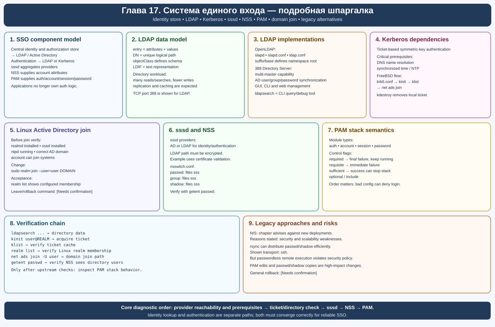
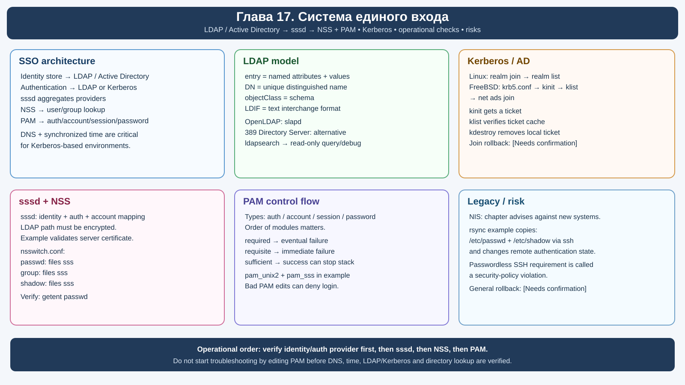

# Глава 17 — Система единого входа

Практические заметки по главе 17 книги «UNIX и Linux: руководство системного администратора», 5-е издание.

## Идентификация

- Book ID: unix-linux-system-administration-handbook-5e-ru-2020
- Глава: 17
- Название: «Система единого входа»
- Slug: single-sign-on
- Source policy: rag_only
- External sources: запрещены
- Model memory: запрещена
- Прямой доступ к source/book.pdf: не использовался
- Unknown data policy: отсутствующие данные помечаются [Needs confirmation]; пробелы источника не достраиваются

## Provenance

- RAG scope: p0596:c01–p0613:c01
- PDF pages: 596–613
- Printed pages: 595–612
- Boundary evidence:
  - p0594:c01 — глава 16;
  - p0595:c01 — отсутствует в RAG;
  - p0596:c01 — начало главы 17;
  - p0613:c01 — продолжение раздела 17.5 «Литература»;
  - p0614:c01 — начало главы 18.
- Provenance verified: yes.
- Внутри диапазона главы 17 пропусков RAG не обнаружено.

## Артефакты

- [commands.md](commands.md)
- [cheatsheet.md](cheatsheet.md)
- [diagram.md](diagram.md)
- [visual-cheatsheet.svg](visual-cheatsheet.svg)
- [visual-cheatsheet-detailed.svg](visual-cheatsheet-detailed.svg)

## Карта главы

- 17.1 — компоненты SSO;
- 17.2 — LDAP, LDIF, OpenLDAP, 389 Directory Server, ldapsearch и миграция учетных данных;
- 17.3 — использование каталогов при входе: Kerberos, Active Directory, realmd, sssd, nsswitch.conf и PAM;
- 17.4 — альтернативы: NIS и rsync;
- 17.5 — литература.

## Краткий анализ

SSO в главе разделяется на несколько функций, которые нельзя смешивать: централизованное хранение identity/authorization data, управление этими данными, аутентификация, подключение приложений к механизму аутентификации и системный поиск атрибутов пользователей и групп.

LDAP рассматривается прежде всего как служба каталогов: записи состоят из атрибутов и значений, передаются в формате LDIF и организуются логической иерархией distinguished name (DN). Object classes задают допустимую схему атрибутов.

В качестве LDAP-серверов рассматриваются OpenLDAP и 389 Directory Server. OpenLDAP использует демон slapd; серверная конфигурация определяет базовое DN, административный DN, пароль администратора и каталог базы. Клиентская конфигурация задает URI сервера и BASE для запросов.

Для чтения каталога глава использует ldapsearch. В запросе задаются сервер/порт, bind identity, baseDN и LDAP filter. Результат выводится как LDIF. LDAP также рассматривается как целевое хранилище для миграции традиционных passwd/group данных.

Интеграция каталога с системным login строится как цепочка:
directory/authentication provider → sssd → NSS/PAM → системные приложения.

Для Linux + Active Directory пакет realmd упрощает присоединение к домену и конфигурирование Kerberos/sssd. До join источник требует проверить наличие realmd и sssd, работу ntpd, правильность имени AD-домена и наличие учетной записи с правом присоединять системы.

Для FreeBSD Kerberos настраивается вручную через /etc/krb5.conf. Перед тестом требуется корректный FQDN в /etc/hosts и работающий NTP. kinit получает Kerberos ticket, klist показывает ticket cache, kdestroy аннулирует ticket. После этого система присоединяется к AD через net ads join.

DNS и NTP являются критическими зависимостями Kerberos: DNS участвует в разрешении имен, а tickets имеют timestamps и ограниченный срок действия.

sssd агрегирует identity lookup, authorization/account mapping и authentication. В LDAP-варианте глава требует защищенный канал: незашифрованная LDAP-аутентификация не разрешается; пример конфигурации использует TLS и проверку сертификата сервера.

NSS определяет, откуда libc-подобные lookup-функции получают passwd/group/shadow data. В примере сначала используются локальные files, затем sss. Проверка выполняется командой getent passwd.

PAM отделяет политику аутентификации от приложений. PAM stack состоит из модулей типов auth, account, session и password. Порядок модулей имеет значение, а control flags include, optional, required, requisite и sufficient определяют поток выполнения и итоговый статус стека.

Пример PAM показывает локальную аутентификацию через pam_unix2 и централизованную через pam_sss. Дополнительные модули проверяют nologin/securetty, ограничения ресурсов, качество пароля, loginuid и другие session actions.

В качестве legacy alternatives глава упоминает NIS и файловую репликацию через rsync. NIS прямо не рекомендуется для новых систем из-за ограничений безопасности и масштабируемости. rsync может распространять /etc/passwd и /etc/shadow, но показанная схема требует passwordless SSH execution и прямо отмечена как нарушение правил безопасности.

## Основной принцип

~~~text
identity data
→ LDAP / Active Directory
→ sssd
├─ NSS → user/group lookup
└─ PAM → authentication/account/session/password
→ login/application
~~~

При использовании Kerberos:

~~~text
DNS + synchronized time
→ Kerberos configuration
→ acquire/verify ticket
→ join domain
→ sssd
→ NSS + PAM
~~~

## Operational checkpoints

Linux + AD:
~~~text
verify prerequisites
→ realm join
→ realm list
→ configure/use sssd
→ NSS via sss
→ getent passwd
→ PAM via pam_sss
~~~

FreeBSD + AD:
~~~text
verify FQDN + NTP
→ configure krb5.conf
→ kinit
→ klist
→ net ads join
→ sssd/NSS/PAM integration
~~~

LDAP:
~~~text
directory data / LDIF
→ server configuration
→ encrypted client connection
→ ldapsearch verification
→ sssd
→ NSS/PAM
~~~

## Риски

- Kerberos при неверном DNS или несинхронизированном времени;
- неверный realm/domain/KDC mapping;
- LDAP authentication без защищенного канала;
- отсутствие проверки LDAP server certificate;
- ошибки в DN/baseDN/filter;
- неправильный порядок источников в nsswitch.conf;
- изменение PAM stack без понимания control flags;
- required/requisite/sufficient имеют различное поведение;
- PAM-ошибка может заблокировать вход;
- passwordless SSH в показанной rsync-схеме нарушает требования безопасности;
- копирование /etc/passwd и /etc/shadow изменяет authentication state удаленного хоста;
- NIS не рекомендуется главой для новых систем;
- rollback для domain join, sssd, NSS и PAM в главе универсально не определен: [Needs confirmation].

## Acceptance boundary

Source-supported checks:
- realm list после Linux realm join;
- klist после kinit;
- успешный вывод net ads join;
- ldapsearch с ожидаемыми LDAP entries;
- getent passwd после включения sss в NSS;
- успешный возврат управления программе login после прохождения PAM stack.

Универсальный rollback для AD join, sssd.conf, nsswitch.conf или PAM changes: [Needs confirmation].
