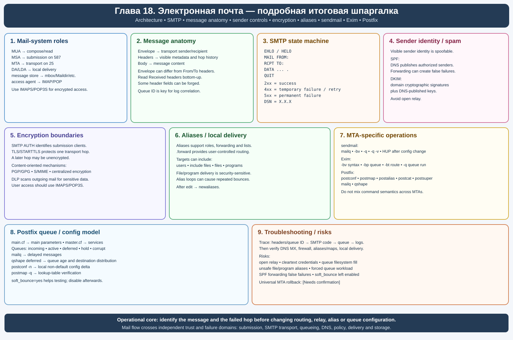
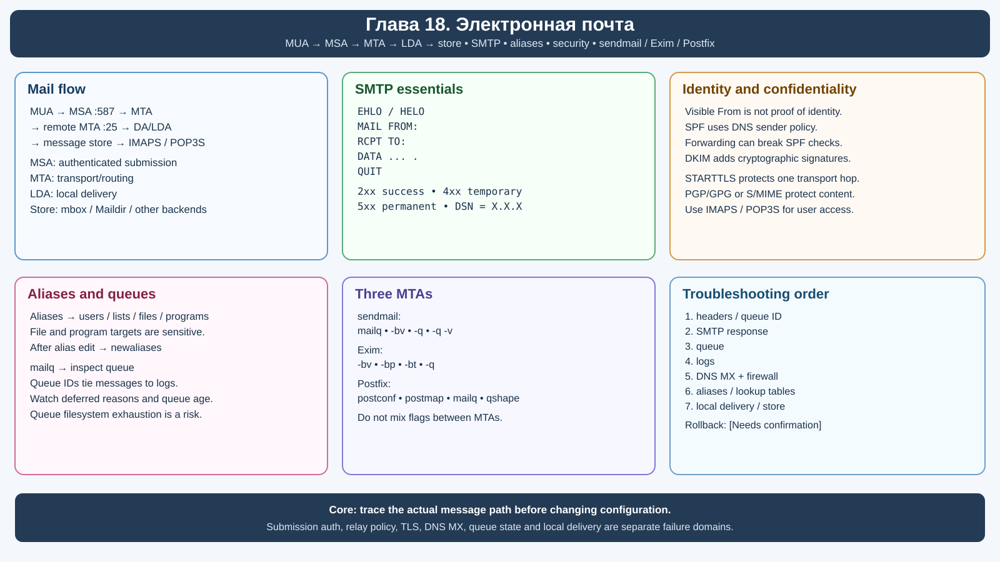

# Глава 18 — Электронная почта

Практические заметки по главе 18 книги «UNIX и Linux: руководство системного администратора», 5-е издание.

## Идентификация

- Book ID: unix-linux-system-administration-handbook-5e-ru-2020
- Глава: 18
- Название: «Электронная почта»
- Slug: email
- Source policy: rag_only
- External sources: запрещены
- Model memory: запрещена
- Прямой доступ к source/book.pdf: не использовался
- Unknown data policy: отсутствующие данные помечаются [Needs confirmation]; пробелы источника не достраиваются

## Provenance

- RAG scope: p0614:c01–p0689:c01
- PDF pages: 614–689
- Printed pages: 613–688
- Boundary evidence:
  - p0613:c01 — глава 17;
  - p0614:c01 — начало главы 18;
  - p0688:c01 — начало раздела 18.11 «Литература» после Postfix debugging;
  - p0689:c01 — продолжение раздела 18.11;
  - p0690:c01 — начало главы 19.
- В диапазоне p0614:c01–p0689:c01 пропусков RAG не обнаружено.
- Provenance verified: yes.

## Артефакты

- [commands.md](commands.md)
- [cheatsheet.md](cheatsheet.md)
- [diagram.md](diagram.md)
- [visual-cheatsheet.svg](visual-cheatsheet.svg)
- [visual-cheatsheet-detailed.svg](visual-cheatsheet-detailed.svg)

## Карта главы

- 18.1 — архитектура почтовой системы: MUA, MSA, MTA, DA/LDA, message store, access agents;
- 18.2 — envelope, headers, body и трассировка по Received;
- 18.3 — SMTP/ESMTP, команды, коды ошибок, SMTP AUTH;
- 18.4 — spam/malware, spoofing, SPF/Sender ID, DKIM;
- 18.5 — confidentiality, PGP/GPG, S/MIME, centralized encryption/DLP, TLS access protocols;
- 18.6 — aliases, .forward, files/program delivery, newaliases;
- 18.7 — общая конфигурация почтовой системы;
- 18.8 — sendmail;
- 18.9 — Exim;
- 18.10 — Postfix;
- 18.11 — литература.

## Краткий анализ

Почтовая система в главе представлена как цепочка независимых ролей. MUA составляет и читает сообщения. MSA принимает исходящую почту от MUA. MTA маршрутизирует сообщения между системами. DA/LDA выполняет локальную доставку. Message store хранит сообщения, а access agent дает клиенту доступ через IMAP/POP.

MSA обычно использует TCP 587, тогда как MTA принимает SMTP на TCP 25. MSA должен взаимодействовать с MTA через SMTP AUTH; иначе неправильная конфигурация может превратить систему в open relay.

Структура сообщения разделена на envelope, headers и body. Envelope используется транспортной системой и может отличаться от видимых From/To. Заголовки Received позволяют прослеживать путь сообщения снизу вверх, но глава предупреждает, что отдельные заголовки могут быть подделаны.

SMTP/ESMTP — общий транспортный протокол для MSA/MTA и ряда внутренних почтовых компонентов. Базовый диалог строится вокруг EHLO/HELO, MAIL FROM, RCPT TO, DATA и QUIT. Для диагностики SMTP можно вручную открыть TCP-соединение на порт 25 или 587 и вводить текстовые команды.

SMTP response codes разделяют success, temporary failure и permanent failure. Коды, начинающиеся с 4, означают временную ошибку и предполагают повторную попытку; 5 — постоянную ошибку. Расширенные DSN используют формат X.X.X.

Email identity не следует считать надежной только по полям сообщения: spoofing прост. SPF публикует через DNS список разрешенных исходящих серверов домена, но forwarding может приводить к ложным отрицательным результатам. DKIM использует криптографические подписи и DNS-публикацию ключей.

По умолчанию почта может передаваться без end-to-end encryption. Глава разделяет transport encryption и message encryption: STARTTLS/TLS защищает конкретный transport hop, но не гарантирует шифрование на всех последующих переходах. Для содержимого рассматриваются PGP/GPG, S/MIME и централизованные encryption/DLP platforms. Для доступа пользователей источник требует безопасные варианты IMAP/POP с TLS — IMAPS и POP3S.

Aliases обеспечивают перенаправление, списки и role-addresses. Псевдонимы могут направлять почту пользователю, в include-file, файл или программу; последние два варианта прямо отмечены как security-sensitive. После изменения aliases hash database перестраивается командой newaliases.

Конфигурация MTA должна согласовываться с DNS MX и firewall policy. Глава рассматривает три реализации: sendmail, Exim и Postfix. Их синтаксис и operational tools различаются и не должны смешиваться.

sendmail использует m4 source configuration и сгенерированный sendmail.cf. Очередь проверяется через mailq, принудительная обработка выполняется sendmail -q. После изменения sendmail.cf работающий процесс должен быть перезапущен или получить HUP. Глава отдельно рассматривает relay restrictions, STARTTLS, chroot, queue monitoring и Syslog.

Exim использует единый конфигурационный язык с routers, transports, retry/rewrite и ACL-related logic. Команда exim -bv проверяет конфигурацию на синтаксические ошибки, -bp показывает очередь, -bt тестирует адрес, -q запускает queue runner. В комплект входят отдельные инструменты для журналов и очередей.

Postfix построен как набор специализированных процессов с несколькими очередями: incoming, active, deferred, hold и corrupt. main.cf задает общую конфигурацию, master.cf — сервисы. postconf используется для просмотра параметров, postmap/postalias — для lookup tables, mailq и qshape — для анализа очереди. Access restrictions и SMTP AUTH/TLS отделяют разрешенную relay/authenticated submission от нежелательной пересылки.

## Основной принцип

~~~text
MUA
→ MSA :587 + authentication/encryption
→ MTA
→ SMTP :25
→ remote MTA
→ LDA/DA
→ message store
→ IMAPS/POP3S
→ recipient MUA
~~~

Диагностика должна идти по фактическому пути сообщения:

~~~text
message headers / queue ID
→ SMTP response
→ queue
→ logs
→ DNS/MX + network/firewall
→ routing/alias rules
→ delivery/store
~~~

## Риски

- open relay из-за неправильной relay/authentication policy;
- submission без SMTP AUTH;
- передача credentials без TLS;
- доверие видимому From как доказательству личности;
- принятие SPF failure без учета forwarding;
- aliases в файл/программу расширяют attack surface;
- alias loops;
- изменение aliases без newaliases;
- queue filesystem exhaustion;
- принудительный queue run создает исходящий workload;
- sendmail/Exim/Postfix flags нельзя считать взаимозаменяемыми;
- STARTTLS защищает только конкретный transport hop;
- unsafe MTA config может конфликтовать с DNS MX и firewall;
- Postfix soft_bounce=yes нельзя оставлять после тестирования;
- универсальный rollback для MTA configuration в главе не определен: [Needs confirmation].

## Acceptance boundary

Source-supported verification:
- SMTP session/response codes;
- Received headers и envelope-related headers;
- mailq/queue inspection;
- sendmail queue retry output с -q -v;
- Exim syntax/address/queue test modes;
- Postfix postconf output, logs, queue ID tracking, mailq/qshape;
- direct lookup-table query через postmap -q;
- проверка, что aliases database перестроена после изменения;
- проверка alignment с DNS MX и firewall policy.

Universal rollback для sendmail/Exim/Postfix configuration changes: [Needs confirmation].
