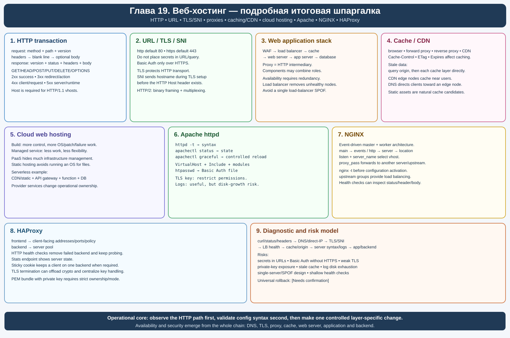
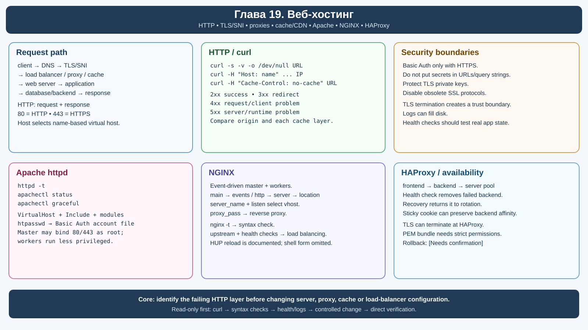

# Глава 19 — Веб-хостинг

Практические заметки по главе 19 книги «UNIX и Linux: руководство системного администратора», 5-е издание.

## Идентификация

- Book ID: unix-linux-system-administration-handbook-5e-ru-2020
- Глава: 19
- Название: «Веб-хостинг»
- Slug: web-hosting
- Source policy: rag_only
- External sources: запрещены
- Model memory: запрещена
- Прямой доступ к source/book.pdf: не использовался
- Unknown data policy: отсутствующие данные помечаются [Needs confirmation]; пробелы источника не достраиваются

## Provenance

- RAG scope: p0690:c01–p0729:c01
- PDF pages: 690–729
- Printed pages: 689–728
- Boundary evidence:
  - p0689:c01 — завершение главы 18;
  - p0690:c01 — начало главы 19;
  - p0729:c01 — раздел 19.7 «Литература»;
  - p0730:c01 — титульная страница части III «Хранение данных»;
  - p0732:c01 — начало главы 20.
- В диапазоне p0690:c01–p0729:c01 пропусков RAG не обнаружено.
- Provenance verified: yes.

## Артефакты

- [commands.md](commands.md)
- [cheatsheet.md](cheatsheet.md)
- [diagram.md](diagram.md)
- [visual-cheatsheet.svg](visual-cheatsheet.svg)
- [visual-cheatsheet-detailed.svg](visual-cheatsheet-detailed.svg)

## Карта главы

- 19.1 — HTTP, URL, запрос/ответ, status codes, headers/body, curl, persistent connections, HTTP over TLS, virtual hosts;
- 19.2 — web servers, proxies, load balancers, caches, CDN, web languages и HTTP APIs;
- 19.3 — cloud web hosting, build-vs-buy, PaaS, static hosting, serverless web applications;
- 19.4 — Apache httpd: process model, config hierarchy, virtual hosts, basic auth, TLS, application modules, logging;
- 19.5 — NGINX: event-driven architecture, config contexts, virtual hosts, proxying, TLS, load balancing;
- 19.6 — HAProxy: frontend/backend, health checks, stats, sticky sessions, TLS termination;
- 19.7 — литература.

## Краткий анализ

HTTP рассматривается как клиент-серверный request/response protocol. HTTP/1.x передает текстовые сообщения, поэтому его можно исследовать обычными сетевыми инструментами; HTTP/2 сохраняет семантику HTTP, но использует бинарное представление и multiplexing нескольких транзакций по одному соединению.

URL состоит из схемы и адресной части. Для web-схем ключевыми являются http и https; стандартные TCP-порты в главе — 80 и 443. Встраивать пароль или другие чувствительные данные в URL не рекомендуется: URL попадают в журналы, закладки, вывод процессов и другие места. Basic HTTP authentication безопасно использовать только поверх HTTPS.

HTTP request содержит method, path и protocol version; response содержит status line. Основные классы status codes: 1xx informational, 2xx success, 3xx additional action/redirect, 4xx client/request problem, 5xx server/runtime problem. Header Host обязателен для HTTP/1.1 и позволяет name-based virtual hosting.

curl — основной command-line инструмент главы для наблюдения HTTP transaction. Verbose-запрос показывает request/response headers, Host можно подменять для проверки virtual host напрямую по IP, а Cache-Control: no-cache используется при диагностике stale cache.

Персистентные соединения HTTP/1.1 уменьшают overhead открытия TCP connections. HTTP/2 идет дальше и multiplexes multiple transactions over one connection. Сам HTTP не обеспечивает confidentiality/integrity transport path; TLS формирует HTTPS.

SNI решает проблему выбора TLS certificate до чтения HTTP Host header: hostname передается в начале TLS negotiation, позволяя обслуживать name-based virtual hosts через HTTPS.

Web stack в главе состоит из специализированных слоев: web application firewall, load balancer, cache, web server, application server и database. Компоненты часто совмещают роли: NGINX может быть web server, proxy, cache и load balancer.

Load balancer уменьшает зависимость от одного web server, может удалять failed backends из rotation и позволяет обслуживать/обновлять узлы без полного простоя. Глава рассматривает round-robin, least-load/least-connections и client-hash approaches. Для отказоустойчивости сами load balancers также не должны быть единственной точкой отказа.

Caching может существовать в browser, forward proxy, reverse proxy и CDN. Cache behavior определяется HTTP headers, status и типом данных. Stale cache следует диагностировать прямым запросом к каждому уровню, начиная с origin. CDN использует географически распределенные edge servers и DNS для направления клиента к подходящему узлу.

Cloud section разделяет самостоятельную сборку инфраструктуры и managed services. PaaS скрывает часть infrastructure management в обмен на ограничение flexibility. Static hosting выносит файлы в managed object/content storage, а serverless модель сочетает event-driven compute, API gateway и static/CDN layers.

Apache httpd использует modular architecture и MPM. Master process может потребовать root для bind к privileged ports, worker processes запускаются с меньшими привилегиями. Основная config logic строится вокруг global directives, VirtualHost и included module/site fragments. apachectl используется для start/status/graceful control, а httpd -t — для syntax check.

Apache Basic Auth хранит credentials в отдельном htpasswd file. Глава требует ограничивать доступ к этому файлу. TLS config отключает старые SSL protocol versions; private key должен быть доступен только master process/root. Web logs полезны для диагностики и security analysis, но могут быстро заполнить filesystem.

NGINX использует event-driven model: master process управляет sockets/configuration, worker processes обслуживают множество connections. Конфигурация организована через contexts main/events/http/server/location. server_name и listen выбирают virtual host, proxy_pass передает запросы upstream systems. nginx -t проверяет syntax; HUP у master process reloads configuration после успешной проверки.

NGINX TLS config использует certificate/key directives и выбор protocol/cipher policy. Load balancing строится через upstream и proxy_pass; health checks могут учитывать status code, headers и body.

HAProxy разделяет frontend и backend. Health checks удаляют failed server из pool и возвращают его после восстановления. Stats endpoint показывает состояние backends и может позволять административное включение/выключение серверов. Sticky sessions используют cookie для привязки клиента к backend, если application state хранится локально.

TLS termination на HAProxy уменьшает число систем, которым нужен private key, но plaintext HTTP к backend допустим только в модели доверия, описанной архитектурой. Для более строгих требований можно снова использовать HTTPS к backend. Private key/certificate bundle должен иметь строго ограниченные permissions.

## Основной принцип

~~~text
client
→ DNS
→ TLS/SNI if HTTPS
→ load balancer / proxy / cache
→ web server
→ application server
→ database or other backend
→ response through cache/proxy layers
~~~

Диагностика:

~~~text
curl request
→ status + headers
→ direct origin
→ reverse proxy/cache
→ load balancer
→ web server logs
→ application/backend
~~~

Change workflow:

~~~text
read-only syntax/config check
→ controlled config change
→ graceful reload/start if source-supported
→ direct HTTP verification
→ logs/health checks
~~~

## Риски

- credentials или sensitive query data в URL;
- Basic Auth без HTTPS;
- TLS private key с чрезмерными permissions;
- старые SSL protocols/weak ciphers;
- config reload без предварительной syntax check;
- single web server или single load balancer как SPOF;
- stale cache на промежуточном уровне;
- cache invalidation/revalidation assumptions без direct-origin verification;
- web logs могут заполнить filesystem;
- health check, проверяющий только TCP/HTTP reachability, может не отражать реальное состояние приложения;
- local session state за load balancer требует sticky sessions или redesign state storage;
- TLS termination создает trust boundary между proxy и backend;
- команды и config semantics Apache, NGINX и HAProxy не взаимозаменяемы;
- universal rollback для web-server/load-balancer config в главе не определен: [Needs confirmation].

## Acceptance boundary

Source-supported verification:
- curl с verbose headers/status;
- curl с custom Host напрямую по IP;
- direct-origin/cache-layer comparison;
- httpd -t и apachectl status;
- apachectl graceful после корректной config;
- nginx -t;
- HTTP status/health endpoint для NGINX/HAProxy upstreams;
- web-server access/error logs;
- HAProxy stats/health state;
- permissions private key и htpasswd files.

Universal rollback для Apache, NGINX, HAProxy или cloud configuration changes: [Needs confirmation].
