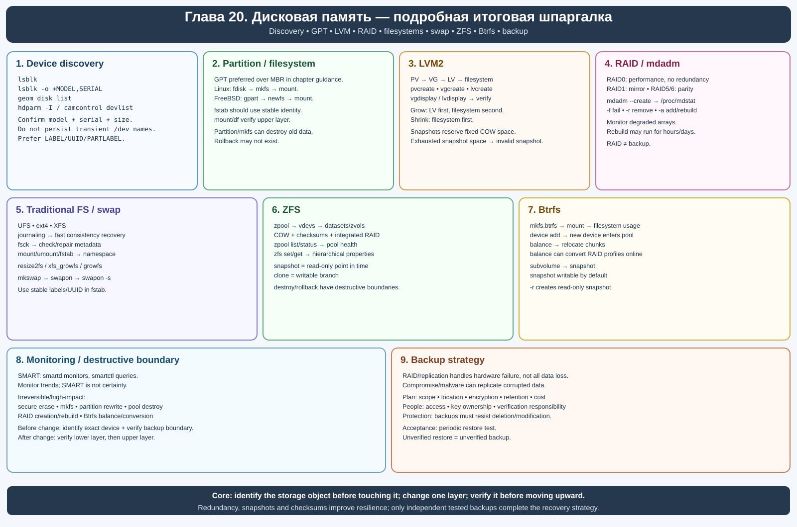
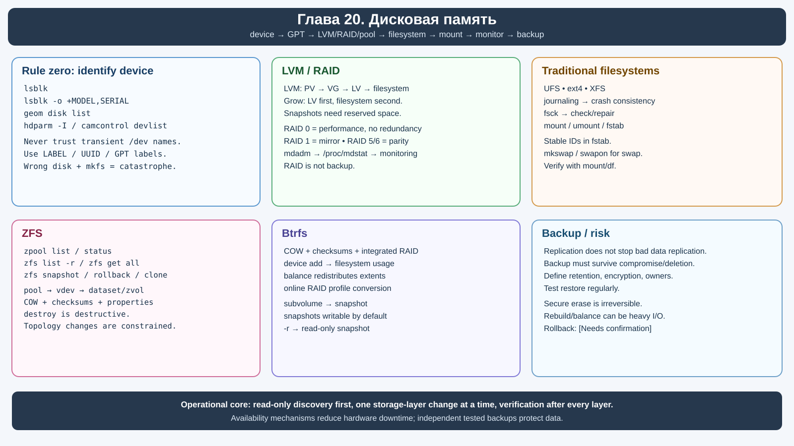

# Глава 20 — Дисковая память

Практические заметки по главе 20 книги «UNIX и Linux: руководство системного администратора», 5-е издание.

## Идентификация

- Book ID: unix-linux-system-administration-handbook-5e-ru-2020
- Глава: 20
- Название: «Дисковая память»
- Slug: disk-storage
- Source policy: rag_only
- External sources: запрещены
- Model memory: запрещена
- Прямой доступ к source/book.pdf: не использовался
- Unknown data policy: отсутствующие данные помечаются [Needs confirmation]; пробелы источника не достраиваются

## Provenance

- RAG scope: p0732:c01–p0804:c01
- PDF pages: 732–804
- Printed pages: 731–803
- Boundary evidence:
  - p0730:c01 — титульная страница части III «Хранение данных»;
  - p0731:c01 — отсутствует в RAG;
  - p0732:c01 — начало главы 20;
  - p0804:c01 — завершение раздела 20.15 «Литература»;
  - p0805:c01 — отсутствует в RAG;
  - p0806:c01 — начало главы 21.
- Внутри диапазона p0732:c01–p0804:c01 пропусков RAG не обнаружено: 73/73 chunks.
- Provenance verified: yes.

## Артефакты

- [commands.md](commands.md)
- [cheatsheet.md](cheatsheet.md)
- [diagram.md](diagram.md)
- [visual-cheatsheet.svg](visual-cheatsheet.svg)
- [visual-cheatsheet-detailed.svg](visual-cheatsheet-detailed.svg)

## Карта главы

- 20.1 — добавление диска: Linux и FreeBSD;
- 20.2 — HDD, SSD, гибридные накопители, 4 KiB blocks;
- 20.3 — SATA, PCI Express, SAS, USB;
- 20.4 — обнаружение устройств, device files, persistent identity, low-level management, secure erase, SMART;
- 20.5 — software stack хранения;
- 20.6 — partitioning, MBR и GPT;
- 20.7 — LVM2, logical volumes, snapshots, resize;
- 20.8 — RAID levels, failure/rebuild и Linux mdadm;
- 20.9 — роль файловых систем;
- 20.10 — UFS/ext4/XFS, journaling, fsck, mount/fstab, swap;
- 20.11 — copy-on-write, checksums, ZFS/Btrfs;
- 20.12 — ZFS pools, datasets, properties, snapshots/clones, zvols;
- 20.13 — Btrfs pools, RAID conversion, subvolumes, snapshots, reflinks;
- 20.14 — backup strategy;
- 20.15 — литература.

## Краткий анализ

Глава строит storage stack снизу вверх: физический накопитель и интерфейс → device identity → partition table → volume manager/RAID → filesystem → mount namespace → backup. Главная operational идея — не менять нижний уровень, пока устройство не идентифицировано однозначно и не подтверждено, что работа ведётся именно с нужным диском.

При добавлении диска источник сначала требует discovery. В Linux используются lsblk и расширенный вывод MODEL/SERIAL; во FreeBSD — geom disk list. Только после подтверждения идентичности выполняются partitioning, mkfs/newfs и mount. Глава отдельно предупреждает, что имена /dev/sdX и аналогичные могут меняться после reboot или добавления устройств, поэтому постоянная конфигурация должна использовать labels/UUID/partition labels, а не случайное имя device node.

GPT рассматривается как предпочтительная современная схема partitioning. MBR ограничен исторической совместимостью и имеет архитектурные ограничения. В Linux глава демонстрирует fdisk с созданием GPT и одного раздела; во FreeBSD — gpart create/add.

Low-level disk management разделяет informational operations и разрушительные. hdparm -I и camcontrol devlist подходят для идентификации физических устройств. ATA secure erase через hdparm или camcontrol является необратимым уничтожением данных. Источник прямо подчеркивает, что форматирование «не того» диска ведет к катастрофе.

SMART используется как механизм прогнозного monitoring: smartd постоянно наблюдает накопители, smartctl предназначен для interactive/scripted queries. Глава подчеркивает ценность трендов и отдельных SMART attributes, но не считает SMART абсолютным предсказателем отказа.

LVM2 вводит три уровня: physical volume → volume group → logical volume. Процедура: pvcreate → vgcreate/vgextend → lvcreate. Логические тома позволяют resize и copy-on-write snapshots. Важная граница: при расширении сначала увеличивается logical volume, затем filesystem; при уменьшении — сначала filesystem. LVM snapshot имеет заранее выделенный размер и становится непригодным, если snapshot space исчерпан.

RAID отделяет performance striping от redundancy. RAID 0 повышает performance без redundancy; RAID 1 зеркалирует; RAID 5/6 используют parity. Глава предупреждает, что RAID не равен backup и что rebuild может длиться часы или дни. Linux mdadm workflow включает create, /proc/mdstat monitoring, configuration documentation через mdadm --detail --scan, monitor daemon и контролируемую fail/remove/add simulation.

Традиционные filesystems UFS/ext4/XFS отделены от volume management/RAID. Journaling снижает риск structural corruption после сбоя питания. fsck проверяет/исправляет структуру, mount связывает filesystem с namespace, /etc/fstab задает persistent mount configuration. Для stable identity используются filesystem UUID/labels и GPT labels.

Swap создается отдельно от обычной filesystem. В Linux mkswap и swapon управляют swap device; active configuration проверяется swapon -s. Глава не дает универсальной рекомендации «swap всегда нужен/не нужен»: выбор зависит от workload, RAM и среды.

ZFS и Btrfs объединяют filesystem, volume management и RAID в вертикально интегрированную модель. Обе используют copy-on-write и checksums. Это позволяет переходить между согласованными состояниями и обнаруживать silent corruption.

ZFS управляется двумя основными командами: zpool для storage pools и zfs для datasets/volumes. Pools состоят из virtual devices; datasets наследуют properties. Snapshots read-only, clones writable. zfs rollback восстанавливает dataset только при выполнении ограничений, связанных с более новыми snapshots. zpool status отображает health и checksum/read/write errors.

Btrfs использует обычный mount model, но позволяет online add/remove/rebalance devices и менять data/metadata RAID profile. btrfs balance фактически перемещает extents и поэтому является тяжелой state-changing operation. Subvolumes — объекты внутри filesystem; snapshots Btrfs по умолчанию writable, а read-only snapshot создается отдельным флагом.

Заключительная часть главы принципиально отделяет redundancy от backup. RAID, mirrors и replication защищают от отдельных hardware failures, но не от компрометации, malware, логической порчи или ошибочного удаления. Backup strategy должна определять scope, location, encryption, retention, restore testing, responsible people и защиту самих backups от изменения/удаления.

## Основной принцип

~~~text
discover device
→ verify identity
→ partition / pool
→ volume / RAID
→ filesystem
→ mount / fstab
→ monitor
→ backup + restore test
~~~

Rollback-first boundary:

~~~text
read-only discovery
→ verify exact device
→ record current state
→ one controlled change
→ verify lower layer
→ verify upper layer
→ only then continue
~~~

## Риски

- работа с неверным /dev device;
- использование непостоянных device names в fstab;
- partition/mkfs/secure erase уничтожают существующие данные;
- secure erase необратим;
- LVM snapshot может стать invalid при исчерпании snapshot space;
- resize требует правильного порядка volume/filesystem operations;
- RAID rebuild создает длительную I/O нагрузку;
- degraded RAID продолжает работать и поэтому failure может остаться незамеченным без monitoring;
- RAID не заменяет backup;
- zpool destroy и zfs destroy удаляют storage objects;
- принудительное смешивание разных redundancy classes через zpool add -f требует осознанного design;
- Btrfs balance/RAID conversion перемещает data и создает существенную I/O нагрузку;
- stale/incorrect fstab может повредить boot/mount behavior;
- filesystem check/repair может менять metadata;
- backup без restore testing не подтверждает восстановимость;
- universal rollback для partitioning, mkfs, RAID creation и secure erase отсутствует: [Needs confirmation].

## Acceptance boundary

Source-supported verification:
- lsblk/geom disk list и model/serial перед изменениями;
- mount/df после создания filesystem;
- vgdisplay/lvdisplay после LVM changes;
- /proc/mdstat и logs после mdadm operations;
- filesystem labels/UUID через supported tools;
- zpool list/status и zfs list/get;
- btrfs filesystem usage после topology changes;
- snapshot visibility/content checks;
- written backup plan плюс регулярный restore test.

Для необратимых операций rollback: [Needs confirmation].
