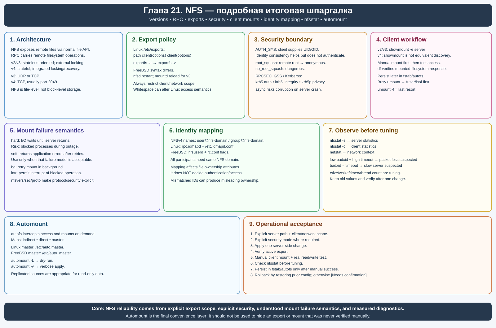
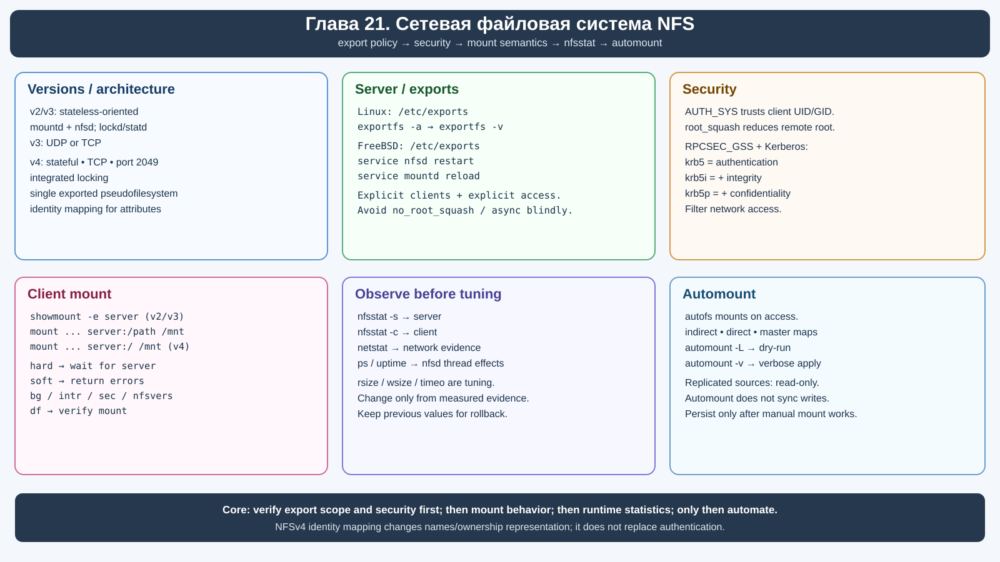

# Глава 21 — Сетевая файловая система NFS

Практические заметки по главе 21 книги «UNIX и Linux: руководство системного администратора», 5-е издание.

## Идентификация

- Book ID: unix-linux-system-administration-handbook-5e-ru-2020
- Глава: 21
- Название: «Сетевая файловая система NFS»
- Slug: nfs
- Source policy: rag_only
- External sources: запрещены
- Model memory: запрещена
- Прямой доступ к source/book.pdf: не использовался
- Unknown data policy: отсутствующие данные помечаются [Needs confirmation]; пробелы источника не достраиваются

## Provenance

- RAG scope: p0806:c01–p0833:c01
- PDF pages: 806–833
- Printed pages: 805–832
- Boundary evidence:
  - p0804:c01 — завершение главы 20;
  - p0805:c01 — отсутствует в RAG;
  - p0806:c01 — начало главы 21;
  - p0833:c01 — завершение раздела 21.9 «Литература»;
  - p0834:c01 — начало главы 22.
- Внутри диапазона p0806:c01–p0833:c01 пропусков RAG не обнаружено: 28/28 chunks.
- Provenance verified: yes.

## Артефакты

- [commands.md](commands.md)
- [cheatsheet.md](cheatsheet.md)
- [diagram.md](diagram.md)
- [visual-cheatsheet.svg](visual-cheatsheet.svg)
- [visual-cheatsheet-detailed.svg](visual-cheatsheet-detailed.svg)

## Карта главы

- 21.1 — назначение NFS, stateful/stateless trade-offs, performance и security;
- 21.2 — версии NFS, RPC, transport, state, exports, locking, AUTH_SYS/RPCSEC_GSS, identity mapping;
- 21.3 — NFS server, /etc/exports Linux/FreeBSD, nfsd/mountd;
- 21.4 — NFS client, showmount, mount options, fstab, privileged ports;
- 21.5 — NFSv4 identity mapping;
- 21.6 — nfsstat и диагностика;
- 21.7 — специализированные NFS servers;
- 21.8 — autofs/automount, direct/indirect/master maps, replicated read-only mounts;
- 21.9 — литература/RFC.

## Анализ главы

NFS предоставляет удаленные файлы через обычную файловую семантику: приложение после mount работает с ними через те же вызовы, что и с локальной файловой системой. Это не блочный протокол: NFS работает на уровне файлов и каталогов.

Главное архитектурное различие версий — состояние. NFSv2/v3 были построены преимущественно как stateless service: сервер не должен помнить открытые файлы клиента. Это упрощает восстановление сервера после сбоя, но усложняет locking. Для v2/v3 блокировки вынесены в отдельные lockd/statd. NFSv4 стал stateful: клиент и сервер отслеживают открытые файлы и locks, а protocol recovery включает восстановление предыдущего состояния после сбоя.

RPC остается базовым механизмом вызова удаленных файловых операций. В NFSv3 transport может быть UDP или TCP, а NFSv4 использует TCP. Для NFSv4 глава указывает обычный TCP port 2049. Если доступ из Интернета не требуется, источник рекомендует ограничивать его firewall/filtering. Для NFSv2/v3 security boundary сложнее из-за RPC/portmap и исторически слабой модели безопасности.

Сервер публикует каталоги через export. Linux и FreeBSD используют /etc/exports, но синтаксис существенно различается. После изменения Linux exports выполняется exportfs -a; во FreeBSD — перезапуск nfsd и, для v3 clients, reload mountd. Любой export должен задавать конкретный набор клиентов и требуемый уровень доступа; export без client restriction источник прямо называет серьезной брешью.

Особенно опасна Linux-синтаксическая граница между именем клиента и скобками с options. Лишний пробел может изменить смысл строки и фактически расширить доступ. Поэтому изменение /etc/exports должно сопровождаться локальной проверкой exports и client-side verification.

Опции Linux exports включают ro/rw, root_squash/no_root_squash, all_squash, sync/async, subtree_check/no_subtree_check и sec=. root_squash применяется по умолчанию и отображает удаленный UID/GID 0 в анонимную учетную запись. no_root_squash разрешает удаленному root привилегированный доступ и в источнике помечен как опасный. async позволяет ответить клиенту до фактической записи на disk и может привести к повреждению данных при неожиданном reboot сервера.

Security model AUTH_SYS передает серверу UNIX UID/GID от клиента. Глава показывает, что эта модель зависит от доверия клиенту и согласованности identities и не является сильной аутентификацией. Для NFSv4 авторы рекомендуют Kerberos + RPCSEC_GSS; режимы krb5, krb5i и krb5p добавляют соответственно authentication, integrity и confidentiality.

NFSv4 identity mapping не заменяет authentication. Оно преобразует UID/GID в строки вида user@nfs-domain для file attributes и обратно. Если локальные identity databases расходятся, ownership может отображаться неожиданно. Для AUTH_SYS согласованность passwd/LDAP остается важной, но сама по себе не устраняет доверительную проблему.

В NFSv4 экспорт формируется как единая псевдофайловая иерархия. Практическая реализация различается: Linux следует этой модели ближе к RFC, а FreeBSD имеет собственную семантику. В FreeBSD особенно опасно назначать локальный / как V4 root: источник предупреждает, что клиенты могут получить доступ ко всей root filesystem.

На клиенте сначала проверяется server-side export. showmount -e подходит для традиционной v2/v3 модели, но глава прямо говорит, что для NFSv4 эта команда не является корректным диагностическим эквивалентом. Для v4 локально на сервере можно смотреть exportfs -v, а удаленно — mount pseudoroot/subtree и исследовать иерархию.

Mount options определяют поведение при сбоях. hard блокирует обращения, пока сервер не вернется; soft возвращает ошибку после retries/timeouts. bg переносит повторные mount attempts в фон. intr позволяет прерывать blocked operations. Источник отмечает, что hard-mounted NFS может повесить процессы при недоступном сервере, поэтому критические system programs не следует запускать через NFS.

Постоянные mounts задаются в /etc/fstab либо передаются automounter. Изменения NFS entries можно применить mount -a -t nfs. df работает с NFS mount так же, как с локальной файловой системой. Если umount сообщает busy, глава предлагает сначала найти open-file users через fuser/lsof; umount -f оставлен как крайний вариант при недоступном server или невозможности штатного detach.

nfsstat разделяет server и client statistics: nfsstat -s и nfsstat -c. В примере главы повышенная доля failures/timeouts используется как сигнал проблем. Если badxid низок, а timeouts велики, источник связывает это с network packet loss; если badxid близок к timeout, server отвечает слишком медленно. Предлагаемые изменения rsize/wsize/timeo являются диагностическими tuning actions, а не универсальными настройками.

Automount решает проблему большого числа постоянных NFS mounts: filesystem подключается по обращению и отключается после простоя. Используются indirect maps, direct maps и master map. Конфигурацию следует dry-run/проверять до применения. Реплицированные automount sources должны быть read-only, потому что automounter не синхронизирует записи между серверами.

## Основной принцип

~~~text
server export policy
→ security identity boundary
→ verify export
→ mount with explicit failure semantics
→ observe with nfsstat
→ automate only after manual path works
~~~

Operational order:

~~~text
read /etc/exports or maps
→ validate client/network scope
→ apply one server-side change
→ verify exported view
→ mount from client
→ verify read/write behavior
→ inspect statistics
→ only then persist in fstab/autofs
~~~

## Риски

- export без client restriction;
- пробел в Linux /etc/exports может радикально изменить access semantics;
- no_root_squash дает удаленному root привилегированный доступ;
- AUTH_SYS доверяет client-supplied UID/GID и не является сильной authentication model;
- inconsistent UID/GID/identity mapping может давать неожиданное ownership representation;
- async export может привести к потере/повреждению данных при crash;
- NFSv2/v3 имеют более слабую security model и дополнительные RPC dependencies;
- FreeBSD V4 root нельзя бездумно ставить в /;
- hard mount может блокировать процессы при server outage;
- soft mount меняет failure semantics и может возвращать application errors;
- showmount не является NFSv4 export-discovery mechanism;
- force umount может оборвать active access;
- изменения rsize/wsize/timeo должны исходить из nfsstat evidence;
- replicated automount mounts должны быть read-only;
- rollback для ошибочной export/mount/autofs configuration: вернуть предыдущий конфигурационный файл; если предыдущая версия не сохранена — [Needs confirmation].

## Acceptance boundary

Source-supported verification:
- Linux server: exportfs -v после export changes;
- v2/v3 client: showmount -e <server>;
- client mount: mount/df и фактический access;
- busy unmount: fuser/lsof перед принудительным действием;
- NFS statistics: nfsstat -s / nfsstat -c;
- nfsd tuning: ps/uptime/nfsstat, а не изменение thread count вслепую;
- autofs changes: dry-run/verbose output и access к конкретному mapped path;
- security: explicit client/network scope и explicit sec= mode where applicable.
