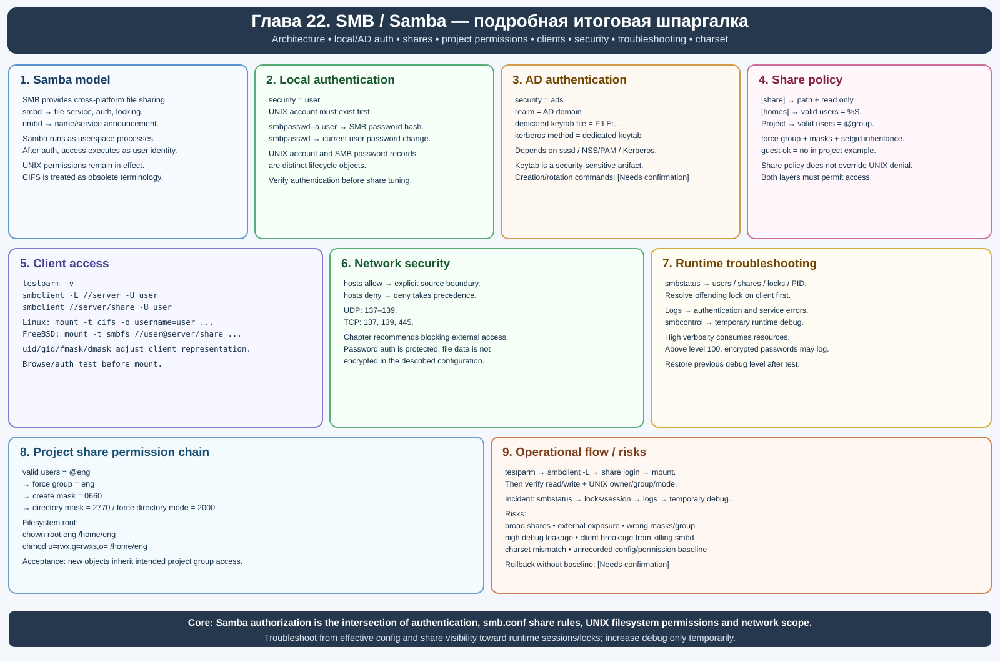
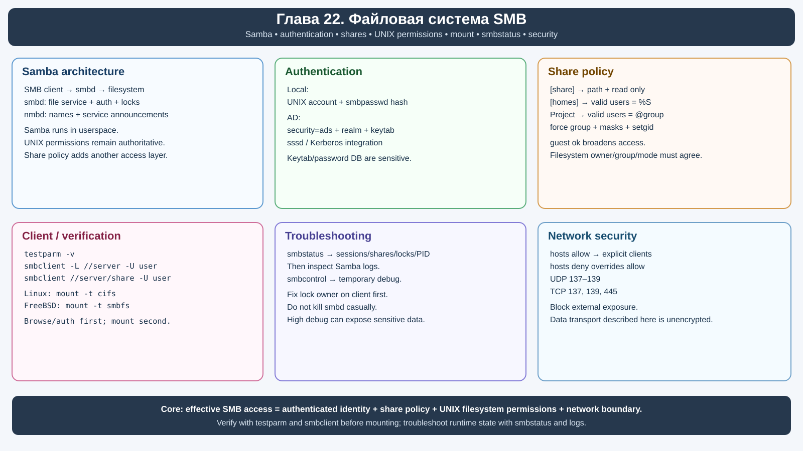

# Глава 22 — Файловая система SMB

Практические заметки по главе 22 книги «UNIX и Linux: руководство системного администратора», 5-е издание.

## Идентификация

- Book ID: unix-linux-system-administration-handbook-5e-ru-2020
- Глава: 22
- Название: «Файловая система SMB»
- Slug: smb
- Source policy: rag_only
- External sources: запрещены
- Model memory: запрещена
- Прямой доступ к source/book.pdf: не использовался
- Unknown data policy: отсутствующие данные помечаются [Needs confirmation]; пробелы источника не достраиваются

## Provenance

- RAG scope: p0834:c01–p0844:c01
- PDF pages: 834–844
- Printed pages: 833–843
- Boundary evidence:
  - p0833:c01 — завершение главы 21;
  - p0834:c01 — начало главы 22;
  - p0844:c01 — раздел 22.7 «Литература»;
  - p0845:c01 — отсутствует в RAG;
  - p0846:c01 — титульная страница части IV;
  - p0847:c01 — отсутствует в RAG;
  - p0848:c01 — начало главы 23.
- В диапазоне p0834:c01–p0844:c01 пропусков RAG не обнаружено: 11/11 chunks.
- Provenance verified: yes.

## Артефакты

- [commands.md](commands.md)
- [cheatsheet.md](cheatsheet.md)
- [diagram.md](diagram.md)
- [visual-cheatsheet.svg](visual-cheatsheet.svg)
- [visual-cheatsheet-detailed.svg](visual-cheatsheet-detailed.svg)

## Карта главы

- 22.1 — Samba как SMB server для UNIX/Linux, smbd/nmbd, сравнение с NFS;
- 22.2 — установка и smb.conf, local authentication, Active Directory/sssd, shares, homes, project groups;
- 22.3 — mount SMB shares в Linux/FreeBSD;
- 22.4 — smbclient для browse/interactive access;
- 22.5 — security: hosts allow/deny, firewall boundary, SMB ports;
- 22.6 — troubleshooting: smbstatus, locks, Samba logs, runtime debug level, character sets;
- 22.7 — литература.

## Анализ главы

SMB используется прежде всего для совместного доступа к файлам между UNIX/Linux и Windows. Samba реализует SMB полностью как userspace service. Основные процессы главы — smbd, отвечающий за file service, authentication/authorization и file locking, и nmbd, отвечающий за name service и service announcements.

После authentication smbd обслуживает запросы от имени пользователя, поэтому обычные UNIX permissions и group permissions остаются частью authorization boundary. Samba не отменяет локальную модель доступа файловой системы: неправильные ownership/mode/group settings на сервере напрямую отражаются на SMB access.

Глава рассматривает Samba 4 и отдельно отмечает, что термин CIFS относится к устаревшей ветви протокола; operational фокус — SMB. Для cross-platform environments SMB имеет преимущество совместимости, тогда как NFS в книге рассматривается как более естественный выбор для однородных UNIX/Linux environments.

Основной файл конфигурации — /etc/samba/smb.conf в Linux и /usr/local/etc/smb4.conf во FreeBSD. testparm -v показывает effective configuration вместе с defaults. По описанию главы Samba периодически перечитывает конфигурацию, поэтому обычное изменение smb.conf не требует отдельного service restart.

Local authentication строится на security = user и отдельном SMB password hash. Перед smbpasswd -a пользователь уже должен существовать как UNIX account. Это две связанные, но разные identity records: UNIX account определяет локальную identity/permissions, Samba password database — SMB authentication.

В среде Active Directory пример использует security = ads, realm, dedicated keytab file и kerberos method = dedicated keytab. Глава опирается на ранее настроенные sssd, NSS/PAM и Kerberos components. Keytab рассматривается как чувствительный authentication artifact; отдельные команды его создания в этой главе не приводятся.

Каждый SMB share получает отдельный section в smb.conf. Базовый share задает path и read only. Специальный [homes] dynamically exposes user home directories и использует valid users = %S для ограничения доступа владельцем share.

Для project shares глава показывает group-based access: valid users = @eng, force group = eng, create mask, directory mask и force directory mode. На filesystem root share выставляется owner/group и setgid behavior, чтобы новые objects наследовали project group.

Linux client mount использует mount -t cifs, FreeBSD — mount -t smbfs. В отличие от NFS, SMB share обычно привязан к конкретному remote user credential. На UNIX client ownership representation может задаваться mount options uid, gid, fmask и dmask.

smbclient позволяет просматривать shares без filesystem mount. Форма smbclient -L перечисляет доступные resources; подключение к конкретному share дает FTP-like interactive interface. Это удобно для диагностики, когда нужно отделить server/share/authentication problem от local mount problem.

Security section требует явно ограничивать доступ через hosts allow; hosts deny имеет приоритет над allow. Глава рекомендует блокировать Samba за пределами организационной сети. В контексте описываемой версии Samba password authentication защищена, но передача file data в рассматриваемой конфигурации не зашифрована. Поэтому SMB traffic не следует бездумно публиковать в Internet.

Глава перечисляет UDP ports 137–139 и TCP ports 137, 139 и 445 как firewall boundary Samba.

smbstatus — первая read-only команда при troubleshooting. Она показывает active users, mounted shares и locked files. При lock problems источник рекомендует сначала исправлять ситуацию на client side, закрывая offending application, а не грубо снимать locks на server.

Samba logs являются вторым основным диагностическим источником. log file, max log size, syslog only и syslog задают logging behavior. Повышение debug verbosity создает дополнительную нагрузку и может раскрывать чувствительную информацию: глава предупреждает, что при уровнях журнала выше 100 в logs начинают появляться encrypted passwords.

smbcontrol позволяет менять runtime debug level без правки smb.conf. Для точечной диагностики сначала smbstatus используется для определения smbd PID, затем debug level можно изменить только для этого process. Это предпочтительнее глобального повышения verbosity.

Character encoding — отдельная operational boundary. Samba 3+ хранит filenames в UTF-8; если server locale использует другую encoding, параметры unix charset/display charset должны быть согласованы с ней с самого начала. Исправлять уже накопленные wrongly encoded filenames значительно сложнее.

## Основной принцип

~~~text
UNIX identity + filesystem permissions
→ Samba authentication
→ share policy in smb.conf
→ network access boundary
→ client browse/mount
→ smbstatus + logs for verification
~~~

Safe change flow:

~~~text
testparm -v
→ change one smb.conf/share/filesystem permission
→ verify effective config
→ test with smbclient
→ test mount/access
→ inspect smbstatus/logs
→ only then widen client scope
~~~

## Риски

- отдельная SMB password database может расходиться с UNIX identity lifecycle;
- smbpasswd -a без существующей UNIX account не является корректной workflow;
- AD/keytab configuration является security-sensitive;
- broad share permissions или guest access расширяют access boundary;
- UNIX filesystem permissions остаются authoritative для Samba access;
- [homes] без valid users = %S может раскрыть соседние home directories в зависимости от local permissions;
- неправильные create/directory masks нарушают project group access;
- mount от root может представить все remote files как принадлежащие root на client;
- hosts deny имеет приоритет над hosts allow;
- Samba traffic не следует публиковать за пределы доверенной сети без соответствующей защиты;
- global high debug level создает overhead и может записывать password-related sensitive data;
- убийство smbd process для снятия lock может ломать client applications;
- charset mismatch приводит к накоплению неправильно закодированных filenames;
- universal rollback для smb.conf/share permission changes: вернуть предыдущую config/permissions; если baseline не сохранен — [Needs confirmation].

## Acceptance boundary

Source-supported verification:
- testparm -v после config changes;
- smbclient -L для server/share visibility;
- smbclient //<server>/<share> для authentication/path test;
- actual mount с mount -t cifs или mount -t smbfs;
- smbstatus для active sessions/shares/locks;
- filesystem ownership/group/mode для project share;
- logs для authentication failures;
- runtime debug через smbcontrol только на время активной диагностики.
