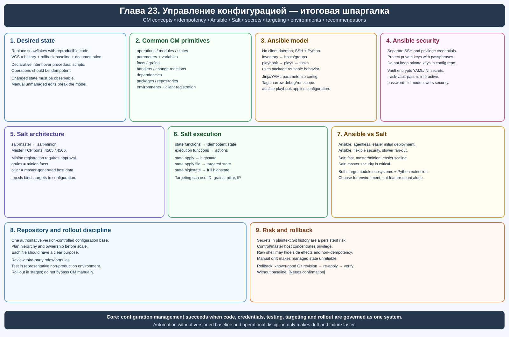
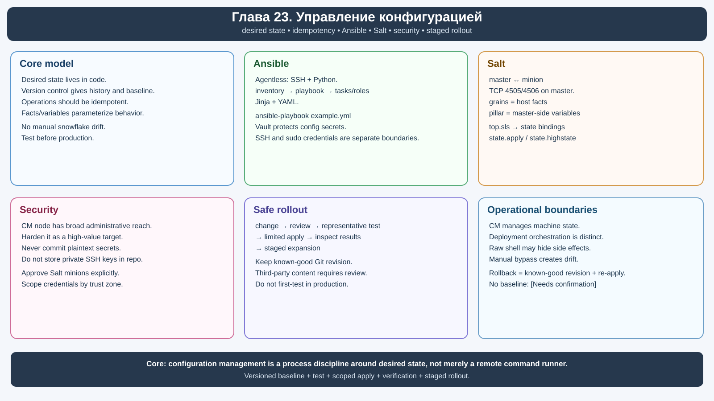

# Глава 23 — Управление конфигурацией

Практические заметки по главе 23 книги «UNIX и Linux: руководство системного администратора», 5-е издание.

## Идентификация

- Book ID: unix-linux-system-administration-handbook-5e-ru-2020
- Глава: 23
- Название: «Управление конфигурацией»
- Slug: configuration-management
- Source policy: rag_only
- External sources: запрещены
- Model memory: запрещена
- Прямой доступ к source/book.pdf: не использовался
- Unknown data policy: отсутствующие данные помечаются [Needs confirmation]

## Provenance

- RAG scope: p0848:c01–p0909:c01
- PDF pages: 848–909
- Printed pages: 847–908
- Boundary evidence:
  - p0846:c01 — титульная страница части IV;
  - p0848:c01 — начало главы 23;
  - p0909:c01 — раздел 23.9 «Литература»;
  - p0910:c01 — начало главы 24.
- Внутри диапазона p0848:c01–p0909:c01 пропусков RAG не обнаружено: 62/62 chunks.
- Provenance verified: yes.

## Артефакты

- [commands.md](commands.md)
- [cheatsheet.md](cheatsheet.md)
- [diagram.md](diagram.md)
- [visual-cheatsheet.svg](visual-cheatsheet.svg)
- [visual-cheatsheet-detailed.svg](visual-cheatsheet-detailed.svg)

## Карта главы

- 23.1 — configuration management как desired state в коде;
- 23.2 — operational risks и drift;
- 23.3 — операции, параметры, переменные, facts, handlers, dependencies, environments;
- 23.4 — Chef, Puppet, Ansible, Salt;
- 23.5 — Ansible: inventory, playbooks, tasks, roles, tags, SSH/sudo, Vault;
- 23.6 — Salt: master/minion, grains, pillar, states, top.sls, formulas, environments;
- 23.7 — сравнение Ansible и Salt;
- 23.8 — рекомендации по организации CM;
- 23.9 — литература.

## Анализ главы

Главный переход главы — от shell-driven snowflake administration к декларативному desired state. Конфигурация хранится как код, версионируется и служит одновременно механизмом управления и документацией.

Ключевое свойство CM operations — идемпотентность: повторный запуск должен безопасно приводить систему к тому же состоянию и сообщать, было ли фактическое изменение. Shell-команды остаются escape hatch, но хуже вписываются в эту модель, потому что CM не всегда может определить их side effects.

Глава выделяет общие primitives: операции, параметры, переменные, facts, handlers/change hooks, dependencies, package/repository management, environments и client registration. Разные продукты называют эти элементы по-разному, но модель сходна.

Ansible в главе — agentless: central node использует SSH и Python на клиентах. Основные сущности — inventory, tasks, playbooks, roles, variables, facts и handlers. Выполнение playbook идет на целевых hosts; ошибка останавливает текущий host, но другие hosts могут продолжить.

Ansible security boundary состоит из SSH credential и privilege-escalation credential. Авторы главы рекомендуют не превращать один credential в master key ко всей организации. Закрытые SSH keys не должны лежать в configuration repository. Для encrypted configuration используется Ansible Vault.

Salt использует master/minion architecture. Master предоставляет configuration data, minions выполняют states и возвращают результат. Для communication bus глава указывает TCP 4505 и 4506 на master. Новый minion должен быть явно approved через salt-key до активации.

В Salt данные разделены на grains и pillar. Grains приходят от minion и описывают host; pillar формируется master-side и может содержать host-specific configuration. State bindings и pillar bindings используют top.sls.

Salt state functions идемпотентно обеспечивают состояние, execution functions выполняют действия. state.apply без аргументов применяет highstate; state.apply с именем запускает отдельный state file. state.highstate — эквивалент high-level application.

Ansible и Salt оба используют YAML/Jinja по умолчанию, но внутренняя модель различается. Глава характеризует Ansible как проще в agentless deployment и flexible security, а Salt — как более быстрый и легче масштабируемый master/minion system.

Финальные рекомендации главы важнее выбора конкретного продукта:
- configuration repository должен жить в VCS;
- hierarchy и ownership надо спроектировать заранее;
- secrets нельзя хранить в Git незашифрованными;
- CM server является high-value security target;
- testing — вне production;
- managed hosts не должны иметь hidden manual drift;
- каждый config file должен иметь одну ясную цель;
- CM лучше подходит для desired state, чем для coordinated deployment workflows;
- rollout должен быть staged.

## Основной принцип

~~~text
desired state in version control
→ test
→ target selection
→ idempotent apply
→ change report
→ verify
→ staged rollout
~~~

Security boundary:

~~~text
CM control node / master
→ credentials
→ many managed hosts
→ concentrated blast radius
~~~

## Риски

- manual changes создают drift и snowflakes;
- shell/command operations могут быть неидемпотентны;
- секреты в Git остаются частью истории даже после удаления из текущей версии;
- CM control node концентрирует административные полномочия;
- одинаковые credentials для разных trust zones увеличивают blast radius;
- Ansible Vault password-file снижает security по сравнению с interactive secret;
- Salt master должен быть особенно защищен;
- автоматическое approval неизвестных Salt minions опасно;
- изменения нельзя тестировать впервые в production;
- сторонние roles/formulas/packages нужно читать и локально проверять;
- ручное «временное отключение CM» приводит к труднообнаружимому drift;
- rollback без versioned baseline: [Needs confirmation].

## Acceptance boundary

Source-supported verification:
- configuration repository под VCS;
- Ansible playbook output и targeted test host;
- Salt key approval перед execution;
- Salt grains/pillar inspection;
- Salt state.apply/state.highstate output;
- representative test environment before production;
- no unencrypted secrets in repository;
- previous configuration revision retained for rollback.
