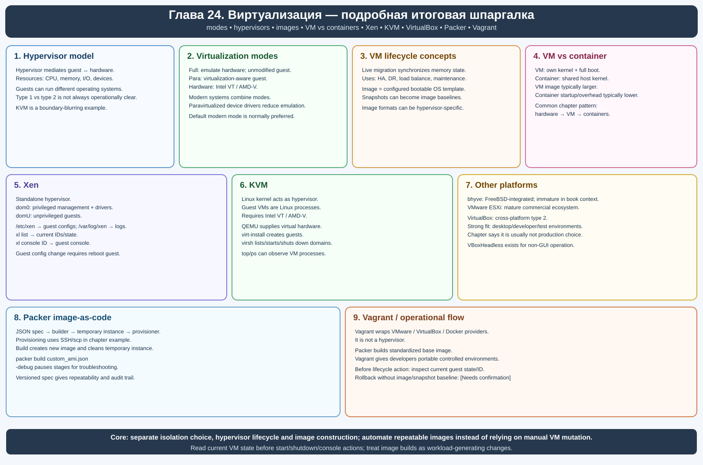
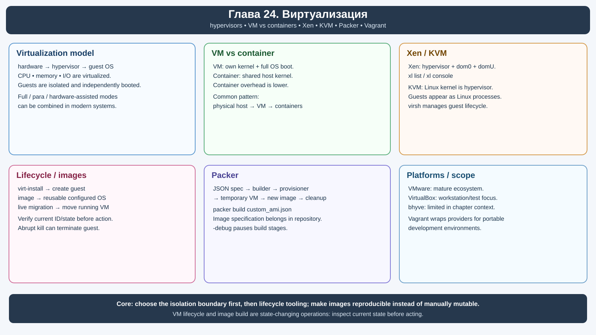

# Глава 24 — Виртуализация

Практические заметки по главе 24 книги «UNIX и Linux: руководство системного администратора», 5-е издание.

## Идентификация

- Book ID: unix-linux-system-administration-handbook-5e-ru-2020
- Глава: 24
- Название: «Виртуализация»
- Slug: virtualization
- Source policy: rag_only
- External sources: запрещены
- Model memory: запрещена
- Прямой доступ к source/book.pdf: не использовался
- Unknown data policy: отсутствующие данные помечаются [Needs confirmation]

## Provenance

- RAG scope: p0910:c01–p0923:c01
- PDF pages: 910–923
- Printed pages: 909–922
- Boundary evidence:
  - p0909:c01 — завершение главы 23;
  - p0910:c01 — начало главы 24;
  - p0923:c01 — раздел 24.8 «Литература»;
  - p0924:c01 — начало главы 25.
- В диапазоне p0910:c01–p0923:c01 пропусков RAG не обнаружено: 14/14 chunks.
- Provenance verified: yes.

## Артефакты

- [commands.md](commands.md)
- [cheatsheet.md](cheatsheet.md)
- [diagram.md](diagram.md)
- [visual-cheatsheet.svg](visual-cheatsheet.svg)
- [visual-cheatsheet-detailed.svg](visual-cheatsheet-detailed.svg)

## Карта главы

- 24.1 — hypervisors, full/paravirtual/hardware virtualization, live migration, VM images, containers;
- 24.2 — Linux virtualization: Xen и KVM;
- 24.3 — FreeBSD bhyve;
- 24.4 — VMware;
- 24.5 — VirtualBox;
- 24.6 — Packer;
- 24.7 — Vagrant;
- 24.8 — литература.

## Анализ главы

Виртуализация отделяет operating system от physical hardware и позволяет нескольким guest OS использовать один host. Hypervisor распределяет CPU, memory и I/O и предоставляет guest systems виртуальное оборудование.

Глава различает full virtualization, paravirtualization и hardware-assisted virtualization. Full virtualization эмулирует hardware и может использовать QEMU; paravirtualization требует virtualization-aware guest OS; hardware virtualization использует CPU extensions Intel VT/AMD-V, но hypervisor всё равно нужен для остальных virtual devices.

Практически режимы смешиваются: CPU virtualization, paravirtualized drivers и эмуляция могут сосуществовать. Авторы прямо предупреждают не переоценивать различия между type 1 и type 2 hypervisors: классификация полезна концептуально, но имеет ограниченное operational значение.

Live migration переносит running VM между physical hosts путем синхронизации memory state. Глава связывает её с load balancing, high availability, disaster recovery и host maintenance.

VM image — шаблон configured OS, загружаемый hypervisor. Images удобны для cloning, snapshots и переносимости, хотя их format обычно зависит от hypervisor.

Контейнеризация вынесена как отдельная isolation model. Container использует host kernel и изолирует processes/filesystem namespace, тогда как VM содержит собственное kernel/OS. Контейнеры имеют меньший overhead, но не являются прямой заменой VM; глава отмечает типичный pattern containers-on-VMs.

### Xen

Xen — standalone hypervisor. dom0 имеет privileged access к hardware, управляет domU guests и содержит management tools/drivers. Guest configuration files находятся в /etc/xen; logs — в /var/log/xen; xl используется для daily management.

Для guest storage глава сравнивает dedicated block devices и file-backed VBD. Dedicated storage дает более высокую performance, file-backed VBD проще перемещать обычными Linux tools.

virt-install используется для создания гостевой системы. После установки xl позволяет list guests и подключаться к console. Изменение virtual resources выполняется через guest config в /etc/xen с последующей reboot guest.

### KVM

KVM интегрирует hypervisor functionality в Linux kernel. Guest VMs выглядят как обычные Linux processes; scheduler и memory management хоста участвуют в их управлении. Глава отмечает, что top, ps и kill могут видеть/управлять VM processes.

KVM требует CPU virtualization extensions Intel VT или AMD-V. QEMU используется для virtual hardware; paravirtualized network/disk/video drivers рекомендуются для performance.

virt-install также используется для KVM guest creation, а virsh — для lifecycle management. В примере virsh показывает all domains, запускает stopped Windows guest и корректно останавливает CentOS guest.

### bhyve, VMware, VirtualBox

bhyve описан как встроенный в FreeBSD начиная с 10.0, способный запускать BSD/Linux/Windows, но в контексте издания ещё ограниченный по hardware/features. Авторы рекомендуют другое решение, если задача не требует именно встроенной FreeBSD virtualization platform.

VMware ESXi представлен как mature commercial ecosystem с centralized management и зрелой live migration technology.

VirtualBox — cross-platform type-2 hypervisor, ориентированный главным образом на desktops/test environments. Глава прямо отмечает, что его performance/hardware support слабее и он обычно не подходит для production virtualization. Для headless use упоминается VBoxHeadless.

### Packer

Packer описывает VM/cloud image как JSON specification. Builder определяет, где и как создать image, provisioner — как настроить экземпляр. Workflow:
1. создать temporary instance;
2. дождаться network availability;
3. применить provisioning через SSH/scp;
4. сохранить новый image;
5. удалить temporary instance.

Это image-as-code подход: specification можно хранить в repository, получая reproducibility, audit trail и rollback-friendly workflow.

### Vagrant

Vagrant не является hypervisor. Это wrapper вокруг VMware, VirtualBox, Docker и других providers для быстрого создания portable development environments.

Глава показывает связку Packer + Vagrant: Packer стандартизирует base production-like image, Vagrant позволяет разработчикам быстро поднимать контролируемые variations этого image локально или у cloud provider.

## Основной принцип

~~~text
physical hardware
→ hypervisor
→ isolated virtual machines
→ repeatable images
→ automated image build
→ portable dev/test environments
~~~

Operational flow:

~~~text
choose isolation model
→ choose hypervisor/provider
→ create or select image
→ allocate CPU/RAM/storage/network
→ install/start guest
→ verify lifecycle and console
→ automate image creation where useful
~~~

## Риски

- type 1/type 2 terminology не должна заменять operational evaluation;
- full emulation имеет больший overhead;
- old guest/hardware modes могут требовать legacy virtualization paths;
- VM image formats могут быть hypervisor-specific;
- file-backed virtual disks удобнее, но dedicated storage может иметь лучшую performance;
- изменение Xen guest config требует reboot guest;
- KVM guest lifecycle commands реально меняют running state;
- kill для VM process может аварийно завершить guest;
- VirtualBox в контексте главы не считается обычным production choice;
- Packer build создаёт temporary resources и новый image;
- Packer -debug используется только для troubleshooting build workflow;
- rollback VM lifecycle/state без snapshot/image baseline: [Needs confirmation].

## Acceptance boundary

Source-supported verification:
- Xen: xl list, xl console;
- KVM: virsh list --all, lifecycle state;
- virt-install completion and bootable guest;
- guest config/resource inspection;
- Packer build returns new image identifier;
- Packer failure performs cleanup as described;
- image specification remains version-controlled;
- Vagrant environment remains aligned with intended base image.
