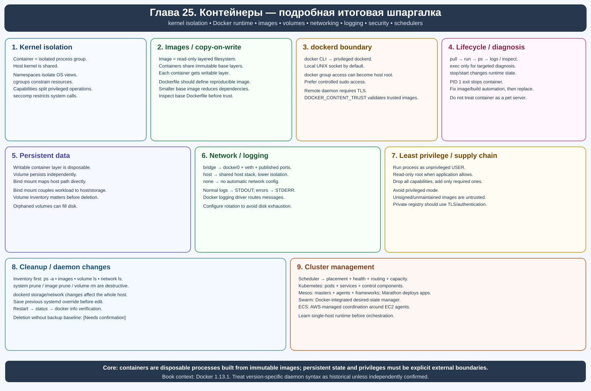
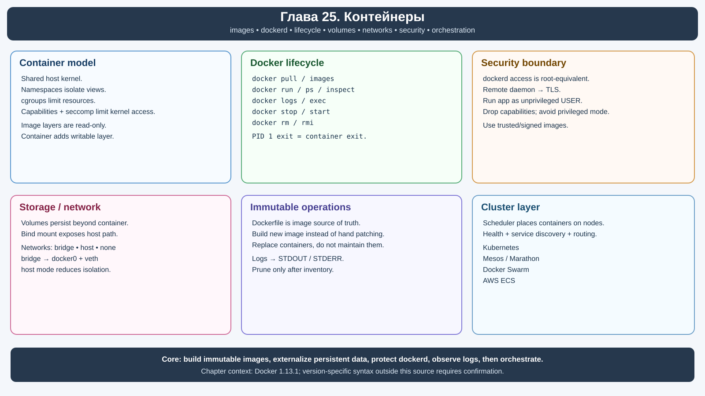

# Глава 25 — Контейнеры

Практические заметки по главе 25 книги «UNIX и Linux: руководство системного администратора», 5-е издание.

## Идентификация

- Book ID: unix-linux-system-administration-handbook-5e-ru-2020
- Глава: 25
- Название: «Контейнеры»
- Slug: containers
- Source policy: rag_only
- External sources: запрещены
- Model memory: запрещена
- Прямой доступ к source/book.pdf: не использовался
- Unknown data policy: отсутствующие или OCR-неоднозначные данные помечаются [Needs confirmation]

## Provenance

- RAG scope: p0924:c01–p0955:c01
- PDF pages: 924–955
- Printed pages: 923–954
- Boundary evidence:
  - p0923:c01 — завершение главы 24;
  - p0924:c01 — начало главы 25;
  - p0955:c01 — раздел 25.5 «Литература»;
  - p0956:c01 — начало главы 26.
- В диапазоне p0924:c01–p0955:c01 пропусков RAG не обнаружено: 32/32 chunks.
- Provenance verified: yes.

## Важная граница версии

Глава прямо сообщает, что обсуждение Docker основано на версии 1.13.1 и что Docker развивается очень быстро. Поэтому артефакты ниже отражают именно материал главы. Они не являются автоматически актуальной инструкцией для современных Docker releases.

## Артефакты

- [commands.md](commands.md)
- [cheatsheet.md](cheatsheet.md)
- [diagram.md](diagram.md)
- [visual-cheatsheet.svg](visual-cheatsheet.svg)
- [visual-cheatsheet-detailed.svg](visual-cheatsheet-detailed.svg)

## Карта главы

- 25.1 — основные концепции: namespaces, cgroups, capabilities, seccomp, images, copy-on-write, networking;
- 25.2 — Docker architecture, installation/client, lifecycle, volumes, networks, storage drivers, dockerd configuration, Dockerfile, registries;
- 25.3 — containers in practice: disposable containers, logging, security, troubleshooting;
- 25.4 — cluster management: schedulers, service discovery, Kubernetes, Mesos/Marathon, Docker Swarm, AWS ECS;
- 25.5 — литература.

## Анализ главы

Контейнер — это изолированная группа процессов с собственной видимой root filesystem и process namespace, но с общим kernel хоста. Изоляция строится не на одном механизме, а на сочетании namespaces, cgroups, capabilities и seccomp.

Namespaces изолируют процессы по mount/process/network и другим представлениям OS. Cgroups ограничивают и приоритизируют resource usage. Capabilities дают отдельные kernel privileges вместо полного root privilege. Seccomp ограничивает доступ к system calls.

Container image — переносимый read-only template. Docker использует layered filesystem и copy-on-write: несколько контейнеров могут разделять неизменные image layers, а изменения каждого контейнера попадают в отдельный writable layer.

Network default — private namespace + bridge на host. Container получает private IP, а host проксирует опубликованные ports. Host networking убирает отдельный network namespace и поэтому ослабляет isolation и может вызвать port conflicts. Режим none оставляет network setup администратору.

Docker architecture в главе — client/server. Команда docker обращается к privileged daemon dockerd через local UNIX socket или TCP. dockerd управляет containers, images, network и data directory.

Security boundary критичен: пользователь с доступом к Docker daemon фактически может получить root-level control над host. Глава прямо рекомендует ограничить membership в docker group и предпочитать sudo-controlled access. Remote daemon должен использовать TLS; plain TCP/HTTP описывается как эквивалент раздачи root-доступа по сети.

Docker Content Trust включается через DOCKER_CONTENT_TRUST=1 и используется для проверки integrity и publisher identity образов. Глава также предупреждает, что значительная часть public Docker Hub content не подписана и должна считаться недоверенной.

Container lifecycle:
- docker pull загружает image;
- docker images показывает local images;
- docker run создаёт и запускает container;
- docker ps показывает running containers;
- docker ps -a показывает также stopped;
- docker logs/exec помогают наблюдать и диагностировать;
- docker stop/start меняют runtime state;
- docker rm/rmi удаляют container/image.

Container прекращает работу, когда завершается PID 1. Поэтому server process должен оставаться foreground process либо нужен отдельный process supervisor. Это operational distinction между container и обычным VM/service host.

Для persistent data chapter вводит volumes. Volume существует отдельно от container writable layer и сохраняется после удаления container. Bind mount отображает host path непосредственно внутрь container. Это удобно, но сильнее связывает container с конкретным host/storage topology.

Сеть Docker включает bridge, host и none. docker network ls показывает configured networks. При bridge mode Docker создаёт docker0, veth pairs и routing/NAT rules. Если автоматически выбранный private address range конфликтует с существующей route, chapter предлагает менять dockerd network range через --fixed-cidr.

Storage driver определяет implementation layered filesystem и влияет на performance/stability. Chapter перечисляет aufs, btrfs, devicemapper, overlay, vfs и zfs и советует не менять default storage mechanism без глубокого понимания выбранной filesystem/driver.

dockerd configuration включает storage driver, DNS, base data directory, bridge addressing, logging и listener. В systemd-примере используется systemctl edit docker, затем restart и status. Это historical Docker 1.13.1 configuration; applicability к современной системе — [Needs confirmation].

Dockerfile делает image build воспроизводимым. FROM задаёт base image, RUN создаёт новый layer, ENV добавляет environment variables, EXPOSE документирует ports, CMD задаёт default process, USER задаёт runtime account, VOLUME — persistent data path. ARG не предназначен для confidential data.

Operational recommendation главы: container should be replaceable, not hand-maintained. Если проблему исправили вручную внутри container, исправление нужно перенести в image/build automation и заменить container.

Logging model: приложение пишет normal output в STDOUT, errors в STDERR; Docker logging driver маршрутизирует output. docker logs читает collected logs. Для file-only applications chapter показывает symlinks к /dev/stdout и /dev/stderr.

Security guidance:
- protect dockerd;
- use TLS for remote API;
- run processes as unprivileged USER;
- use read-only root filesystem where possible;
- drop unneeded capabilities;
- avoid --privileged unless explicitly justified;
- use trusted/signed images;
- inspect third-party images/Dockerfiles.

Troubleshooting starts with logs, then docker exec shell where appropriate. Disk leaks arise from stopped containers, unused images and orphaned volumes. Chapter supports prune commands and explicit dangling-volume cleanup; these actions are destructive and require inventory before execution.

At cluster scale, standalone dockerd is insufficient. A scheduler needs placement, health monitoring, API integration, service discovery, network routing and capacity management. Chapter surveys Kubernetes, Mesos/Marathon, Docker Swarm and AWS ECS.

Kubernetes introduces API server, scheduler, controller manager, kubelet, cAdvisor and proxy. Pods are disposable and should not be addressed by long-lived pod IPs; Services provide stable addressing.

Mesos separates masters, agents and frameworks; Marathon is a framework for application/container deployment. Swarm is Docker-integrated orchestration and chapter notes TLS between nodes by default. ECS is AWS-managed cluster coordination around EC2/container agents and AWS integrations.

## Основной принцип

~~~text
immutable image
→ controlled container runtime
→ explicit network/storage boundaries
→ logs and health visibility
→ replace container instead of repairing in place
→ orchestrate only after single-host behavior is understood
~~~

Security order:

~~~text
protect dockerd
→ TLS for remote access
→ unprivileged process
→ minimal capabilities
→ trusted image
→ controlled volumes/network
→ observable logs
~~~

## Риски

- docker group access is effectively root-level host access;
- remote dockerd without TLS is a critical security exposure;
- host networking reduces network isolation;
- --privileged disables many isolation benefits;
- bind mounts can expose host data directly to container processes;
- mutable repair inside containers creates configuration drift;
- unsigned/unmaintained images are supply-chain risk;
- logging without rotation can fill disk;
- stopped containers/images/volumes accumulate disk usage;
- docker system prune, docker image prune and volume removal are destructive;
- changing storage driver/network base may make existing runtime state inaccessible or conflict with routes;
- daemon restart interrupts Docker service;
- cluster orchestrators add significant distributed-system operational complexity;
- exact rollback after destructive prune without external backup/baseline: [Needs confirmation].

## Acceptance boundary

Source-supported checks:
- docker info / docker version for daemon/client baseline;
- docker ps / docker ps -a for runtime inventory;
- docker images and docker volume ls before cleanup;
- docker network ls plus ip addr show for network context;
- docker inspect for effective container mounts/network/config;
- docker logs before entering container;
- docker exec only for targeted diagnosis;
- systemctl status docker after daemon restart;
- Docker Content Trust enabled where chapter workflow requires trusted images;
- image build source kept in Dockerfile rather than manual mutation;
- destructive cleanup only after verifying what will be removed.
